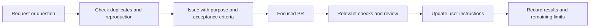

# Contributing

[English](CONTRIBUTING.md) · [日本語](CONTRIBUTING.ja.md)

You do not need to write code to describe a use case, report a difficult interaction, or point out missing instructions. English and Japanese are both welcome.

| What you want to do | Where to start |
|---|---|
| Send a request or question without GitHub | [Private feedback form](https://muse-relay-guide.spicy-cup-4319.chatgpt.site/#feedback) |
| Discuss a question, problem, or idea publicly | [GitHub Issue forms](https://github.com/3mintimer/muse-relay/issues/new/choose), in English or Japanese |
| Find existing requests | [Issues](https://github.com/3mintimer/muse-relay/issues) |
| Improve code or documentation | Check related Issues and submit a focused Pull Request |

The private form does not ask for contact details. Only with explicit sharing consent may a maintainer summarize a submission into a public Issue after removing identifying information. Keep your receipt number. The form offers no individual reply or status lookup. [Data handling and receipt management](docs/feedback.md)

## Submit a change

1. For a large behavior change, open an Issue first with the interaction and expected outcome. Small typos or clear fixes can go directly to a PR.
2. Work in your fork. Do not include tokens, personal connection settings, Gist data, conversations, audio, avatars, `.local/`, or build outputs.
3. Target app changes at `beta`; target documentation or public-guide-only changes at `main`. See the [release workflow](docs/releases.md) for channel and release decisions.
4. Check the changed area and describe the results and remaining uncertainty in the PR.

```sh
npm ci
npm run build
```

| Area | Relevant checks |
|---|---|
| App logic and G2 navigation | Relevant files from `npx tsx --test tests/core.test.ts tests/navigation.test.ts tests/images.test.ts` |
| Node relay | `node --test tests/server.test.mjs` |
| Worker relay | `node --test server/cloudflare/worker.test.mjs` |
| Gist watcher | `node --test adapters/gist/watcher.test.mjs` |
| Guide feedback API | `node --test guide/feedback.test.mjs` |
| Documentation only | Check links, steps, and consistency with the UI |

Keep tests focused on reproducing the problem or verifying the public contract. Distinguish physical-device results from Simulator or synthetic-input checks. If you do not have the hardware, say so.

## Maintenance workflow



Maintainers record scope, the next check, and reasons for deferral in the Issue. Acceptance and timing are not guaranteed. Merging a PR and distributing an EvenHub build are separate actions; verify the target build and channel before distribution. Never copy private feedback or personal information into PRs, tests, or examples.
