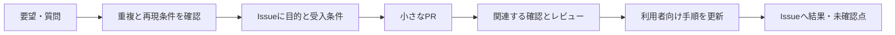

# 参加方法

コードを書かなくても、使いたい場面・困った操作・説明が足りない箇所を送れます。日本語・英語のどちらでも構いません。

| したいこと | 入口 |
|---|---|
| GitHub登録なしで要望・質問を送る | [ガイドの非公開受付](https://muse-relay-guide.spicy-cup-4319.chatgpt.site/#feedback) |
| 公開で質問・不具合・改善案を扱う | [GitHubのIssueフォーム](https://github.com/3mintimer/muse-relay/issues/new/choose) |
| 既存の要望を探す | [Issues](https://github.com/3mintimer/muse-relay/issues) |
| コードや資料を改善する | 関連Issueを確認し、変更を小さくまとめてPull Requestを作る |

非公開受付には連絡先を求めません。公開への同意がある場合だけ、保守担当者が本人を特定する情報を除いて要約し、Issueへ登録します。受付番号は控えてください。フォームから個別返信・進捗照会はできません。[データの扱いと受付票の管理](docs/feedback.md)

## 変更を送る

1. 大きな仕様変更は先にIssueへ、直したい操作と期待する結果を書きます。小さな誤字・明確な修正は直接PRでも構いません。
2. 自分のforkで変更します。トークン、個人の接続設定、Gistデータ、会話、音声、アバター、`.local/`、ビルド成果物を含めません。
3. 変更した範囲の確認を実行し、PRに実施結果と未確認点を書きます。

```sh
npm ci
npm run build
```

| 変更箇所 | 関連する確認 |
|---|---|
| アプリの処理・G2操作 | `npx tsx --test tests/core.test.ts tests/navigation.test.ts tests/images.test.ts` から関連するもの |
| Node中継 | `node --test tests/server.test.mjs` |
| Worker中継 | `node --test server/cloudflare/worker.test.mjs` |
| Gist watcher | `node --test adapters/gist/watcher.test.mjs` |
| ガイドの受付API | `node --test guide/feedback.test.mjs` |
| 文章だけ | リンク・手順・画面との一致を確認 |

テストは不具合の再現や公開契約の確認に絞ります。実機が必要な変更は、Simulatorや合成入力の確認を実機の結果と区別してください。実機を持っていない場合は、その旨を書けば構いません。

## 保守の流れ



保守担当者はIssueに対象範囲・次の確認・保留理由を残します。採用や対応時期は約束しません。PRのマージとEvenHubへの配布は別の操作で、配布先と対象ビルドを確認してから実施します。受付の本文や個人情報をPR・テスト・サンプルへ転記しません。
