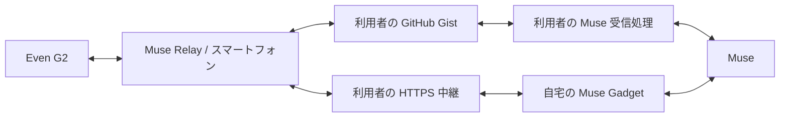

# Muse Relay

[English](README.md) · [日本語](README.ja.md)

スマートフォンや Even G2 からメッセージを送り、グラスで Muse の返信を読めます。ガイドで自分の中継方式を選ぶと、Muse に渡す設定の依頼文をコピーできます。

[初回設定を始める](https://muse-relay-guide.spicy-cup-4319.chatgpt.site/ja/#setup) · [G2Muse の Gist を引き継ぐ](https://muse-relay-guide.spicy-cup-4319.chatgpt.site/ja/#g2muse) · [質問・フィードバック](docs/feedback.ja.md) · [プライバシー](PRIVACY.md) · [セキュリティ](SECURITY.md)

## 利用するもの

| 方式・機能 | 利用者が用意するもの |
| --- | --- |
| GitHub Gist | Gist、GitHub トークン、Muse 側の受信・返信処理 |
| Muse Gadget SDK | 外出先から届く HTTPS 中継、対応機器、SDK トークン、Muse とのペアリング |
| Soniox のリアルタイム文字起こし | 本人の Soniox API キー、または一時キーを発行するサーバー |
| スペース・アバター | Muse に既存の内容・画像を書き出す処理を依頼 |

中継・アカウント・キーは各利用者が用意します。開発者が全利用者向けの中継を提供する構成ではありません。ATOM S3 は自宅に置く Gadget の参考実装で、Gist 方式では不要です。



Gadget は自宅から中継へ接続して依頼を取得します。外出先のスマートフォンから自宅機器へ直接接続する必要はありません。Gist watcher は利用者のハンドラーを呼び出す参考実装で、Muse 接続や音声処理はハンドラー側に実装します。

Secret Gist も URL を知る人は閲覧でき、変更履歴を持ちます。[GitHub の説明](https://docs.github.com/en/get-started/writing-on-github/editing-and-sharing-content-with-gists/creating-gists)

## 機能

| 機能 | 動作 |
| --- | --- |
| チャット | テキスト・音声を送り、返信を G2 とスマートフォンで読む |
| 文字起こし | 音声ファイルを中継先で処理する方式、または Soniox に直接音声を送り録音中に字幕を表示する方式を選択 |
| 画像 | 初期値はオフ。利用者が有効にした場合に画像を扱う。参考 Gadget の画像入力は初期無効 |
| スペース | Muse への作成依頼を作り、書き出しを受信して登録。リスト・カードと宣言された操作部品を表示 |
| スペース管理 | 上下並べ替え、登録解除、受信済みから再追加。Muse・中継の原本を削除しない |
| ホーム | 日付・時計、受信した本人の Muse アバターを表示。アバターは画像 ON が必要で共通ビルドに含めない |
| 表示設定 | ライト／ダーク、自動非表示、チャット表示方式、9 言語 |

スペースは Muse のページを埋め込む機能ではありません。アプリから作る依頼文はコピーまたはチャットの下書きに追加し、利用者が送信します。画像・会話・アバターの個人データを配布ソースに含めません。

日本語・English・简体中文・繁體中文・Español・Français・Deutsch・Italiano・한국어に対応します。初期値は WebView の言語に従います。Even アプリ独自の言語と合わない場合は手動選択できます。

## 技術資料

| 内容 | 資料 |
| --- | --- |
| 初回設定と Muse への依頼 | [設定手順](docs/relay-setup.ja.md)、[方式の比較](docs/relay-comparison.ja.md) |
| 画面・操作・スペース部品 | [UI](docs/ui.ja.md)、[Spaces](docs/spaces.ja.md) |
| 独自中継の入出力 | [プロトコル](docs/protocol.ja.md) |
| 参考中継 | [Gist watcher](adapters/gist/README.ja.md)、[Node](docs/server.ja.md)、[Cloudflare Worker](server/cloudflare/README.ja.md) |
| 自宅の対応機器 | [ATOM S3](docs/atoms3.ja.md) |
| データの保存・削除 | [データの流れ](docs/data.ja.md)、[Privacy](PRIVACY.md) |
| ソースの再現・書き出し | [ビルドと公開ソース](docs/public-source.ja.md)、[公開範囲](PUBLIC-SOURCE.md) |
| ガイドの公開用ソース | [guide/README.md](guide/README.ja.md) |
| 変更提案 | [参加方法](CONTRIBUTING.ja.md) |
| 配布区分・リリース運用 | [リリース手順](docs/releases.ja.md) |

各資料の冒頭で英語・日本語を切り替えられます。公開Issueは下のフォームを選んでください。[GitHub登録なしの非公開受付](https://muse-relay-guide.spicy-cup-4319.chatgpt.site/ja/#feedback)も利用できます。

| 内容 | 日本語 | English |
| --- | --- | --- |
| こう使いたい・改善案 | [改善案フォーム](https://github.com/3mintimer/muse-relay/issues/new?template=idea.ja.yml) | [Idea](https://github.com/3mintimer/muse-relay/issues/new?template=idea.yml) |
| 操作で困った・不具合 | [不具合フォーム](https://github.com/3mintimer/muse-relay/issues/new?template=problem.ja.yml) | [Problem](https://github.com/3mintimer/muse-relay/issues/new?template=problem.yml) |
| 設定・使い方の質問 | [質問フォーム](https://github.com/3mintimer/muse-relay/issues/new?template=question.ja.yml) | [Question](https://github.com/3mintimer/muse-relay/issues/new?template=question.yml) |

## ビルド

Node.js 24 と npm を用意し、ルートで実行します。

```sh
npm ci
npm test
npm run build
npm run pack
```

EHPK は `artifacts/muse-relay-<version>.ehpk` に生成します。バージョン・要求権限は [app.json](app.json)、依存関係は [package.json](package.json)・[package-lock.json](package-lock.json) にあります。ビルドと既存テストは、各利用者の実機・アカウント・ネットワークへの接続を確認するものではありません。

通常ブラウザーで画面を確認する場合は `npm run dev`。G2・マイク・写真選択は Even アプリで確認してください。ガイドと参考中継のビルド手順は上記の技術資料にあります。

G2Muse の公開メッセージ形式を読み取れます。送信には Muse Relay の独立した要求ファイルを使うため、既存の G2Muse 受信処理には対応が必要です。G2Muse のコードは同梱していません。

新規コードは [MIT](LICENSE)。SDK 由来ファイルと配布条件は [NOTICE.md](NOTICE.md) を参照してください。Even Realities・Meta・Soniox の公式製品ではありません。
