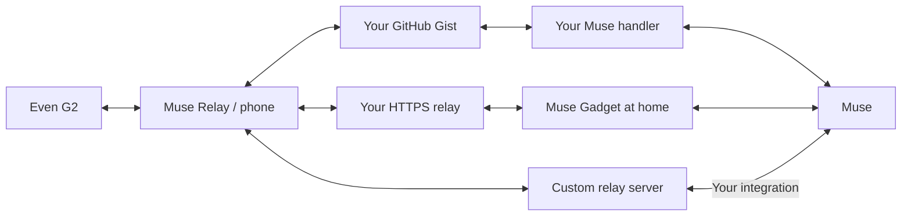

# Muse Relay

[English](README.md) · [日本語](README.ja.md)

Send a message from your phone or Even G2 and read Muse’s reply on your glasses. The setup guide lets you choose your own relay and copy the instructions for Muse.

[Set up Muse Relay](https://muse-relay-guide.spicy-cup-4319.chatgpt.site/#setup) · [Using a G2Muse Gist?](https://muse-relay-guide.spicy-cup-4319.chatgpt.site/#g2muse) · [Questions and feedback](docs/feedback.md) · [Privacy](PRIVACY.md) · [Security](SECURITY.md)

## What you need

| Connection or feature | Supplied by the user |
| --- | --- |
| GitHub Gist | A Gist, GitHub token, and Muse-side request/reply handler |
| Muse Gadget SDK | An HTTPS relay reachable away from home, a supported device, SDK token, and Muse pairing |
| Custom relay server | Your own server implementing the [app HTTPS protocol](docs/protocol.md#custom-relay) and a connection to Muse. Enter its base URL and optional token |
| Soniox live transcription | Your own Soniox API key or a server that issues temporary keys |
| Spaces and avatar | Ask Muse to export the existing content and image |

Run chat and image processing in the Muse VM by default. Generate or read the image there and publish it directly to the connection used by the app. Keep its writer credential in the VM. A separate relay is optional when the VM can serve the app’s HTTPS protocol.

Each user supplies the accounts and credentials for their selected connection. The developer does not operate a shared relay for everyone. ATOM S3 is the reference Gadget kept at home; the Gist method does not need it.



The Gadget connects outbound from home to fetch requests. Your phone does not need a direct connection to the home device. The Gist watcher invokes a handler you provide; that handler implements the Muse connection and voice processing.

A Secret Gist is readable by anyone who knows its URL and retains revision history. [GitHub's explanation](https://docs.github.com/en/get-started/writing-on-github/editing-and-sharing-content-with-gists/creating-gists)

## Features

| Feature | Behavior |
| --- | --- |
| Chat | Send text or voice and read replies on G2 and your phone |
| Transcription | Choose relay-side processing of a voice file, or send audio directly to Soniox for captions during recording |
| Images | Off by default; enable them in settings. Image input through the reference Gadget is disabled by default |
| Spaces | Prepare a request for Muse to create a Space, receive its export, and add it. Display lists, cards, and declared controls |
| Space management | Move up/down, remove from the app, or add again from received exports. Original Muse/relay data is preserved |
| Home | Date, clock, and your Muse's exported avatar. The avatar requires Images on and is never included in the shared build |
| Display settings | Light/dark theme, auto-hide, chat layout, and nine languages |

Spaces are structured exports, not embedded Muse pages. Generated instructions can be copied or added to the chat draft; the user sends them. Personal images, conversations, and avatars are not part of the distributed source.

The app supports Japanese, English, Simplified Chinese, Traditional Chinese, Spanish, French, German, Italian, and Korean. It follows the WebView language by default. Select a language manually if this differs from the Even app's language.

## Documentation

| Topic | Documents |
| --- | --- |
| Setup and instructions for Muse | [Setup](docs/relay-setup.md), [relay comparison](docs/relay-comparison.md) |
| Screens, gestures, and Space controls | [UI](docs/ui.md), [Spaces](docs/spaces.md) |
| Implementing your own relay | [Protocol](docs/protocol.md) |
| Reference relays | [Gist watcher](adapters/gist/README.md), [Node](docs/server.md), [Cloudflare Worker](server/cloudflare/README.md) |
| Hardware at home | [ATOM S3](docs/atoms3.md) |
| Data storage and deletion | [Data flow](docs/data.md), [Privacy](PRIVACY.md) |
| Reproducible builds and source export | [Build and public source](docs/public-source.md), [publication scope](PUBLIC-SOURCE.md) |
| Source for the public guide | [Guide development](guide/README.md) |
| Contributions | [CONTRIBUTING.md](CONTRIBUTING.md) |
| Release channels and workflow | [Release guide](docs/releases.md) |

Each translated document has an English/Japanese switch. For a public Issue, choose a form below. You can also [send feedback privately without a GitHub account](https://muse-relay-guide.spicy-cup-4319.chatgpt.site/#feedback).

| Topic | English | 日本語 |
| --- | --- | --- |
| Idea or improvement | [Idea form](https://github.com/3mintimer/muse-relay/issues/new?template=idea.yml) | [改善案](https://github.com/3mintimer/muse-relay/issues/new?template=idea.ja.yml) |
| Problem or bug | [Problem form](https://github.com/3mintimer/muse-relay/issues/new?template=problem.yml) | [不具合](https://github.com/3mintimer/muse-relay/issues/new?template=problem.ja.yml) |
| Setup or usage question | [Question form](https://github.com/3mintimer/muse-relay/issues/new?template=question.yml) | [質問](https://github.com/3mintimer/muse-relay/issues/new?template=question.ja.yml) |

## Build

Use Node.js 24 and npm from the repository root:

```sh
npm ci
npm test
npm run build
npm run pack
```

The EHPK is written to `artifacts/muse-relay-<version>.ehpk`. See [app.json](app.json) for the version and permissions, and [package.json](package.json)/[package-lock.json](package-lock.json) for dependencies. Builds and automated tests do not verify each user's hardware, accounts, or network.

Run `npm run dev` to inspect the phone UI in a browser. Check G2, microphone, and photo selection in the Even app. The guide and reference relays have separate build instructions linked above.

Muse Relay reads G2Muse's public message format. Outgoing requests use separate Muse Relay request files, so an existing G2Muse watcher needs adaptation. G2Muse code is not bundled.

New code is [MIT licensed](LICENSE). See [NOTICE.md](NOTICE.md) for SDK-derived files and distribution terms. This is not an official product of Even Realities, Meta, or Soniox.
