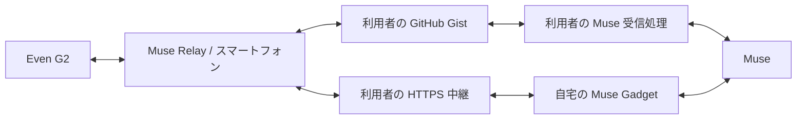

# Muse Relay

Muse Relay is an EvenHub app for Even G2. Each user supplies a Gist or HTTPS relay, Muse-side processing, and credentials.

Even G2 で Muse の返信・画像・書き出されたスペースを表示し、スマートフォンまたは G2 からテキスト・音声を送るアプリです。配布アプリは全利用者共通で、接続先と認証情報はアプリ内で設定します。

[使い方・初回設定ガイド](https://muse-relay-guide.spicy-cup-4319.chatgpt.site/) · [質問・不具合・提案](docs/feedback.md) · [Privacy](PRIVACY.md) · [Security](SECURITY.md)

## 利用するもの

| 方式・機能 | 利用者が用意するもの |
| --- | --- |
| GitHub Gist | Gist、GitHub トークン、Muse 側の受信・返信処理 |
| Muse Gadget SDK | 外出先から届く HTTPS 中継、対応機器、SDK トークン、Muse とのペアリング |
| Soniox のリアルタイム文字起こし | 本人の Soniox API キー、または一時キーを発行するサーバー |
| スペース・アバター | Muse に既存の内容・画像を書き出す処理を依頼 |

中継・アカウント・キーは各利用者が用意します。開発者が全利用者向けの中継を提供する構成ではありません。ATOM S3 は自宅に置く Gadget の参考実装で、Gist 方式では不要です。



Gadget は自宅から中継へ接続して依頼を取得します。外出先のスマートフォンから自宅機器へ直接接続する必要はありません。Gist watcher は利用者のハンドラーを呼び出す参考実装で、Muse 接続や音声処理はハンドラー側に実装します。

Secret Gist も URL を知る人は閲覧でき、変更履歴を持ちます。[GitHub の説明](https://docs.github.com/en/get-started/writing-on-github/editing-and-sharing-content-with-gists/creating-gists)

## 機能

| 機能 | 動作 |
| --- | --- |
| チャット | テキスト・音声を送り、返信を G2 とスマートフォンで読む |
| 文字起こし | 音声ファイルを中継先で処理する方式、または Soniox に直接音声を送り録音中に字幕を表示する方式を選択 |
| 画像 | 初期値はオフ。利用者が有効にした場合に画像を扱う。参考 Gadget の画像入力は初期無効 |
| スペース | Muse への作成依頼を作り、書き出しを受信して登録。リスト・カードと宣言された操作部品を表示 |
| スペース管理 | 上下並べ替え、登録解除、受信済みから再追加。Muse・中継の原本を削除しない |
| ホーム | 日付・時計、受信した本人の Muse アバターを表示。アバターは画像 ON が必要で共通ビルドに含めない |
| 表示設定 | ライト／ダーク、自動非表示、チャット表示方式、9 言語 |

スペースは Muse のページを埋め込む機能ではありません。アプリから作る依頼文はコピーまたはチャットの下書きに追加し、利用者が送信します。画像・会話・アバターの個人データを配布ソースに含めません。

日本語・English・简体中文・繁體中文・Español・Français・Deutsch・Italiano・한국어に対応します。初期値は WebView の言語に従います。Even アプリ独自の言語と合わない場合は手動選択できます。

## 技術資料

| 内容 | 資料 |
| --- | --- |
| 初回設定と Muse への依頼 | [設定手順](docs/relay-setup.md)、[方式の比較](docs/relay-comparison.md) |
| 画面・操作・スペース部品 | [UI](docs/ui.md)、[Spaces](docs/spaces.md) |
| 独自中継の入出力 | [プロトコル](docs/protocol.md) |
| 参考中継 | [Gist watcher](adapters/gist/README.md)、[Node](docs/server.md)、[Cloudflare Worker](server/cloudflare/README.md) |
| 自宅の対応機器 | [ATOM S3](docs/atoms3.md) |
| データの保存・削除 | [データの流れ](docs/data.md)、[Privacy](PRIVACY.md) |
| ソースの再現・書き出し | [ビルドと公開ソース](docs/public-source.md)、[公開範囲](PUBLIC-SOURCE.md) |
| ガイドの公開用ソース | [guide/README.md](guide/README.md) |
| 変更提案 | [CONTRIBUTING.md](CONTRIBUTING.md) |

## ビルド

Node.js 24 と npm を用意し、ルートで実行します。

```sh
npm ci
npm test
npm run build
npm run pack
```

EHPK は `artifacts/muse-relay-<version>.ehpk` に生成します。バージョン・要求権限は [app.json](app.json)、依存関係は [package.json](package.json)・[package-lock.json](package-lock.json) にあります。ビルドと既存テストは、各利用者の実機・アカウント・ネットワークへの接続を確認するものではありません。

通常ブラウザーで画面を確認する場合は `npm run dev`。G2・マイク・写真選択は Even アプリで確認してください。ガイドと参考中継のビルド手順は上記の技術資料にあります。

G2Muse の公開メッセージ形式を読み取れます。送信には Muse Relay の独立した要求ファイルを使うため、既存の G2Muse 受信処理には対応が必要です。G2Muse のコードは同梱していません。

新規コードは [MIT](LICENSE)。SDK 由来ファイルと配布条件は [NOTICE.md](NOTICE.md) を参照してください。Even Realities・Meta・Soniox の公式製品ではありません。
