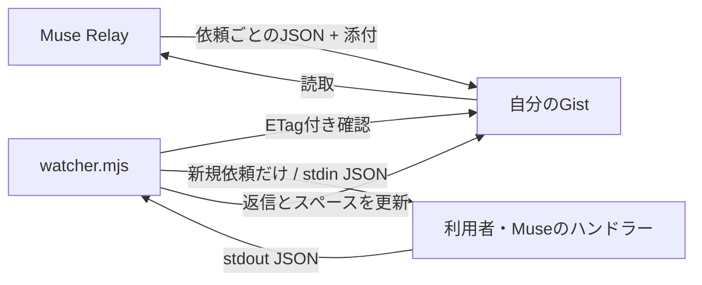
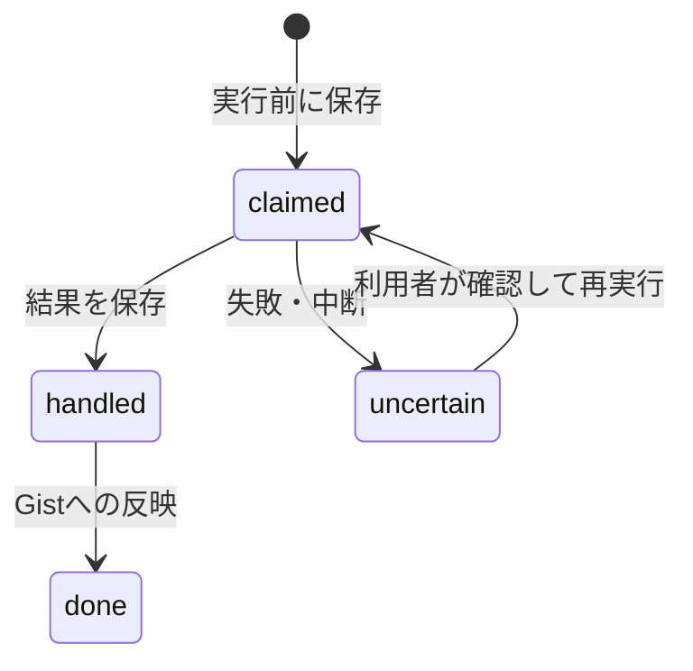

# Gist watcher

[English](README.md) · [日本語](README.ja.md)

Gistの新規依頼だけをユーザー指定のハンドラーへ渡す、任意の参考実装です。配布するEvenHubアプリとEHPKは全利用者共通で、Gist側の中継は利用者が実装するかMuseに依頼します。このwatcherを使わず、同じファイル入出力を実装しても接続できます。

Museとの会話・Whisper・スペースの作成は利用者またはMuseがハンドラーに実装します。このwatcherだけを起動してもMuseへの接続処理は完成しません。Gist ID・トークン・実行ファイルは利用者ごとの設定です。

[設定チュートリアルとMuse依頼文](../../docs/relay-setup.ja.md) / [ファイル入出力契約](../../docs/protocol.ja.md#gist方式)



## この参考実装を使う場合

| 準備 | 設定 |
|---|---|
| Gist | `g2muse-relay.json` に `{"messages":[]}` |
| 秘密設定 | [.env.example](.env.example) を `.local/gist-watcher.env` へコピーして入力 |
| 処理先 | `MUSE_HANDLER` に実行ファイルの絶対パス |
| 引数 | `MUSE_HANDLER_ARGS` に文字列配列JSON |
| 起動 | 下記コマンド |

```sh
node --env-file=.local/gist-watcher.env adapters/gist/watcher.mjs
```

Node.js 22 以降。追加のnpm依存はありません。GitHubのトークンは環境変数で受け取り、コマンド引数・ログ・ハンドラーの環境へ渡しません。実行するハンドラーは自分が用意したものだけを指定します。

## ハンドラーの入出力

標準入力に1つのJSONを渡します。シェルは経由しません。

```json
{
  "id": "r_example",
  "kind": "chat",
  "text": "内容を教えて",
  "created_at": 1794880000,
  "audio": {"mime":"audio/wav","name":"voice.wav","data_base64":"..."}
}
```

`audio` / `image` は該当する依頼だけにあります。スペース更新は `kind:"space"` と `space_id`。返信は標準出力へJSONだけを書き、終了コード0で終了します。

```json
{
  "text": "返信の本文",
  "transcript": "音声から文字起こしした本文",
  "image": {"mime":"image/png","name":"reply.png","data_base64":"..."},
  "spaces": [{
    "id":"news","title":"ニュース",
    "items":[{"id":"today","title":"今日","text":"表示用テキスト"}]
  }]
}
```

`text` は必須（画像・スペース・プロフィールがある場合は空文字可）。他の項目は任意です。音声を受けたハンドラーは文字起こしを `transcript` へ返します。Whisper等のモデルや実行方法はMuse側で用意します。参照watcherのスペース出力はテキストと操作部品です。`layout` と `control` を保持し、操作依頼の `space_action` を検証してハンドラーへ渡します。[部品と操作例](../../docs/spaces.ja.md)。画像カードを出す独自実装は [共通形式](../../docs/protocol.ja.md) に従います。

ホームのアバターには任意の `profile:{name?,avatar:{mime,name?,data_base64},updated_at?}` を返します。Museで設定済みの元画像を使い、PNG/JPEG/WebP・デコード後250,000バイト以下にします。watcherが `muse-relay-profile.json` と画像ファイルを出力します。通常の返信で `profile` を省略すれば維持、`profile:{}` で解除します。画像を特定できなければ別のアバターで代用しません。アプリの画像設定がオンのときにホームへ表示します。[プロフィールの契約](../../docs/protocol.ja.md#museのアバター--g2ホーム)

| アプリで選んだ設定 | ハンドラーへの実装指示 |
|---|---|
| Museで文字起こし | `audio`のWAVを処理し、`transcript`を返す。watcherが`from:"You"`として保存 |
| Soniox | `text`をそのまま使用。音声や再文字起こしを必須にしない |
| 画像オフ | テキスト返信とテキストカードを生成 |
| 画像オン | 返信の`image`は利用可。参考watcherの`spaces`は画像フィールドを出力しない |
| スペース | 安定したIDと順序、短い見出し、自己完結した本文。タップでページ送り、スワイプで項目切替、ダブルタップで戻るだけで読める内容 |

マイクの選択はアプリ側です。G2・スマートフォンのどちらでもハンドラーのWAV形式は同じです。スペースの更新結果は一覧全体を置き換えるため、残すスペースも含めます。閲覧に画像の有効化・音声入力・外部リンク・操作用Webページを要求しません。

## 処理の再開



- `handled` のまま中断した場合は、保存済み結果を反映します。ハンドラーを再実行しません。
- 処理中のクラッシュや10分超過は結果不明です。Muse側を確認した後に限り、明示的に再実行します。
- 同じ状態ファイルに対してwatcherは1つ。別マシンで複数起動しません。`g2muse-relay.json` を別のプロセスが同時に更新する運用も対象外です。

```sh
node --env-file=.local/gist-watcher.env adapters/gist/watcher.mjs --retry r_example --once
```

## 保存・削除

| 対象 | 参照実装の方針 |
|---|---|
| 返信 | 直近50メッセージを保持 |
| 処理済み依頼・入力添付 | 返信と同じPATCHで現在のGistから削除 |
| 古い出力画像 | 保持中のメッセージ・スペースから参照されない自分の生成分のみ削除 |
| 重複処理記録 | 30日保持。元ファイルが消えた記録だけ期限切れ後に削除 |
| 元Gistの履歴 | GitHub側に残り得る。現在のファイル削除は履歴の消去ではない |

Gistは暗号化された私設ストレージではありません。secret GistもURLを知る人は閲覧できます。入力・返信・音声・画像をGitHubへ置く方式を選ぶ際に確認してください。

未処理時の確認は通常のHTTP通信だけで、ハンドラーやAIを起動しません。最小10秒、初期15秒。GitHubのレート制限には待機時間を適用します。

[プロトコル全体](../../docs/protocol.ja.md) / [G2Muse元仕様](https://github.com/GenomiskDiagnostik/G2Muse/blob/main/g2muse-setup.md)
