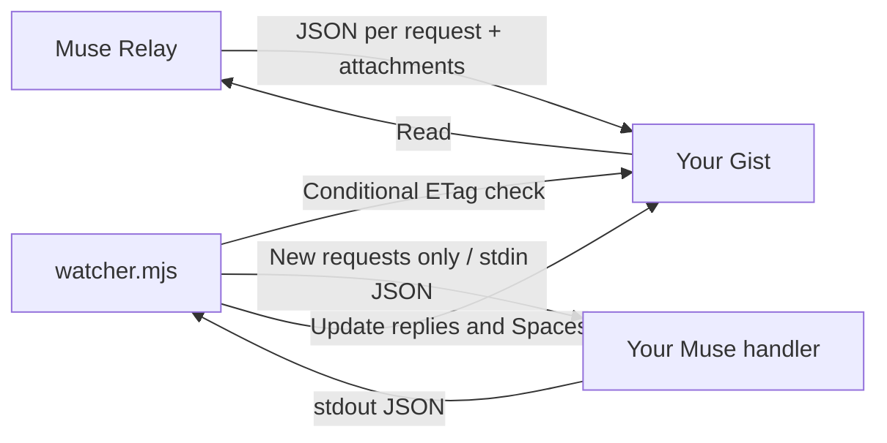
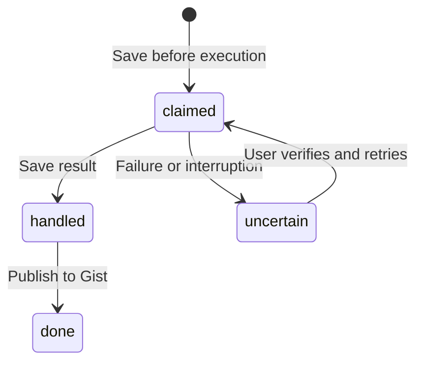

# Gist watcher

[English](README.md) · [日本語](README.ja.md)

This optional reference passes only new Gist requests to a user-supplied handler. All users share the same EvenHub app and EHPK; each user implements their Gist relay or asks Muse to do so. A custom implementation of the same file contract can replace this watcher.

You or Muse must implement Muse conversations, Whisper, and Space creation in the handler. Running the watcher alone does not complete the Muse connection. Gist ID, token, and executable are user-specific settings.

[Setup tutorial and Muse instructions](../../docs/relay-setup.md) / [File contract](../../docs/protocol.md#gist-method)



## Use this reference

| Requirement | Setting |
|---|---|
| Gist | Put `{"messages":[]}` in `g2muse-relay.json` |
| Secret configuration | Copy [.env.example](.env.example) to `.local/gist-watcher.env` and fill it in |
| Handler | Absolute executable path in `MUSE_HANDLER` |
| Arguments | JSON string array in `MUSE_HANDLER_ARGS` |
| Start | Command below |

```sh
node --env-file=.local/gist-watcher.env adapters/gist/watcher.mjs
```

Requires Node.js 22 or later, with no additional npm dependencies. The GitHub token comes from the environment and is not passed in command arguments, logs, or the handler environment. Select only a handler you have supplied.

## Handler input/output

The handler receives one JSON object on stdin without a shell:

```json
{
  "id": "r_example",
  "kind": "chat",
  "text": "Tell me about this",
  "created_at": 1794880000,
  "audio": {"mime":"audio/wav","name":"voice.wav","data_base64":"..."}
}
```

`audio` / `image` appear only on relevant requests. Space refresh uses `kind:"space"` and `space_id`. Write only JSON to stdout and exit with code 0:

```json
{
  "text": "Reply text",
  "transcript": "Text transcribed from the recording",
  "image": {"mime":"image/png","name":"reply.png","data_base64":"..."},
  "spaces": [{
    "id":"news","title":"News",
    "items":[{"id":"today","title":"Today","text":"Display text"}]
  }]
}
```

`text` is required but may be empty when an image, Spaces, or a profile is present. Other fields are optional. A handler receiving audio returns its transcript in `transcript`. Muse supplies the Whisper or other model and its execution method. The reference watcher exports text and controls for Spaces. It preserves `layout`/`control`, validates action requests' `space_action`, and passes them to the handler. See [controls and examples](../../docs/spaces.md). Custom image-card implementations follow the [common protocol](../../docs/protocol.md).

For the home avatar, return optional `profile:{name?,avatar:{mime,name?,data_base64},updated_at?}`. Use the original avatar already configured in Muse: PNG/JPEG/WebP, at most 250,000 decoded bytes. The watcher writes `muse-relay-profile.json` and the image file. Omitting `profile` in an ordinary reply preserves it; `profile:{}` clears it. Do not substitute another avatar if the original cannot be found. The app displays it on home when images are enabled. [Profile contract](../../docs/protocol.md#muse-avatar-on-g2-home)

| App setting | Handler requirement |
|---|---|
| Transcribe with Muse | Process the WAV in `audio` and return `transcript`; the watcher saves it as `from:"You"` |
| Soniox | Use `text` directly; do not require audio or transcription again |
| Images off | Produce text replies and text cards |
| Images on | Reply `image` is available. The reference watcher's `spaces` output does not include image fields |
| Spaces | Stable IDs/order, short headings, self-contained text; readable with tap to page, swipe to change items, and double tap to return |

Microphone selection belongs to the app. G2 and phone microphones produce the same handler WAV format. Space results replace the entire list, so include every Space to retain. Do not require images, voice input, external links, or a separate control webpage for reading.

## Resume processing



- If interrupted in `handled`, the watcher publishes the saved result without running the handler again.
- A crash during processing or a run exceeding ten minutes has an unknown outcome. Retry explicitly only after checking Muse.
- Run one watcher per state file, not multiple machines. Concurrent writers to `g2muse-relay.json` are unsupported.

```sh
node --env-file=.local/gist-watcher.env adapters/gist/watcher.mjs --retry r_example --once
```

## Storage and deletion

| Item | Reference policy |
|---|---|
| Replies | Keeps the latest 50 messages |
| Processed requests / input attachments | Deletes from the current Gist in the same PATCH that publishes the reply |
| Old output images | Deletes only its own generated files no longer referenced by retained messages/Spaces |
| Deduplication records | Keeps for 30 days; removes expired records only after the source file is gone |
| Original Gist history | May remain on GitHub; deleting current files does not erase history |

Gist is not encrypted private storage. Anyone who knows a secret Gist URL can view it. Consider this when choosing to put requests, replies, audio, and images on GitHub.

Idle polling performs ordinary HTTP requests without starting the handler or AI. The interval is at least ten seconds, default 15. GitHub rate limits trigger backoff.

[Full protocol](../../docs/protocol.md) / [Original G2Muse specification](https://github.com/GenomiskDiagnostik/G2Muse/blob/main/g2muse-setup.md)
