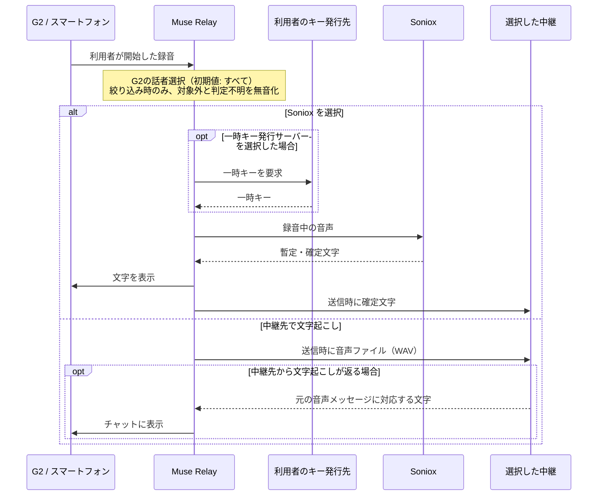

# データの流れと保存

[English](data.md) · [日本語](data.ja.md)

共通の配布アプリから、利用者が設定した中継へ接続します。開発者が全利用者向けに運営する中継、広告配信、利用状況分析の送信処理は、このソースに含みません。Even、Muse、GitHub、Soniox、利用者のホスティング環境による処理・ログ・バックアップは別です。[Privacy notice](../PRIVACY.md)

## 送信先

| 操作・設定 | 送る内容と経路 | 確認するコード |
| --- | --- | --- |
| Gist で送信 | テキスト、要求 ID・時刻、指定した添付を GitHub API へ。Muse 側のハンドラーが処理し返信を Gist に保存 | [gist.ts](../src/relay/gist.ts)、[watcher.mjs](../adapters/gist/watcher.mjs) |
| HTTPS 中継で送信 | 同じ要求を設定した中継へ。Gadget が外向きの接続で取得し Muse へ渡す | [gadget.ts](../src/relay/gadget.ts)、[server/app.mjs](../server/app.mjs)、[relay.c](../firmware/components/muse_relay/relay.c) |
| 中継先で文字起こし | 送信時に WAV（16 kHz / mono / PCM16）を1件渡す。Gistは利用者のハンドラー、参考GadgetはSDK経由でMuseが処理する | [controller.ts](../src/core/controller.ts)、[media.ts](../src/core/media.ts) |
| Soniox（アプリから直接） | 本人のAPIキーまたは一時キーで、録音中の PCM を Soniox へ直接送る。G2とスマホに字幕を表示し、送信時に確定文字だけを中継へ渡す | [soniox.ts](../src/core/soniox.ts)、[config.ts](../src/core/config.ts) |
| 画像を選んで送信 | 利用者が選択した画像を縮小・再エンコードして中継へ送信。初期設定では画像オフ | [media.ts](../src/core/media.ts)、[controller.ts](../src/core/controller.ts) |
| 受信・表示 | 返信、書き出されたスペース、任意の表示名・アバターを中継から読む。画像は有効にした場合に表示 | [protocol.ts](../src/relay/protocol.ts)、[controller.ts](../src/core/controller.ts) |
| スペースの操作 | 選択した操作 ID と値、マイク操作なら音声または確定文字を同じ中継へ送信 | [space-controls.mjs](../protocol/space-controls.mjs)、[controller.ts](../src/core/controller.ts) |

Soniox の録音を中止しても、すでに Soniox へ送った音声を取り消すことはできません。中止が送信前に完了した場合、確定文字を中継へ送りません。送信済みの要求は、端末で表示を消しても撤回されません。

## 保存先と保持

| 保存先 | 内容・保持の範囲 | 確認するコード |
| --- | --- | --- |
| Even アプリの SDK ストレージ | `muse-relay-v1` に保存した設定・トークン、選択したスペースと既読・非表示 ID。メッセージ本文は現在の保存処理から除外 | [glasses.ts](../src/core/glasses.ts)、[persistence.ts](../src/core/persistence.ts) |
| 端末の WebView / ブラウザー | `muse-relay-state-v1` に設定のバックアップ。`muse-relay-cache-v1` に直近 50 メッセージ、スペース、プロフィールの名前・参照・更新時刻などの表示キャッシュ。取得画像本体は永続キャッシュから除外 | [persistence.ts](../src/core/persistence.ts)、[controller.ts](../src/core/controller.ts) |
| 録音中のアプリメモリー | PCM と暫定文字。音声バッファは録音終了処理で解放。送信後の文字はメッセージとして残る | [controller.ts](../src/core/controller.ts) |
| Gist | 要求、返信、音声・画像、書き出されたスペース・プロフィール。現在のファイルを消しても Git の履歴や既存のコピーは別 | [gist.ts](../src/relay/gist.ts) |
| 参考 Gist watcher | 状態ファイルに処理・結果・所有ハッシュを保存。所有を確認できるYou/Muse行だけを合計50件に制限し、既存・共有の履歴は保持。完了の詳細は元ファイル消失後かつ30日経過後に圧縮し、要求ID・ダイジェストは残す | [watcher.mjs](../adapters/gist/watcher.mjs) |
| Node 参考中継 | 設定した状態ファイルに要求・返信・スペース・プロフィール・添付を保存。メッセージは直近 100 件。本文と添付は参照が残る間保存 | [app.mjs](../server/app.mjs)、[core.mjs](../server/core.mjs) |
| Cloudflare 参考中継 | D1 に状態、R2 に添付。参照のなくなった添付は作成後 24 時間の猶予を経て、上限付きの回収処理で削除。即時・定時の完全削除ではない | [storage.mjs](../server/cloudflare/storage.mjs)、[worker.mjs](../server/cloudflare/worker.mjs) |
| ATOM S3 参考ファームウェア | NVS に Wi-Fi、SDK・ペアリング、中継設定。転送内容は処理用メモリーを通る。アプリ領域の更新だけでは NVS は消えない | [relay.c](../firmware/components/muse_relay/relay.c)、[ATOM S3 手順](atoms3.ja.md) |
| Muse / Soniox / ホスティング | 各利用者のアカウント・処理・設定に従う。アプリから保持期間や完全削除を制御する機能はない | 利用するサービスと中継の管理設定 |

Node/Worker の要求が終了すると、キュー内の入力本文・添付・解析途中のデータを整理します。ただし、同じ内容が保持中のメッセージ・添付として残る場合があります。件数上限は日数による削除ではありません。サービス停止中に回収処理は進みません。

既存のG2Muse Gistはファイルを残し、共有する返信ファイルの書込担当を1つにします。参考watcherが削除するのは、確認できた入力と、自分が作成した参照のない出力・アバターだけです。別の履歴やスペースからの参照も保護し、所有不明・内容変更・参照確認の不足があれば削除を保留します。Muse Relay風のファイル名だけでは削除しません。[設定と復旧](../adapters/gist/README.ja.md)

設定とトークンはアプリ独自の暗号化を施さず保存します。端末の保護、バックアップ、サーバー・フラッシュのアクセス制御は利用環境に依存します。新しいファイルへ設定するアクセス権は、既存ファイルやホスティング全体の安全性を保証しません。

## 削除・停止

| 操作 | 消えるもの・残るもの |
| --- | --- |
| チャットを非表示 | このアプリの表示だけ。中継と Muse の原本は残り、再表示可能 |
| スペースの登録解除 | 端末の選択一覧だけ。Muse と中継のスペースは残る |
| 「接続情報を削除」 | 端末の接続設定・トークン・キャッシュ・選択を空にして保存。テーマと言語は維持。Even 側の保存失敗は画面で区別 |
| 発行済みキーを失効 | GitHub、Muse、Soniox、中継の管理側で行う。アプリの接続情報削除では失効しない |
| Gist のデータ削除 | watcher を停止し、Gist とその状態ファイルを管理側で処理。履歴・fork・コピーの削除は別 |
| 自分の HTTPS 中継を初期化 | 処理を停止して状態ファイル、または D1 と R2、設定、必要なバックアップを管理側で削除。端末側のキャッシュも別途削除 |
| プロフィール解除 | Muse 側の出力で空のプロフィールに置換。参考中継は参照を解除し、上記の添付整理規則を適用。Muse のアバター原本は消さない |
| 機器を譲渡・廃棄 | ペアリング・トークンの失効と、機器側に残る設定の消去を別途行う |

アバターは利用者の中継から取得します。共通アプリ・公開ソース・配布画面例に個人の実画像を含めません。端末キャッシュに画像本体がない場合、次回表示時に中継から再取得します。

## 権限・キー・ログ

| 項目 | 用途 |
| --- | --- |
| `network` | 選択した中継、必要に応じて Soniox と一時キー発行先へ通信 |
| `g2-microphone` / `phone-microphone` | 利用者が録音を開始したとき、選んだマイクを使用 |
| `album` / `camera` | 画像が有効なとき、利用者が写真選択・撮影を行う |
| GitHub トークン | Gist API の読み書き。参照する生ファイル URL には付けない。classic PAT の `gist` 権限は単一 Gist 専用ではない。[GitHub のスコープ仕様](https://docs.github.com/en/apps/oauth-apps/building-oauth-apps/scopes-for-oauth-apps) |
| 中継のトークン | スマートフォン、機器、Muse の書き込み用を参考中継で分離。URL の共有だけで書き込める構成ではない |
| Soniox の長期キー | APIキー方式ではEven設定と端末バックアップへ保存しSonioxだけへ送信。サーバー方式では利用者のサーバーへ保存。参考サーバーは使用開始まで 60 秒・1 回用・最大セッション 150 秒の一時キーを要求 |

アプリは位置情報・連絡先・広告 ID を要求しません。要求権限は [app.json](../app.json)、キーの送信先は [config.ts](../src/core/config.ts) と各通信アダプターで確認できます。

アプリに利用状況の解析送信はありません。参考サーバーは起動情報・固定された障害分類などを出力します。Gist watcher は処理件数やエラーを出力し、ハンドラーの標準エラーをそのまま転送しません。SDK・USB コンソール・リバースプロキシ・ホスティングのログは別途確認してください。生ログや接続設定を公開 Issue へ貼り付けないでください。
