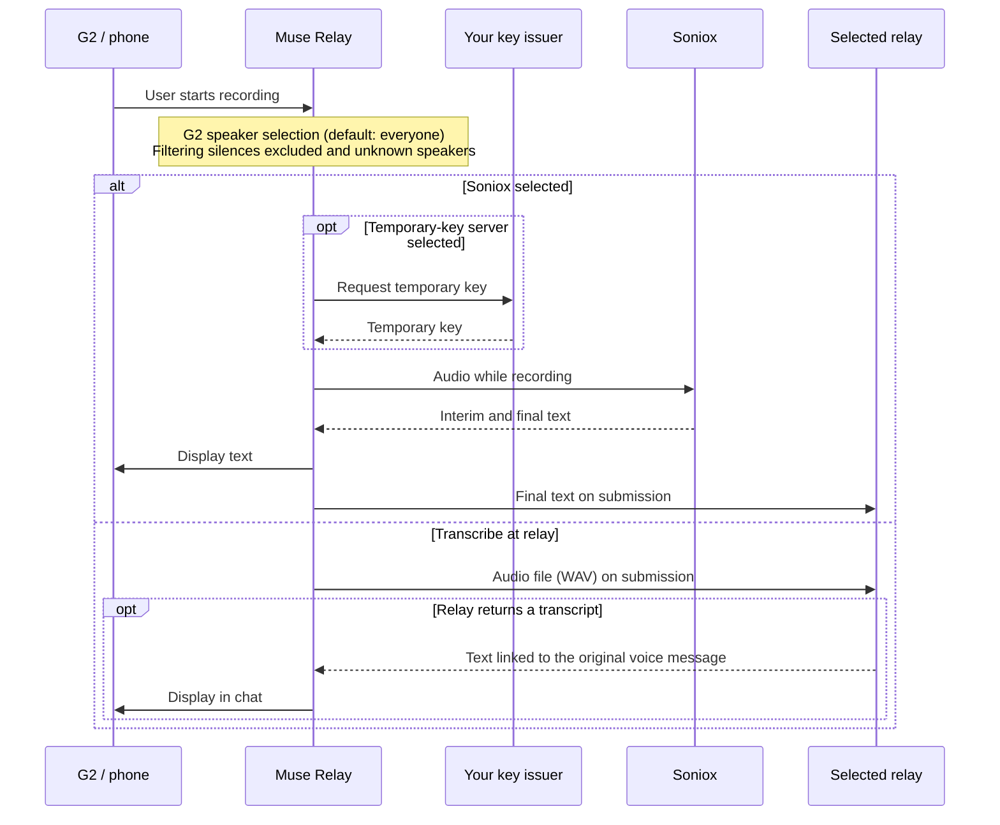

# Data flow and storage

[English](data.md) · [日本語](data.ja.md)

The shared app connects to a relay configured by its user. This source includes no developer-operated relay for all users, advertising delivery, or usage analytics. Processing, logs, and backups by Even, Muse, GitHub, Soniox, and your hosting environment are separate. [Privacy notice](../PRIVACY.md)

## Destinations

| Action / setting | Data and route | Source |
| --- | --- | --- |
| Send through Gist | Text, request ID/time, and selected attachments go to the GitHub API. Your Muse handler processes them and saves replies to Gist | [gist.ts](../src/relay/gist.ts), [watcher.mjs](../adapters/gist/watcher.mjs) |
| Send through HTTPS | The same request goes to your configured relay. The Gadget fetches it over an outbound connection and forwards it to Muse | [gadget.ts](../src/relay/gadget.ts), [server/app.mjs](../server/app.mjs), [relay.c](../firmware/components/muse_relay/relay.c) |
| Transcribe at the relay | Sends one WAV file (16 kHz / mono / PCM16) when submitted. Your handler processes it for Gist; Muse processes it through the SDK for the reference Gadget relay | [controller.ts](../src/core/controller.ts), [media.ts](../src/core/media.ts) |
| Soniox, directly from the app | Sends PCM while recording directly to Soniox with your API key or a temporary key. Displays captions on G2 and the phone; sends only final text to the relay on submission | [soniox.ts](../src/core/soniox.ts), [config.ts](../src/core/config.ts) |
| Select and send an image | Resizes and re-encodes your selected image before sending it to the relay. Images are off by default | [media.ts](../src/core/media.ts), [controller.ts](../src/core/controller.ts) |
| Receive and display | Reads replies, exported Spaces, and optional display name/avatar from the relay. Displays images when enabled | [protocol.ts](../src/relay/protocol.ts), [controller.ts](../src/core/controller.ts) |
| Operate a Space | Sends the selected action ID/value through the same relay, with audio or final text for microphone actions | [space-controls.mjs](../protocol/space-controls.mjs), [controller.ts](../src/core/controller.ts) |

Canceling a Soniox recording cannot retract audio already sent to Soniox. If cancellation finishes before submission, the app does not send final text to the relay. Hiding a submitted request on the device does not retract it.

## Storage and retention

| Location | Stored data and retention | Source |
| --- | --- | --- |
| Even app SDK storage | Settings/tokens, selected Spaces, and read/hidden IDs under `muse-relay-v1`. Current persistence excludes message bodies | [glasses.ts](../src/core/glasses.ts), [persistence.ts](../src/core/persistence.ts) |
| Device WebView / browser | Settings backup under `muse-relay-state-v1`. `muse-relay-cache-v1` holds the latest 50 messages, Spaces, and profile display data such as name/reference/update time. Downloaded image bytes are excluded from the persistent cache | [persistence.ts](../src/core/persistence.ts), [controller.ts](../src/core/controller.ts) |
| App memory during recording | PCM and interim text. Audio buffers are released when recording ends. Submitted text remains as a message | [controller.ts](../src/core/controller.ts) |
| Gist | Requests, replies, audio/images, exported Spaces/profile. Deleting current files does not remove Git history or existing copies | [gist.ts](../src/relay/gist.ts) |
| Reference Gist watcher | Processing records and results awaiting publication in its own state file. Keeps the latest 50 replies; completion records are cleaned after the source file is gone and 30 days have elapsed | [watcher.mjs](../adapters/gist/watcher.mjs) |
| Node reference relay | Requests, replies, Spaces, profile, and attachments in the configured state file. Keeps the latest 100 messages; bodies and attachments remain while referenced | [app.mjs](../server/app.mjs), [core.mjs](../server/core.mjs) |
| Cloudflare reference relay | State in D1, attachments in R2. Bounded garbage collection removes unreferenced attachments after a 24-hour grace period from creation. This is not immediate or scheduled complete deletion | [storage.mjs](../server/cloudflare/storage.mjs), [worker.mjs](../server/cloudflare/worker.mjs) |
| ATOM S3 reference firmware | Wi-Fi, SDK/pairing, and relay settings in NVS. Forwarded content passes through working memory. Updating the app partition alone does not erase NVS | [relay.c](../firmware/components/muse_relay/relay.c), [ATOM S3 guide](atoms3.md) |
| Muse / Soniox / hosting | Depends on each user's account, processing, and settings. The app cannot control these services' retention or complete deletion | Your service and relay administration settings |

After a Node/Worker request finishes, its queued input body, attachments, and parsing buffers are cleared. The same content may remain in retained messages/attachments. Count limits are not age-based deletion. Cleanup does not progress while the service is stopped.

Settings and tokens are stored without app-specific encryption. Device protection, backups, and server/flash access controls depend on your environment. Permissions applied to newly created files do not establish the security of existing files or the whole hosting environment.

## Delete or stop

| Action | What is removed / retained |
| --- | --- |
| Hide a chat | Removes it from this app's display only. Relay and Muse originals remain; it can be shown again |
| Unregister a Space | Removes it from the device's selected list only. Muse and relay Spaces remain |
| Delete connection information | Clears and saves local connection settings, tokens, caches, and selections. Preserves theme/language. The UI distinguishes a failure to save on the Even side |
| Revoke issued keys | Do this in GitHub, Muse, Soniox, or relay administration. Deleting app connection information does not revoke keys |
| Delete Gist data | Stop the watcher and manage the Gist and watcher state file. History, forks, and copies are separate |
| Reset your HTTPS relay | Stop processing; delete the state file or D1/R2 data, settings, and relevant backups in the hosting environment. Clear device caches separately |
| Clear the profile | Replace Muse's exported profile with an empty object. Reference relays remove references and apply the attachment-cleanup rules above. The original Muse avatar is not deleted |
| Transfer or dispose of hardware | Revoke pairing/tokens and separately erase settings remaining on the device |

Avatars come from the user's relay. Personal images are not included in the shared app, public source, or distributed screenshots. If the device cache lacks image bytes, the app fetches them from the relay when next displayed.

## Permissions, keys, and logs

| Item | Purpose |
| --- | --- |
| `network` | Connects to the selected relay and, when used, Soniox and the temporary-key issuer |
| `g2-microphone` / `phone-microphone` | Uses the selected microphone when the user starts recording |
| `album` / `camera` | Opens photo selection/capture at the user's request when images are enabled |
| GitHub token | Reads/writes the Gist API; never attached to raw-file URLs. A classic PAT's `gist` scope is not limited to one Gist. [GitHub scopes](https://docs.github.com/en/apps/oauth-apps/building-oauth-apps/scopes-for-oauth-apps) |
| Relay tokens | Reference relays separate phone, device, and Muse-writer credentials. Knowing the URL alone does not authorize writing |
| Long-term Soniox key | API-key mode stores it in Even settings and the device backup and sends it only to Soniox. Server mode stores it on your server. The reference server requests a single-use temporary key that must start within 60 seconds and allows a session of at most 150 seconds |

The app does not request location, contacts, or advertising IDs. See [app.json](../app.json) for requested permissions and [config.ts](../src/core/config.ts) and transport adapters for key destinations.

The app sends no usage analytics. Reference servers log startup information and fixed failure classifications. The Gist watcher logs counts/errors without forwarding handler stderr verbatim. Review SDK, USB-console, reverse-proxy, and hosting logs separately. Do not paste raw logs or connection settings into public Issues.
