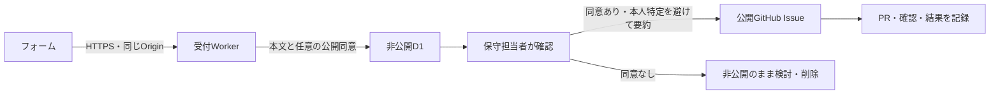

# 要望・質問の受付

| 入口 | 公開範囲 | アカウント |
|---|---|---|
| [ガイドのフォーム](https://muse-relay-guide.spicy-cup-4319.chatgpt.site/#feedback) | 非公開の受付DB。公開への同意があるものだけ匿名化した要約を検討 | 不要 |
| [GitHubのIssueフォーム](https://github.com/3mintimer/muse-relay/issues/new/choose) | 入力した内容が公開される | GitHubが必要 |

「こう使いたい」「操作で困った」「設定・使い方」のいずれかを選んで送れます。連絡先は不要です。トークン、設定JSON、個人のURL、氏名、実際の会話・音声・写真は入力しないでください。受付番号は手元に控えます。番号から本文を読む公開APIや進捗照会はありません。連絡先を保持しないため、フォームから個別返信はできません。



公開同意は初期状態でオフです。オンでも原文・受付番号・個人の環境をそのまま公開せず、保守担当者が内容と必要性を判断します。自動Issue作成、GitHub Bot、GitHubへのトークン保存はありません。

## 保存するデータ

| データ | 場所・保持 |
|---|---|
| 種類、本文、公開同意、受付日時、ランダムな受付番号 | D1の `feedback_receipts`。90日を目安に清掃の実行時に削除 |
| 確認状態、対応する公開IssueのURL | 同じ受付票。Issue URLの記録は公開同意がある票だけ |
| 日替りHMACによる接続元識別子と件数 | `feedback_limits`。期限は最大48時間、次の清掃時に削除 |
| 生IP・User-Agent・連絡先・Cookie | 受付実装では保存しない |

接続元IPはそのリクエスト内でのみHMAC計算に使い、本文の行とは関連付けて保存しません。入力値・ヘッダー・例外をアプリのログへ出しません。ホスティング事業者の通信ログやバックアップの保持は別なので、管理画面側でも設定を確認します。公開Issueになった要約は、受付票の削除だけでは削除されません。

## HTTP契約

`guide/feedback.mjs` の `handleFeedback(request, env)` を `POST /api/feedback` に接続します。サイトと同じOriginからJSONを送ります。利用者のトークン・Cookieは不要です。別OriginへのCORS公開はしません。

```json
{"kind":"idea","message":"スペース一覧を自分の順番に並べたいです。","share":false,"website":""}
```

| 項目 | 制約 |
|---|---|
| `kind` | `idea` / `problem` / `question` |
| `message` | 前後の空白を除いて10〜4,000 Unicode文字。プレーンテキスト |
| `share` | boolean。未指定は `false`。本人を特定する情報を除いた公開Issueへの要約に同意する場合だけ `true` |
| `website` | 空文字／省略。フォームのhoneypotで、利用者には入力させない |
| 本文全体 | UTF-8で16,384バイト以下。添付不可 |

| 応答 | 意味 |
|---|---|
| `201 {"receipt":"<UUID>"}` | 受付番号。内容や接続元は返さない |
| `400 invalid_json` | JSONを読めない |
| `403 origin_not_allowed` | 同じOriginではない、またはOriginがない |
| `405 method_not_allowed` | POST以外。匿名の一覧・本文読取はない |
| `413 too_large` / `415 json_required` | 本文サイズ／形式が不適合 |
| `422 invalid_kind / invalid_message / invalid_share / invalid_website / invalid_input` | 入力値が不適合 |
| `429 rate_limited` | `Retry-After` 秒待つ。入力内容を残し、自動連続送信しない |
| `503 unavailable` | 設定・保存の問題。入力内容を残す |

同じ接続元はUTCの1時間枠で3件、1日枠で10件、全体で1日100件までです。家庭・会社の共用回線では枠を共有します。HMACはサーバー秘密値とUTC日付で作り、生IPを残しません。Cloudflareの `CF-Connecting-IP` だけを使用し、欠落時は共通の制限枠になります。別のホストへ移植する場合は、信頼できるプロキシがこのヘッダーを置換する構成にします。制限と保存は同じD1 batchで確定します。[D1のトランザクション](https://developers.cloudflare.com/d1/worker-api/d1-database/#batch)、[Cloudflareの接続元ヘッダー](https://developers.cloudflare.com/fundamentals/reference/http-headers/#cf-connecting-ip)

honeypotに値がある送信は保存せず、同じ形の201を返します。これは高度なbot判定ではありません。通信が成功応答の直前に切れた場合は、票が既に保存されていることがあります。再送で重複した票は保守担当者が整理します。

## 配備・確認

| 必要なもの | 設定 |
|---|---|
| D1 binding | `DB`。受付DBを公開する読取ルートを作らない |
| サーバー秘密値 | `FEEDBACK_RATE_SECRET`。ランダムな32文字以上。配備先のsecretとして設定し、ソース・ビルド・ブラウザーへ含めない |
| スキーマ | `guide/db/schema.ts` |
| schema-only migration | `guide/db/drizzle/0000_feedback.sql` と `meta/` |

Sites用の配備では、このmigrationと `meta/` を配備成果物の `.openai/drizzle/` へコピーします。マイグレーションにはテーブル・索引・制約だけを入れ、受付データや秘密値を混ぜません。

```sh
node --test guide/feedback.test.mjs
```

ローカルのSQLiteで実際のmigrationとSQLを使い、同意の初期値・同時送信の制限・公開読取の拒否・保持期限・受付番号による削除を確認します。外部へのテスト投稿は行いません。

開発プレビューは `guide/local-db.mjs` の `createLocalDb()` を使用できます。全migrationを適用したメモリ上のDBで、終了時に消えます。Hosted D1には接続しません。schemaを変更した場合はガイド用の依存をインストールしたうえで `npm --prefix guide run db:generate` を使い、生成SQLにデータ操作を混ぜないでください。

配備後のスモークテストは保守担当者が1件だけ、架空の本文に `[動作確認・削除対象]` を付け、`share:false` で送ります。返った受付番号でD1到達を確認して削除します。この票を本物の要望や公開Issueにしません。

## 保守担当者の確認・削除

ホスティングの認証済みD1管理画面・CLIで実行します。DB結果を公開ログやGitへ保存しません。以下の `?` は、ツールの値バインドまたは確認した受付番号へ置き換えます。

1. 新しい票の概要を確認し、必要な1件だけ本文を開きます。

```sql
SELECT receipt, kind, share, created_at, status
FROM feedback_receipts WHERE status = 'new' ORDER BY created_at LIMIT 50;
SELECT receipt, kind, message, share, created_at, status, issue_url
FROM feedback_receipts WHERE receipt = ?;
```

2. 重複・操作方法・再現条件を確認します。`share=0` の原文・個別内容は公開へ転載しません。公開に同意した票も氏名・固有URL・会話・機器識別情報を除き、再現に必要な架空の例へ置き換えてからIssueを作ります。

```sql
UPDATE feedback_receipts SET status = 'reviewed' WHERE receipt = ?;
UPDATE feedback_receipts SET status = 'issue', issue_url = ?
WHERE receipt = ? AND share = 1;
```

3. Issueへ目的・受入条件を記載し、関連するPRと実施した確認を結び付けます。実機／Simulator／ブラウザーを区別します。対応しない場合も理由を残します。受付票の本文や番号はIssue・PRに載せません。

4. 完了・重複・テスト票は閉じるか、受付番号を確認して削除します。削除依頼はフォームで受付番号を添えて送れます。公開Issueの修正・削除が必要な場合は別に確認します。

```sql
UPDATE feedback_receipts SET status = 'closed' WHERE receipt = ?;
DELETE FROM feedback_receipts WHERE receipt = ?;
```

有効な送信の処理時に、90日超の票を最大100件、期限切れの制限情報を最大200件清掃します。送信がない期間は自動実行されません。保守時にも次の限定クエリを繰り返し、残件がなくなったことを確認します。

```sql
DELETE FROM feedback_receipts WHERE receipt IN (
  SELECT receipt FROM feedback_receipts
  WHERE created_at < unixepoch() - 90 * 86400 ORDER BY created_at LIMIT 100
);
DELETE FROM feedback_limits WHERE bucket IN (
  SELECT bucket FROM feedback_limits
  WHERE expires_at <= unixepoch() ORDER BY expires_at LIMIT 200
);
```

受付票の削除はGitHub上のIssue・PRやホスティングのバックアップまで削除する操作ではありません。秘密値を変更すると接続元ごとの現在の制限枠が切り替わりますが、全体の日別上限は維持されます。
