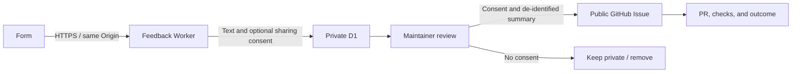

# Requests and questions

[English](feedback.md) · [日本語](feedback.ja.md)

| Entry point | Visibility | Account |
|---|---|---|
| [Guide form](https://muse-relay-guide.spicy-cup-4319.chatgpt.site/#feedback) | Private receipt database; only explicitly consented submissions may be summarized without identifying details | None |
| [GitHub Issue forms](https://github.com/3mintimer/muse-relay/issues/new/choose) | Submitted content is public; English and Japanese forms are available | GitHub required |

Choose an idea, a problem, or a setup/use question. Contact details are not required. Do not submit tokens, configuration JSON, personal URLs, names, or real conversations/audio/photos. Keep your receipt number. There is no public API for reading its body or checking progress. The form cannot provide individual replies because it stores no contact address.



Sharing is off by default. Even with consent, maintainers assess whether an Issue is useful and do not publish the raw text, receipt number, or identifying environment details. There is no automatic Issue creation, GitHub Bot, or stored GitHub token.

## Stored data

| Data | Location and retention |
|---|---|
| Kind, message, consent, time, random receipt number | D1 `feedback_receipts`; eligible for removal at cleanup after about 90 days |
| Review status and corresponding public Issue URL | Same receipt. An Issue URL may be recorded only with sharing consent |
| Daily HMAC client identifier and counts | `feedback_limits`; expires within 48 hours and is removed at the next cleanup |
| Raw IP, User-Agent, contact address, Cookie | Not stored by this implementation |

The address is used only within the request to calculate the HMAC; it is not saved alongside the receipt. The application does not log input, headers, or exceptions. Hosting-provider access logs and backups have separate policies; review those settings too. Deleting a receipt does not remove a summary already published as an Issue.

## HTTP contract

Route `POST /api/feedback` to `handleFeedback(request, env)` in `guide/feedback.mjs`. Send JSON from the site's own Origin. No user token or Cookie is required. Cross-origin CORS access is not enabled.

```json
{"kind":"idea","message":"I would like to arrange Spaces in my own order.","share":false,"website":""}
```

| Field | Constraint |
|---|---|
| `kind` | `idea` / `problem` / `question` |
| `message` | 10–4,000 Unicode characters after trimming; plain text |
| `share` | Boolean, default `false`. Set `true` only to consent to a public Issue summary with identifying details removed |
| `website` | Empty or omitted. A honeypot; users should not fill it in |
| Complete body | At most 16,384 UTF-8 bytes. No attachments |

| Response | Meaning |
|---|---|
| `201 {"receipt":"<UUID>"}` | Receipt number; no message or address is returned |
| `400 invalid_json` | Unreadable JSON |
| `403 origin_not_allowed` | Missing or different Origin |
| `405 method_not_allowed` | Not POST. No anonymous list/body reader |
| `413 too_large` / `415 json_required` | Invalid body size/format |
| `422 invalid_kind / invalid_message / invalid_share / invalid_website / invalid_input` | Invalid input |
| `429 rate_limited` | Wait `Retry-After` seconds. Keep the draft; do not repeatedly auto-submit |
| `503 unavailable` | Configuration/storage problem. Keep the draft |

Limits are 3 submissions per UTC hour and 10 per UTC day for the same address, plus 100 per day overall. Shared home/work networks share a limit. The HMAC uses a server secret and UTC day; raw addresses are not retained. Only Cloudflare's `CF-Connecting-IP` is used; missing metadata uses a shared limit. On another host, ensure a trusted proxy replaces this header. Acceptance and counters commit in the same D1 batch. [D1 transactions](https://developers.cloudflare.com/d1/worker-api/d1-database/#batch), [Cloudflare address header](https://developers.cloudflare.com/fundamentals/reference/http-headers/#cf-connecting-ip)

A filled honeypot receives the same 201 shape without storage. This is a basic measure, not advanced bot detection. If a connection drops just before the success response, the receipt may already exist. Maintainers consolidate duplicates caused by resubmission.

## Deployment and checks

| Requirement | Setting |
|---|---|
| D1 binding | `DB`. Do not expose database reader routes |
| Server secret | `FEEDBACK_RATE_SECRET`, random and at least 32 characters. Store as a deployment secret, never in source/build/browser |
| Schema | `guide/db/schema.ts` |
| Schema-only migration | `guide/db/drizzle/0000_feedback.sql` and `meta/` |

For Sites, copy the migration and `meta/` to `.openai/drizzle/` in the deployment artifact. Migrations contain only tables, indexes, and constraints, not receipt data or secrets.

```sh
node --test guide/feedback.test.mjs
```

The local SQLite test executes the real migration and SQL for default consent, concurrent limits, rejection of public reads, retention, and receipt-based deletion. It does not post externally.

Development can use `createLocalDb()` from `guide/local-db.mjs`: an in-memory database with all migrations, discarded on exit, without a hosted D1 connection. After schema changes, install guide dependencies and run `npm --prefix guide run db:generate`. Keep data changes out of generated SQL.

A maintainer may run one deployment smoke test with artificial text labeled `[SMOKE TEST — DELETE]` and `share:false`. Verify D1 delivery using the returned receipt and delete it. Do not treat it as a real request or publish an Issue for it.

## Maintainer review and deletion

Use the hosting provider's authenticated D1 console/CLI. Do not save database results in public logs or Git. Bind the `?` parameters below through your tool, or substitute a verified receipt number.

1. List new receipt metadata, then open only the message needed.

```sql
SELECT receipt, kind, share, created_at, status
FROM feedback_receipts WHERE status = 'new' ORDER BY created_at LIMIT 50;
SELECT receipt, kind, message, share, created_at, status, issue_url
FROM feedback_receipts WHERE receipt = ?;
```

2. Check duplicates, usage questions, and reproduction. Do not publicly copy the original or individual details of `share=0` submissions. For consented submissions, remove names, private URLs, conversations, and device identifiers; use artificial examples necessary for reproduction before creating an Issue.

```sql
UPDATE feedback_receipts SET status = 'reviewed' WHERE receipt = ?;
UPDATE feedback_receipts SET status = 'issue', issue_url = ?
WHERE receipt = ? AND share = 1;
```

3. Record purpose and acceptance criteria in the Issue, link the PR and relevant checks, and distinguish hardware, Simulator, and browser evidence. Record reasons for not proceeding. Do not put receipt text or numbers in Issues/PRs.

4. Close or delete completed, duplicate, and test receipts after checking their number. Users may request deletion through the form with their receipt number. Review any requested public Issue changes separately.

```sql
UPDATE feedback_receipts SET status = 'closed' WHERE receipt = ?;
DELETE FROM feedback_receipts WHERE receipt = ?;
```

Valid submissions trigger cleanup of up to 100 receipts older than 90 days and 200 expired rate-limit rows. No submissions means no automatic cleanup. During maintenance, repeat these bounded queries until no eligible rows remain.

```sql
DELETE FROM feedback_receipts WHERE receipt IN (
  SELECT receipt FROM feedback_receipts
  WHERE created_at < unixepoch() - 90 * 86400 ORDER BY created_at LIMIT 100
);
DELETE FROM feedback_limits WHERE bucket IN (
  SELECT bucket FROM feedback_limits
  WHERE expires_at <= unixepoch() ORDER BY expires_at LIMIT 200
);
```

Receipt deletion does not delete GitHub Issues/PRs or hosting backups. Rotating the secret changes the current per-address limit buckets, but preserves the global daily limit.
