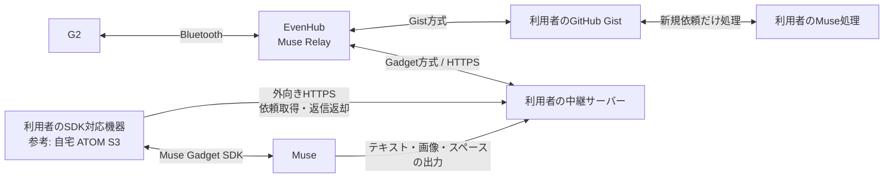
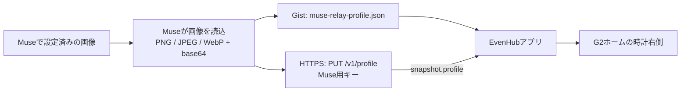
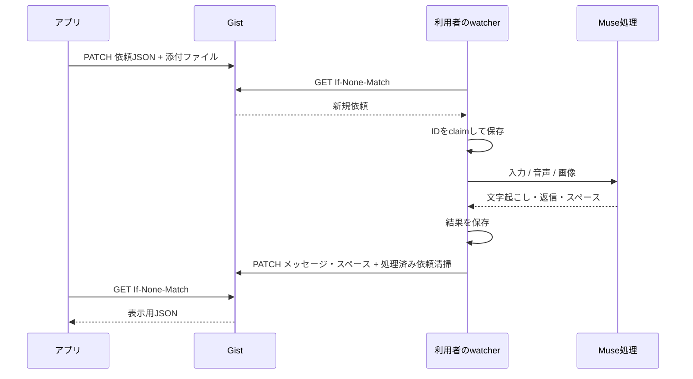
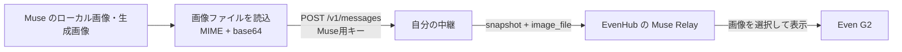
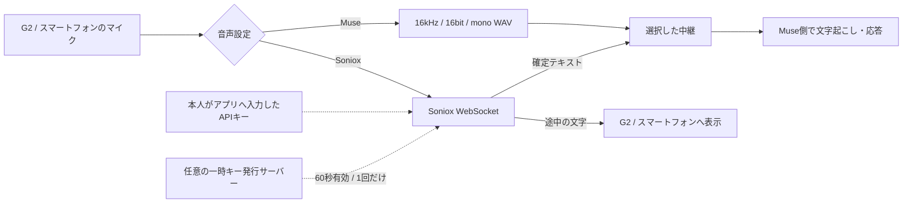

# Muse Relay プロトコル v1

[English](protocol.md) · [日本語](protocol.ja.md)

配布するEvenHubアプリとEHPKは全利用者共通です。接続先と資格情報は各利用者がアプリのUIで設定します。中継の構築・Muse側の処理・資格情報の管理は、利用者自身または利用者のMuseが担当します。

この文書のアプリ側入出力を満たせば、中継の内部実装や配置先を変更してもアプリの再ビルドは不要です。同梱の `server/`・`adapters/gist/`・`firmware/` は任意の参考実装です。利用者共通の運営サーバーや、配布物に埋め込んだ個人の接続先・トークンはありません。

[設定チュートリアルとMuseへの依頼文](relay-setup.ja.md)

## 接続方式



| 役割 | アプリ | 中継 / Muse側 |
|---|---|---|
| 入力 | テキスト、音声、任意の画像 | 入力形式を受け取って処理 |
| 表示 | メッセージ、未読、ホーム、画像、スペースカード、処理状態 | 表示用JSONを出力 |
| 音声 | PCMからWAV、またはSonioxの文字起こしを送信 | Muse音声処理ではWhisper等を用意 |
| スペース | 公開されたカードを選択・閲覧・更新要求 | Museがスペースを作成し、読取用にエクスポート |
| 保存・清掃 | 既読などのアプリ状態 | 依頼の重複排除、保存期間、添付の清掃 |

G2Museのメッセージ形式を読み取れます。機能の基準として参照しており、G2Museの旧監視スクリプトとの送信互換ではありません。Muse Relayの送信先は依頼ごとのファイルです。既存watcherは下記へ対応させます。[G2Muse公開仕様](https://github.com/GenomiskDiagnostik/G2Muse/blob/main/g2muse-setup.md)

## 共通データ

日時はUnix秒。両方式で使う依頼IDは80文字以下の英数字・`_`・`-`を推奨します。`muse_` / `status_` で始まるIDはGadget側の出力用に予約されています。

### アプリ → 中継

```json
{
  "id": "r_53bde8af",
  "kind": "chat",
  "text": "今日の予定を教えて",
  "created_at": 1794880000
}
```

| 項目 | 用途 |
|---|---|
| `id` | 再送でも同じID。中継側の重複排除キー |
| `kind` | `chat` / `space` |
| `text` | 入力テキスト。音声や画像のみなら空文字 |
| `created_at` | 作成日時 |
| `space_id` | `kind:space` の場合の設定済みスペースID |
| `audio` / `image` | Gadget方式の添付。Gistは後述の別ファイル参照 |

Gadgetの添付形式:

```json
{"mime":"audio/wav","name":"voice.wav","data_base64":"..."}
```

### 中継 → アプリ

```json
{
  "messages": [{
    "id":"muse_reply_53bde8af",
    "from":"Muse",
    "type":"text",
    "text":"今日の予定は…",
    "ts":1794880012,
    "reply_to":"r_53bde8af"
  }],
  "spaces": [],
  "device": {"connected":true,"last_seen":1794880010},
  "capabilities": {"audio":true,"images":false,"spaces":true,"soniox":false}
}
```

| 項目 | 形式 |
|---|---|
| `messages` | 必須。空の場合は `[]` |
| `type` | `text` / `voice-note` / `image` |
| `from` | `Muse` / `You` など表示する送信者 |
| `image` | インライン添付。PNG / JPEG / WebP |
| `image_file` + `mime_type` | 別ファイルに置いた画像 |
| `reply_to` | 元のアプリ依頼ID（任意） |
| `spaces` | リスト／カードと操作部品の定義（任意） |
| `profile` | Museの名前・設定済みアバター（任意）。`{name?,avatar?,avatar_file?,mime_type?,updated_at?}` |
| `device` | Gadget参照実装の接続状態（任意） |
| `capabilities` | `images` はアプリからMuseへの画像送信可否。受信画像の表示とは別。任意の `soniox` はサーバーに長期キーが設定されているかの boolean で、接続検証済みを意味しない |

チャットで入力と回答を併記する場合は、入力を `from:"You", id:<元の依頼ID>, text:<入力文または文字起こし>`、回答を `from:"Muse", reply_to:<同じ依頼ID>` にします。文字起こしは元のYouメッセージを同じIDで更新します。独立したMuse投稿は `reply_to` を省略し、関係のない入力と結び付けません。

Sonioxではアプリが確定文を保存します。Gist参考watcherはハンドラーの `transcript` を同じYouメッセージへ反映します。Gadget参考サーバーはACKに一致するSDK `message.user` の文字列をYouへ反映しますが、SDKから文字起こしが届くこと自体を保証しません。独自Gistが別IDのYou文字起こしを返す場合は、その `reply_to` を元の依頼IDにすれば表示側で解決できます。

### Museのアバター → G2ホーム

固定SDKで設定済みアバターを直接返す公開イベント／APIは確認できていません。公式の手順も、Museにプロフィール・persona・ファイル内の自分のアバターを探させる方式です。この中継では、その**既存の画像**をMuseが読み込んで書き出します。画像を特定できなければ未設定とし、別のキャラクターやSDKの既定アバターで代用しません。[公式のアバター依頼](https://github.com/facebookincubator/muse-gadget-sdk/blob/c3d58c66a02bfea44847e0345714507166656bed/esp32/tools/muse/avatar_prompt.md#L7-L18)、[公式手順](https://github.com/facebookincubator/muse-gadget-sdk/blob/c3d58c66a02bfea44847e0345714507166656bed/esp32/tools/muse/AVATAR_RECIPE.md#L52-L60)



| 項目 | 契約 |
|---|---|
| `name` | 任意。Museの名前、120文字以下 |
| `avatar` | `{mime,name?,data_base64}`。PNG / JPEG / WebP、デコード後250,000バイト以下 |
| `avatar_file` + `mime_type` | 読取用の添付参照。Gistでは同じGist内のbase64ファイル、HTTPSでは `/v1/files/:name` の添付JSON |
| `updated_at` | 任意。更新日時の正整数Unix秒 |
| 未設定／解除 | 未設定は `profile` を省略。明示的な解除は `profile:{}` |

HTTPSの書込例（`Authorization: Bearer <Muse用キー>`、`PUT /v1/profile` の本文）。`data_base64` は元の画像全体をエンコードした値へ置き換えます。

```json
{"name":"Museの名前","avatar":{"mime":"image/png","name":"avatar.png","data_base64":"..."},"updated_at":1794880012}
```

PUTは全体置換です。`{}` で解除し、名前のみを送れば以前のアバターも外れます。書込は `avatar` のインライン添付を使い、`avatar_file` は指定しません。中継が内容から参照名を生成します。スマートフォン・ATOMのキーでは更新できません。URLやローカルパスを自動取得せず、SDKの `display.draw_*` も使用しません。`capabilities.images` はMuseへの画像入力フラグなので、このプロフィール出力には影響しません。

アプリの「画像」設定をオンにするとホームのアバターも表示します。オフでは画像の読込・表示を抑えますが、中継に保存済みのプロフィールを削除する操作にはなりません。

Gistの `muse-relay-profile.json` は次の形です。`avatar` のインライン添付でも受信できます。参照watcherではハンドラーが `{text:"",profile:{name,avatar,updated_at?}}` を返すと画像を別ファイルへ保存し、下のJSONを作ります。通常の返信で `profile` を省略すると既存プロフィールを維持し、`profile:{}` で解除します。

```json
{"profile":{"name":"Museの名前","avatar_file":"muse-relay-avatar-<sha256>.base64","mime_type":"image/png","updated_at":1794880012}}
```

プロフィールはチャット履歴の件数制限とは独立して1件保持します。更新・解除で未参照になった添付はNodeでは状態から削除、Workerでは24時間の猶予と既存の上限付きGCに従って削除します。参照Gist watcherは自分の `muse-relay-avatar-*.base64` のうち参照されなくなったファイルを削除します。Gist履歴に残る過去版は別です。

## Gist方式

### ファイルと書き込み担当

| ファイル | 書き込み元 | 内容 |
|---|---|---|
| `g2muse-relay.json` | Muse側の1つのwriter | `{"messages":[...]}`。初期値は空配列 |
| `muse-relay-spaces.json` | Muse側 | `{"spaces":[...]}` |
| `muse-relay-profile.json` | Muse側 | `{"profile":{...}}`。設定済みのアバター |
| `muse-relay-request-<id>.json` | アプリ | 1件の依頼 |
| `muse-relay-audio-<id>.base64` | アプリ | 音声のbase64文字列 |
| `muse-relay-image-<id>.base64` | アプリ | 画像のbase64文字列 |
| `muse-relay-output-<id>.base64` | 参照watcher | Museからの画像返信 |
| `muse-relay-avatar-<sha256>.base64` | 参照watcher | プロフィール画像のbase64文字列 |

アプリは共有の `messages` 配列へ追記せず、依頼ごとに異なるファイルへ書きます。Muse側が受信した依頼と返信を `g2muse-relay.json` に反映します。複数のwriterで同じJSONを上書きする構成は避けます。

音声付き依頼ファイルの例:

```json
{
  "protocol":"muse-relay/1",
  "id":"r_53bde8af",
  "kind":"chat",
  "text":"",
  "created_at":1794880000,
  "audio_file":"muse-relay-audio-r_53bde8af.base64",
  "audio_mime":"audio/wav",
  "audio_name":"voice.wav"
}
```

画像は `image_file` / `image_mime` / `image_name`。`audio` / `image` のインラインデータはGist依頼JSONには含めません。



参照実装: [adapters/gist](../adapters/gist/README.ja.md)。通常のHTTP確認はAIを起動せず、新規依頼だけを利用者の実行ファイルへ標準入力で渡します。実行ファイルは `{text,transcript?,image?,spaces?,profile?}` を返します。Museへの架空のAPI呼び出しは実装していません。

### HTTP・資格情報

| 通信先 | 認証 | 処理 |
|---|---|---|
| `https://api.github.com/gists/<id>` | GitHubトークン | GET / PATCH |
| APIが返した `https://gist.githubusercontent.com/...` | なし | `truncated:true` のファイルを取得 |

raw取得にはトークンを付けず、別ホストへのリダイレクトは追跡しません。GitHubは約1MBを超えるファイル内容を切り詰め、300ファイルを超えると一覧も切り詰める場合があります。処理済みファイルの清掃をMuse側で行います。[GitHub Gists API](https://docs.github.com/en/rest/gists/gists#truncation)

secret GistはURLを知る人が閲覧できる非公開一覧であり、内容を暗号化しません。音声・画像・会話はGitHubへ保存されます。ファイル削除後もGistの履歴に残り得ます。

## Muse Gadget SDK方式

スマートフォンは利用者のHTTPS中継へ接続します。同梱の参考構成では、自宅のATOM S3が中継を取得し、ペアリング済みMuse Gadget SDKの接続でMuseへ渡します。利用者の対応機器や配置に合わせた実装も可能です。

### アプリのHTTP境界と参考実装の管理口

`/v1/snapshot`・`/v1/requests`・`/v1/files/:name` がアプリとの契約です。Sonioxを使用するときは一時キー発行先も用意します。`/v1/messages`・`/v1/spaces`・`/v1/profile` は参考サーバーのMuse用管理口、`/device/*` は参考ファームウェアとの接続口です。独自実装では、アプリ側の契約を保ったまま内部のMuse・機器連携を変更できます。

| 認証キー | 方法・パス | 入出力 |
|---|---|---|
| スマートフォン用 | `GET /v1/snapshot` | 共通の表示用JSON |
| スマートフォン用 | `POST /v1/requests` | 共通依頼。HTTP 202は受付のみ |
| スマートフォン用 | `GET /v1/files/:name` | 添付JSON |
| スマートフォン用 | `POST /v1/soniox-token` | Soniox一時キー |
| Muse用 | `POST /v1/messages` | テキスト・画像の出力 |
| Muse用 | `GET /v1/spaces` | 現在のエクスポート `{spaces:[...]}`。チャットは含まない |
| Muse用 | `PUT /v1/spaces/:id` | 本文の `id` がURLと一致する1件を追加・置換。他のスペースは保持 |
| Muse用 | `PUT /v1/spaces` | `{spaces:[...]}` でスペース一覧を一括置換 |
| Muse用 | `PUT /v1/profile` | 設定済みアバター・名前を置換。`{}` で解除 |
| Muse用・Worker参考実装のみ | `POST /admin/gc` | 24時間以上前の未参照添付を限定数だけ削除。アプリは使用しない |
| ATOM用 | `GET /device/jobs` | 次の1件または `{"job":null}` |
| ATOM用 | `GET /device/jobs/:id/request` | SDKへ渡すJSON本文 |
| ATOM用 | `POST /device/events` | ACK / ストリーム / heartbeat / error |

3種類とも `Authorization: Bearer <対応するキー>`。同じ値は使用しません。SDKトークンはATOMとMuseのペアリング用であり、上記HTTPキーとは別です。

### 受信間隔

| 状態 | `GET /v1/snapshot` の間隔 |
|---|---|
| 通常 | 利用者が保存した間隔（初期値15秒） |
| `POST /v1/requests` 成功後 | 1秒。テキスト・音声・スペース依頼で共通 |
| 対象の返信が5秒間変化しない、または各送信から2分経過 | 通常の間隔へ復帰 |
| 取得失敗 | 高速確認を解除し、既存の再試行待ち（最低30秒） |
| Evenアプリがバックグラウンド | グラス操作と受信を継続 |
| アプリ終了・通常ブラウザーの非表示 | 受信を停止 |

各取得・画面処理の完了後から次の間隔を計り、取得は重複させません。送信した依頼IDと同じ `reply_to` を持つ返信だけを追跡します。少しずつ届く本文は引き続き確認し、複数の依頼を送った場合はそれぞれを追跡します。`reply_to` がない独自中継も利用できますが、その場合は2分の上限で通常間隔へ戻ります。5秒の判定は返信内容の変化に基づくもので、Museの生成完了を保証するものではありません。通常間隔に戻った後も新しい更新は取得します。

設定値の書き換え、メッセージの再送信、ATOMやMuse側の通信間隔の変更は行いません。Gist方式の間隔は従来どおりです。

### アプリの Origin

参考サーバーは Origin の完全一致を基本とし、Even iPhone の可変ポート用には `http://127.0.0.1:*` を明示設定できます。

| 設定例 | 対象 |
|---|---|
| Node: `"allowedOrigins":["http://127.0.0.1:*"]` | `http://127.0.0.1:54848`、`http://127.0.0.1:54914` などの正規 Origin |
| Worker: `ALLOWED_ORIGINS=https://app.example,http://127.0.0.1:*` | 完全一致する HTTPS Origin と上記ローカル Origin |

予約値は `http://127.0.0.1` と有効なポートだけに適用します。別ホスト・別scheme・userinfo・パス・query・fragment・IPの別表記には適用しません。`Access-Control-Allow-Origin` は要求された Origin 自体を返します。`null` は必要な環境でだけ別途登録します。OPTIONS の通過後も、すべてのデータAPIで役割別 Bearer 認証を検証します。

### Muse → EvenHub → G2 の画像



最小の画像投稿例。`data_base64` は画像ファイル全体の base64 です。URL や Muse のファイルパスは渡しません。

```json
{
  "id":"muse_export_photo_01",
  "type":"image",
  "image":{"mime":"image/png","name":"reply.png","data_base64":"..."}
}
```

`POST /v1/messages` のIDは `muse_export_` に続けて1～80文字の英数字・`_`・`-`。同じIDで更新できます。画像の `text` は任意で、省略時は空文字になります。説明があれば `text`、時刻があれば `ts`（秒）、返信先があれば `reply_to` を追加します。`from` はサーバー側で `Muse` に揃えます。PNG / JPEG / WebP、デコード後250,000 bytes以下です。

`capabilities.images:false` はアプリからMuseへの画像**入力**を無効にする値です。Museからの画像出力はこの値によらず受信できます。

固定SDKのチャット購読では、assistant画像の公開payload形式を確認できていません。SDKの `display.draw_file` / `display.draw_url` はSDK機器の画面向けで、G2描画には使いません。Museの実装では上の画像エクスポートを使用してください。中継は未知のイベントフィールドやURLを自動取得しません。[SDK画像コマンド](https://github.com/facebookincubator/muse-gadget-sdk/blob/c3d58c66a02bfea44847e0345714507166656bed/esp32/main/app.c#L1998)、[SDKチャット受信](https://github.com/facebookincubator/muse-gadget-sdk/blob/c3d58c66a02bfea44847e0345714507166656bed/linux/src/musegadget/muse_turn.py#L106)

**ATOM経由でMuseへ画像を入力する部分**は未実機確認で、参照サーバーの初期設定では無効です。

### ATOM ↔ 中継

```json
{"job":{"id":"r_53bde8af","kind":"chat","created_at":1794880000,"session_id":"6f1c2d4e-0b7a-4c3e-9f5d-2a8b1e0c7d93","request_bytes":118,"lease_seconds":180}}
```

`session_id` はリレー状態に保存した専用会話のUUIDで、依頼をまたいで維持します。スマートフォンの設定や再ビルドは不要です。`/request` は `Content-Length` 付き。ATOMは本文を小さく分け、公式SDKの `/chat/stream` へ送ります。

```json
{"message":"今日の予定を教えて","output_modality":"text","session_id":"6f1c2d4e-0b7a-4c3e-9f5d-2a8b1e0c7d93"}
```

音声付きSDK本文:

```json
{
  "message":"",
  "output_modality":"text",
  "session_id":"6f1c2d4e-0b7a-4c3e-9f5d-2a8b1e0c7d93",
  "device":"mcu-wearable",
  "items":[{"type":"file","mime_type":"audio/wav","filename":"voice.wav","data_base64":"..."}]
}
```

ATOMはまず `POST /chat/subscribe` に同じ `{"session_id":"…"}` を渡します。200なら購読を維持してから送信し、ACK前の候補を限定数保持します。初回404なら送信で会話を作成し、ACKの確認後に購読を開き直します。購読が自分の発言履歴を必ず再送するとは仮定しません。すべてのdeviceイベントの外側にも同じ `session_id` が必要です。

イベント送信例:

```json
{"job_id":"r_53bde8af","session_id":"6f1c2d4e-0b7a-4c3e-9f5d-2a8b1e0c7d93","event_id":"e_1","type":"muse_ack","body":{"result":{"message_id":"note-id","session_id":"6f1c2d4e-0b7a-4c3e-9f5d-2a8b1e0c7d93","is_thread":true}}}
```

| type | 追加フィールド |
|---|---|
| `muse_ack` | `body`: SDKのACK文字列またはオブジェクト。初回購読404を実観測した場合だけ外側に `subscription_fresh:true` |
| `muse_chunk` | `body_base64`: `/chat/subscribe` のNDJSON生バイト |
| `muse_event` | `body`: 完全なNDJSON行またはイベントオブジェクト |
| `heartbeat` | なし。30秒以内ごとに送る |
| `error` | `error`: 資格情報を含まない短い説明 |

応答: `{"ok":true,"terminal":false}`。`terminal:true` で購読を終了します。`event_id` は同じ内容を再送するときも変えません。

| 返信の条件 | 処理 |
|---|---|
| ACK | `result.session_id` が専用会話と一致し、`is_thread:true`、message ID があること |
| 購読範囲 | 外側の `session_id` は必須。本文に別の会話IDが明示されていれば除外 |
| 親IDがない返信 | ACK ID と一致する `message.user` の後だけ受理。別の `message.user` で境界を閉じる |
| 新規会話の例外 | 初回404の申告 `subscription_fresh:true` と有効な専用会話ACKがある場合だけ、自分の発言行を待たず受理。既にACK済みの会話の別依頼では拒否 |
| 親IDがある返信 | ACKまたは既に照合した返信との関連を確認。別の親IDは除外 |
| 重複・過去の返信 | event ID と既知の返信IDで除外。message行とlive deltaの `seq` は別々に管理 |

メイン会話の親IDなし返信を時刻だけで推測しません。本文をATOMへ渡した後の切断は結果不明として扱い、自動再実行しません。同梱ATOMは対象外の履歴や大きなsnapshotを受信側で除き、対象のテキスト更新をまとめて送ります。1返信の可視テキスト上限はUTF-8で4KiBで、超過は `muse_response_text_too_large` として報告します。[公式の専用会話と購読順](https://github.com/facebookincubator/muse-gadget-sdk/blob/c3d58c66a02bfea44847e0345714507166656bed/linux/src/musegadget/service.py#L484)、[2系統のseq](https://github.com/facebookincubator/muse-gadget-sdk/blob/c3d58c66a02bfea44847e0345714507166656bed/linux/src/musegadget/service.py#L567)

参照実装・配備手順: [server](server.ja.md)。物理機器の設定: [ATOM S3](atoms3.ja.md)。

## スペースのエクスポートと操作

Museが作成したスペースを宣言的なJSONとして表示します。`layout:"list"`（初期値）／`"cards"` を選び、項目ごとに `control` を省略するか、`button`・`slider`・`choice`・`microphone` を指定します。操作方法・上限・入り口／出口・サンプルは [スペースの仕様](spaces.ja.md) と [JSON例](../examples/spaces.json) を参照してください。

`kind:"space"` と `space_id` のみの依頼は従来の読取用更新です。操作依頼には `space_action:{item_id,type,value?}` が加わります。スライダーは数値、選択肢は選択ID、ボタン／マイクはvalueなし。マイクは既存の音声設定で確定テキストまたはWAVを送ります。

参照中継は宣言済みの項目・型・値域・無効状態を検証します。依頼IDで重複を排除し、Museは処理結果を `PUT /v1/spaces/:id` で対象のスペースだけに反映します。必要なら同じMuse用キーで `GET /v1/spaces` を呼びます。取得した一覧には画像も書き込みと同じ形式で含まれます。`PUT /v1/spaces` は一覧を意図的に入れ替えるときに使います。既存の中継・Gist handlerは新しいフィールドを保持するよう更新が必要です。

画像が有効な場合は項目へ任意の `image` 添付を加えられます。Gistの独自実装はPNGのbase64ファイルを指す `image_file` も使用できます。参照Gist watcherのスペース出力は画像を除くテキストと操作部品です。画像オフでも必要な情報が本文から分かるようにします。

## 音声処理を選ぶ



Soniox認証は、アプリに入力した本人のAPIキー、または発行サーバーから取得する一時キーを選べます。APIキー方式はGistでも追加サーバー不要です。キーを共通ビルドやMuseへの依頼文へ埋め込みません。アプリは選んだキーで `wss://stt-rt.soniox.com/transcribe-websocket` に接続し、音声を直接Sonioxへ送信します。Museへは確定したテキストを送ります。Gist方式でも一時キーの発行先は別途設定できます。

Muse方式の文字起こしを別表示する場合、参考Gist watcherはハンドラーの `transcript` を `from:"You"` として保存します。参考Gadgetサーバーの `POST /v1/messages` は `from:"Muse"` 固定です。Gadgetでは文字起こしをMuse返信内に明示できますが、同APIでユーザー発言を作成することはできません。Soniox方式では確定テキストがアプリのユーザー発言となるため、再文字起こしは行いません。

一時キー応答: `{"api_key":"snx_temp_...","expires_at":"..."}`。参照サーバーは発行時に `usage_type:transcribe_websocket`、`expires_in_seconds:60`、`single_use:true`、`max_session_duration_seconds:150` を指定します。[Soniox仕様](https://docs.soniox.com/authentication/temporary-api-keys)

## 上限・保持

アプリの上限と同梱の参考実装の上限を示します。独自中継ではアプリ側の受信上限を守り、保存期間・処理済みデータの清掃方針を利用者が決めます。

| 対象 | v1実装 |
|---|---|
| 録音 | Gist 最大120秒 / Gadget 最大30秒 |
| Gist送信添付 | base64 5,500,000文字以下 / 個 |
| Gist読取ファイル | 6,000,000文字以下。参照watcherは6,000,000バイト以下 |
| Gadget音声 | WAV 1,100,000バイト以下 |
| Gadget画像出力 | 画像 250,000バイト以下 |
| プロフィール | 1件。アバター250,000バイト以下、名前120文字以下（両方式） |
| 参照中継のテキスト依頼 | Gist watcher 20,000文字 / Gadget 10,000文字以下 |
| 表示用本文 | アプリ読取は20,000文字まで |
| ATOMの返信本文 | 1返信につきUTF-8で4KiB。超過は明示エラー |
| スペース | 参照中継は最大20、各50カード |
| HTTP要求本文 | Gadget参照サーバーは2,000,000バイト以下 |
| ジョブ | Gadgetは同時処理1件、待機20件、期限15分 |
| 中継の保持 | Gist参照watcher50メッセージ / Gadget参照サーバー100メッセージ |
| 既読・非表示 | アプリ内。元中継の削除を意味しない |

中継の保持期間・処理済み音声・画像の削除は利用者 / Museが管理します。アプリの設定変更だけでGist履歴やMuse内のデータは消去しません。

実装の参照: [型](../src/core/types.ts)、[Gist通信](../src/relay/gist.ts)、[Gadget通信](../src/relay/gadget.ts)、[受信形式](../src/relay/protocol.ts)、[参照サーバー](../server/app.mjs)。
