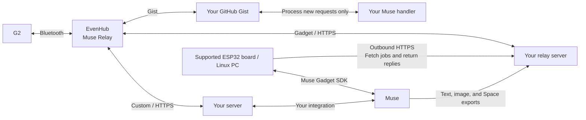
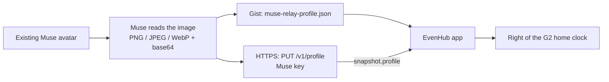
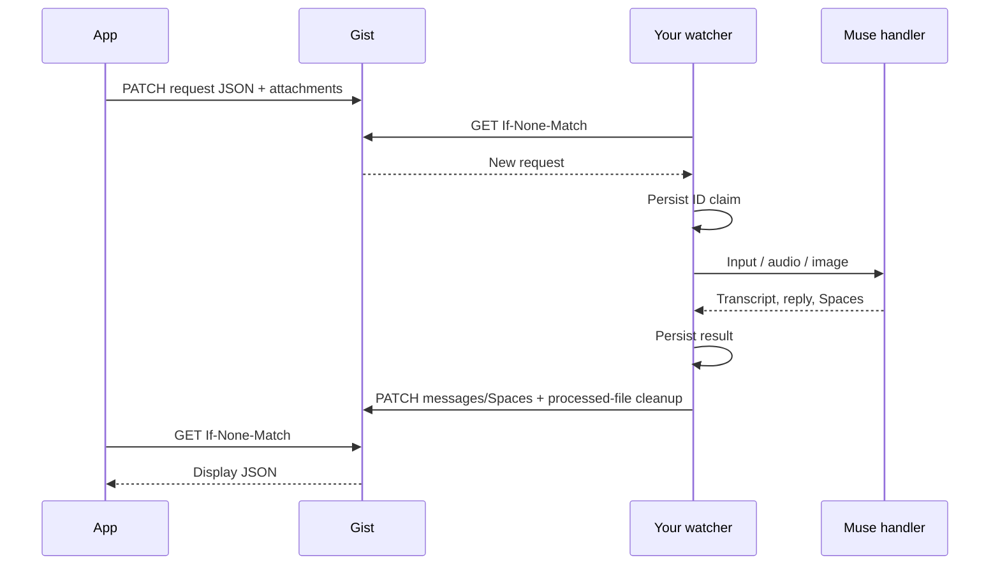
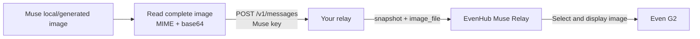
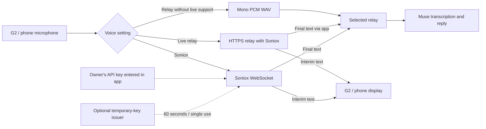

# Muse Relay protocol v1

[English](protocol.md) · [日本語](protocol.ja.md)

The EvenHub app and EHPK are shared by all users. Each user configures their endpoint and credentials in the app UI. The user or their Muse implements the relay, Muse-side processing, and credential management.

Preserve this app input/output contract and you can change relay internals or hosting without rebuilding the app. The bundled `server/`, `adapters/gist/`, and `firmware/` are optional references. There is no common operated relay or personal endpoint/token embedded in the distribution.

[Setup tutorial and instructions for Muse](relay-setup.md)

## Connection methods



| Responsibility | App | Relay / Muse |
|---|---|---|
| Input | Text, audio, optional images | Receive and process the input format |
| Display | Messages, unread state, home, images, Space cards, processing status | Export display JSON |
| Voice | Convert PCM to WAV, or send Soniox transcription | Provide Whisper or another Muse-side audio processor |
| Spaces | Select/read exported cards and request refreshes | Muse creates Spaces and exports readable data |
| Storage/cleanup | App state such as read markers | Deduplicate requests, set retention, clean attachments |

G2Muse message data is readable. It is a feature baseline, not outgoing compatibility with the old G2Muse watcher. Muse Relay writes one file per request; adapt an existing watcher to the contract below. [G2Muse public format](https://github.com/GenomiskDiagnostik/G2Muse/blob/main/g2muse-setup.md)

## Common data

Timestamps use Unix seconds. For IDs shared across the relay methods, use at most 80 letters, digits, `_`, or `-`. Gadget reserves IDs beginning with `muse_` or `status_` for output.

### App to relay

```json
{
  "id": "r_53bde8af",
  "kind": "chat",
  "text": "What is on my schedule today?",
  "created_at": 1794880000
}
```

| Field | Purpose |
|---|---|
| `id` | Keep it unchanged on retry; relay deduplication key |
| `kind` | `chat` / `space` |
| `text` | Input text; empty for audio/image-only input |
| `created_at` | Creation time |
| `location` | Optional for chats. Degrees in `latitude` and `longitude`, Unix seconds in `captured_at`, optional horizontal `accuracy` in metres. Omitted while sharing is off or no fix under five minutes old is available. |
| `space_id` | Configured Space ID for `kind:space` |
| `audio` / `image` | Gadget attachments; Gist uses separate file references below |

The composer pin and Settings change the same sharing preference, initially off. Chat sends with the cached fix when available. The Gadget relay appends `【現在地】` and the location JSON to the Muse message. For audio and photos, the same message is included as a text item. Muse can use the coordinates directly. Gist handlers and custom relays receive the request’s `location` field. See the [route-specific upgrade steps](relay-setup.md#relay-upgrade) when updating an existing relay.

After the relay accepts a message, Even Hub keeps its sent fix with that message in the phone’s local history cache. Tap its pin to inspect the fix. Both the G2 and the normal phone chat display the original text or transcript.

Gadget attachment format:

```json
{"mime":"audio/wav","name":"voice.wav","data_base64":"..."}
```

### Relay to app

```json
{
  "messages": [{
    "id":"muse_reply_53bde8af",
    "from":"Muse",
    "type":"text",
    "text":"Today's schedule is…",
    "ts":1794880012,
    "reply_to":"r_53bde8af"
  }],
  "spaces": [],
  "device": {"connected":true,"last_seen":1794880010},
  "capabilities": {"audio":true,"images":false,"spaces":true,"soniox":false}
}
```

| Field | Format |
|---|---|
| `messages` | Required; `[]` when empty |
| `type` | `text` / `voice-note` / `image` |
| `from` | Displayed sender, such as `Muse` / `You` |
| `image` | Inline PNG / JPEG / WebP attachment |
| `image_file` + `mime_type` | Image stored separately |
| `reply_to` | Original app request ID, optional |
| `spaces` | List/card and control definitions, optional |
| `profile` | Muse's name/configured avatar, optional: `{name?,avatar?,avatar_file?,mime_type?,updated_at?}` |
| `device` | Reference Gadget connection state, optional |
| `capabilities` | `images` permits image input from app to Muse. Optional `soniox` indicates a configured server key. Optional `live_transcription:true` enables live captions in Transcribe via relay on compatible app builds |

### Voice transcripts and reply matching

Receiving a Muse answer and receiving a transcript are separate results. Without displayable input text, G2 shows a voice-message label; it does not reconstruct what was said.

<details>
<summary>Fields for the relay / Muse implementer</summary>

| Path | Input text returned to the app |
|---|---|
| Gist reference watcher | Handler `transcript` → `You.text`, with `You.id` equal to the original request ID. If omitted, the watcher uses request `text`, which may be empty for audio |
| Gadget reference relay | For an audio request, an SDK `message.user` whose message ID matches an ACK ID updates the original `You.text` from `payload.display_text`, `payload.text`, or `payload.content`. The SDK may supply no displayable transcript |
| Soniox direct or live relay | Final text becomes the app request's `text` and its local You message. Muse receives the final text |

Use the original app request ID for both the input and the answer's `reply_to`:

```json
{"messages":[
  {"id":"r_voice1","from":"You","type":"voice-note","text":"What is next?","ts":1794880000},
  {"id":"muse_r_voice1","from":"Muse","type":"text","text":"Here is your next item.","ts":1794880012,"reply_to":"r_voice1"}
]}
```

For Gadget, the SDK user message ID is `payload.message_id`, `event.message_id`, or `payload.id`; accepted ACK IDs are `result.message_id` and optional `result.reply_to_message_id`. The [dedicated-session checks](#atom-and-relay) still apply. SDK IDs are not substituted for the app request ID in the exported messages.

A custom Gist exporter may use a separate transcript ID, but that `from:"You"` row must set `reply_to` to the original request ID; the Muse answer references the same original ID. An independent Muse post omits `reply_to` and must not be paired with unrelated input.

Putting a labeled transcript in `Muse.text` does not update `You.text`. Reference `POST /v1/messages` accepts Muse output only, so it cannot create a You transcript. Do not invent an SDK user event to work around a missing transcript.

Sources: [Gist publication](../adapters/gist/watcher.mjs), [Gadget event handling](../server/core.mjs), [chat pairing](../src/core/chat.ts).

</details>

### Muse avatar on G2 home

No public event/API that directly returns the configured avatar has been verified in the pinned SDK. Its official workflow asks Muse to find its own avatar in its profile, persona, or files. Here, Muse reads and exports that **existing image**. If it cannot identify the image, leave it unset rather than substitute another character or the SDK's default avatar. [Official avatar prompt](https://github.com/facebookincubator/muse-gadget-sdk/blob/c3d58c66a02bfea44847e0345714507166656bed/esp32/tools/muse/avatar_prompt.md#L7-L18), [official recipe](https://github.com/facebookincubator/muse-gadget-sdk/blob/c3d58c66a02bfea44847e0345714507166656bed/esp32/tools/muse/AVATAR_RECIPE.md#L52-L60)



| Field | Contract |
|---|---|
| `name` | Optional Muse name, at most 120 characters |
| `avatar` | `{mime,name?,data_base64}`, PNG / JPEG / WebP, at most 250,000 decoded bytes |
| `avatar_file` + `mime_type` | Read reference: a base64 file in the same Gist, or attachment JSON from HTTPS `/v1/files/:name` |
| `updated_at` | Optional positive integer Unix seconds |
| Unset/clear | Omit `profile` when unset; `profile:{}` explicitly clears it |

HTTPS writer example: `PUT /v1/profile` with `Authorization: Bearer <Muse key>`. Replace `data_base64` with the encoded complete image.

```json
{"name":"Muse name","avatar":{"mime":"image/png","name":"avatar.png","data_base64":"..."},"updated_at":1794880012}
```

PUT replaces the full profile. `{}` clears it; a name-only update removes the previous avatar. Writers send inline `avatar`, not `avatar_file`; the relay generates the file reference from the content. Phone and ATOM keys cannot update profiles. The relay does not fetch URLs/local paths or use SDK `display.draw_*`. The `capabilities.images` input flag does not affect profile output.

Enable Images in app settings to display the home avatar. Turning it off suppresses image loading/display without deleting the relay's stored profile.

Gist `muse-relay-profile.json` has the shape below; inline `avatar` is also readable. In the reference watcher, a handler result `{text:"",profile:{name,avatar,updated_at?}}` stores a separate image and writes this JSON. Omitting `profile` preserves the existing one; `profile:{}` clears it.

```json
{"profile":{"name":"Muse name","avatar_file":"muse-relay-avatar-<sha256>.base64","mime_type":"image/png","updated_at":1794880012}}
```

One profile is retained independently of chat history limits. When replaced/cleared, Node removes unreferenced attachment state; Worker uses its existing bounded GC and 24-hour grace. The Gist watcher removes its own unreferenced `muse-relay-avatar-*.base64` files. Older Gist revisions are separate.

### Home and reply-wait animations

In **Settings → Avatar & animation**, enable images and open **Manage artwork → Ask Muse for animations**. The prompt asks Muse to generate two looping sequences from its current character reference. Each loop has 16 square frames at 4 fps. With individual PNG, JPEG or WebP frames, choose **Choose 16 frames** for the desired loop. Number filenames 01–16. The app sorts them in numeric filename order and saves the import in this WebView for the selected connection. **Use images from Muse** restores the relay version.

The transport record has ID `muse_relay_avatar_motion_v1`, a title, an increasing Unix-second `updated_at`, and two items. Each item has `id` (`idle` or `working`), `title`, empty `text`, and `image:{mime:"image/png",name,data_base64}`. Each PNG is 576 × 576 px, at most 250,000 bytes. Pack the 144 × 144 px frames in a 4 × 4 grid, reading across each row. The working motion depicts Muse using a computer. The final pose transitions into the first.

- HTTPS writers send the record with the Muse credential using `PUT /v1/spaces/muse_relay_avatar_motion_v1`. This uses one space and two image slots. The app recognizes the reserved ID, omits it from the Spaces menu and reads inline images or the relay's `image_file` references. Publish a new revision when replacing artwork.
- Gist writers put the same record in `muse-relay-motions.json`. It is independent of the profile, chat history and space exports.

With images enabled and the default animation choices, Home uses the idle loop when available and falls back to the existing still avatar. An outstanding chat on the reply-wait screen uses the working loop. A matching reply replaces it. The app updates one image container on a four-second timeline and skips elapsed frames when the glasses transfer takes longer than 250 ms.

<a id="custom-relay"></a>

## Custom relay server

Enter your HTTPS base URL under **Custom relay server**. For example, the app reads `https://example.com/muse/v1/snapshot` for the base URL `https://example.com/muse`. Choose how your server reaches Muse and handles access and storage. Loopback HTTP is supported for local development.

**Text chat needs two routes.** Timestamps are Unix seconds.

```http
GET /v1/snapshot
200 OK
{"messages":[]}

POST /v1/requests
{"id":"r_example","kind":"chat","text":"Hello","created_at":1795219200}
202 Accepted
{"accepted":true,"id":"r_example"}

GET /v1/snapshot
200 OK
{"messages":[{"id":"muse_example","from":"Muse","type":"text","text":"Hello!","ts":1795219202,"reply_to":"r_example"}]}
```

Deduplicate requests by ID and put that ID in the reply’s `reply_to`. **Check connection** reads the snapshot. Send a new message and look for its matching reply to verify the round trip to Muse.

- The optional phone token sets `Authorization: Bearer <token>`. Leaving it blank omits the header. An independently configured hosting key sets `OAI-Sites-Authorization: Bearer <key>`.
- Allow the origin displayed in the app, `GET`, `POST`, preflight `OPTIONS`, `Content-Type`, and the authentication headers you use. Return JSON bodies.
- Return images and avatars inline or as attachment JSON at `GET /v1/files/:name`. Export Spaces in `spaces` and a profile in `profile`. Advertise `capabilities.images:true` when supporting image input.
- For voice input, read the WAV in the request’s `audio`. For live captions advertise `capabilities.live_transcription:true` and implement the documented `/v1/voice/live` WebSocket. Without a phone token the only offered subprotocol is `muse-relay-voice`. A configured token is offered as the second subprotocol and must be a valid WebSocket protocol token. Enable this feature on hosts that accept upgrades without the HTTP hosting header. Implement `POST /v1/soniox-token` only when issuing Soniox temporary keys on this relay.

## Gist method

### Files and writers

| File | Writer | Content |
|---|---|---|
| `g2muse-relay.json` | One Muse-side writer | `{"messages":[...]}`, initially empty |
| `muse-relay-spaces.json` | Muse side | `{"spaces":[...]}` |
| `muse-relay-profile.json` | Muse side | `{"profile":{...}}`, configured avatar |
| `muse-relay-request-<id>.json` | App | One request |
| `muse-relay-audio-<id>.base64` | App | Audio base64 |
| `muse-relay-image-<id>.base64` | App | Image base64 |
| `muse-relay-output-<id>.base64` | Reference watcher | Muse image reply |
| `muse-relay-avatar-<sha256>.base64` | Reference watcher | Profile image base64 |

The app writes a distinct request file instead of appending to the shared `messages` array. Muse-side processing reflects input and replies in `g2muse-relay.json`. If G2Muse already owns that file, preserve existing history and extend its writer to handle Muse Relay requests; do not reinitialize it or run a second writer. A separate Gadget relay does not need a copy of this Gist profile or history.

Audio request example:

```json
{
  "protocol":"muse-relay/1",
  "id":"r_53bde8af",
  "kind":"chat",
  "text":"",
  "created_at":1794880000,
  "audio_file":"muse-relay-audio-r_53bde8af.base64",
  "audio_mime":"audio/wav",
  "audio_name":"voice.wav"
}
```

Images use `image_file` / `image_mime` / `image_name`. Gist request JSON does not contain inline `audio` or `image` data.



Reference: [adapters/gist](../adapters/gist/README.md). Ordinary polling does not invoke AI. Only new requests are passed to your executable on stdin; it returns `{text,transcript?,image?,spaces?,profile?}`. The watcher does not implement an invented Muse API.

### HTTP and credentials

| Destination | Authentication | Operation |
|---|---|---|
| `https://api.github.com/gists/<id>` | GitHub token | GET / PATCH |
| API-provided `https://gist.githubusercontent.com/...` | None | Retrieve a `truncated:true` file |

Raw-file fetches omit the token and reject redirects. GitHub may truncate file content over roughly 1 MB and file lists beyond 300 files. These are different cases. [GitHub Gists API](https://docs.github.com/en/rest/gists/gists#truncation)

| Reported condition | Reference behavior |
|---|---|
| A listed file has `truncated:true` | App/watcher fetch that file's API-provided raw URL within their size limit |
| The Gist itself has `truncated:true` | The reference watcher stops that read with an error. The app does not explicitly reject the incomplete index; unlisted files can be missing from its view. A successful root read is not proof that all files were listed |

Do not treat unlisted requests as completed. The owner must reconcile processed files and restore a complete index before resuming the watcher. Keep shared history and files still referenced by messages, Spaces, or profile.

A Secret Gist is unlisted, readable by anyone with its URL, and not encrypted by this app. Audio, images, and conversations are stored on GitHub and may remain in revision history after deletion.

### Gist cleanup and retention

These are the bundled watcher's policies, not requirements for every relay. Agree on retention before using it with an existing shared Gist.

<details>
<summary>Cleanup contract for the operator / implementer</summary>

| Item | Reference behavior |
|---|---|
| Processed request and its input audio/image files | Publish the saved result and remove confirmed, unreferenced inputs in one PATCH. Keep inputs whose ownership or references cannot be verified |
| Display history | Latest 50 messages written by this watcher, including its You and Muse rows; preserves pre-existing G2Muse or other shared history |
| Generated output files | Remove files whose contents match this writer’s record and whose names are no longer referenced in any retained Gist file |
| Duplicate requests | After 30 days and once the request file is gone, the watcher compacts the local receipt to its ID and content digest to prevent replay |
| App Hide / Manage history | Changes local visibility only; sends no Gist deletion |
| Gist revisions | Not erased by removing current files; forks/copies and Muse-held data remain separate |

Run one writer for the shared root. Preserve saved results after interruption instead of blindly rerunning a Muse action. See [watcher operations](../adapters/gist/README.md) and [data deletion](data.md).

</details>

## Muse Gadget SDK method

The phone and the SDK device connect to the same HTTPS relay. The device retrieves requests and forwards them to Muse over its paired SDK connection. An ESP32 board uses firmware for its model, such as the ATOM S3 reference firmware. A Linux computer needs a separate SDK adapter.

### App HTTP boundary and reference management routes

`/v1/snapshot`, `/v1/requests`, and `/v1/files/:name` are the app contract. Provide a temporary-key issuer when that Soniox mode is selected. `/v1/messages`, `/v1/spaces`, and `/v1/profile` are reference-server Muse-writer routes; `/device/*` connects the reference firmware. Custom implementations may change internal device/Muse integration while preserving the app boundary.

| Key | Method/path | Input/output |
|---|---|---|
| Phone | `GET /v1/snapshot` | Common display JSON |
| Phone | `POST /v1/requests` | Common request. HTTP 202 means acceptance only |
| Phone | `GET /v1/files/:name` | Attachment JSON |
| Phone | `POST /v1/soniox-token` | Soniox temporary key |
| Phone | `GET /v1/voice/live` (WebSocket upgrade) | Optional live relay transcription |
| Muse | `POST /v1/messages` | Text/image output |
| Muse | `GET /v1/spaces` | Current `{spaces:[...]}` exports, without chat |
| Muse | `PUT /v1/spaces/:id` | Add/replace one Space whose body ID matches the URL; preserve others |
| Muse | `PUT /v1/spaces` | Replace the entire list with `{spaces:[...]}` |
| Muse | `PUT /v1/profile` | Replace name/configured avatar; `{}` clears |
| Muse, reference Worker only | `POST /admin/gc` | Bounded removal of unreferenced attachments created at least 24 hours ago; not used by the app |
| ATOM | `GET /device/jobs` | Next job or `{"job":null}` |
| ATOM | `GET /device/jobs/:id/request` | SDK request JSON |
| ATOM | `POST /device/events` | ACK / stream / heartbeat / error |

All three roles use `Authorization: Bearer <role key>` with distinct values. The SDK token pairs ATOM with Muse and is separate from these HTTP keys.

### Polling intervals

| State | `GET /v1/snapshot` interval |
|---|---|
| Normal | Saved user setting, initially 15 seconds |
| After successful `POST /v1/requests` | 1 second for text, voice, and Space requests |
| Matching reply unchanged for 5 seconds, or 2 minutes after each send | Return to normal interval |
| Fetch failure | Stop fast polling and use the existing retry delay, at least 30 seconds |
| Even app in background | Continue receiving and G2 interaction |
| App exit / ordinary browser hidden | Stop polling |

Intervals start after the previous fetch/render completes; reads do not overlap. Track only replies whose `reply_to` matches a sent request ID. Continue while text changes; track multiple requests separately. Custom relays without `reply_to` still work, but fast polling ends at the two-minute limit. Five seconds without changes does not prove Muse generation has completed. Normal polling continues to receive later updates.

This does not change saved settings, resend requests, or change ATOM/Muse communication intervals. Gist polling remains unchanged.

### App Origin

The reference server normally uses exact Origin matching. Explicitly opt into `http://127.0.0.1:*` for Even iPhone's variable local port.

| Example | Allowed origins |
|---|---|
| Node: `"allowedOrigins":["http://127.0.0.1:*"]` | Canonical origins such as `http://127.0.0.1:54848` and `http://127.0.0.1:54914` |
| Worker: `ALLOWED_ORIGINS=https://app.example,http://127.0.0.1:*` | That exact HTTPS origin and the local origins above |

The reserved pattern applies only to `http://127.0.0.1` with a valid port. It does not permit other hosts/schemes, userinfo, paths, queries, fragments, or alternate IP spellings. `Access-Control-Allow-Origin` echoes the allowed request Origin. Add `null` separately only if required. Every data API still validates its role-specific Bearer key after OPTIONS.

### Images from Muse through EvenHub to G2



Minimal image post. `data_base64` contains the complete encoded image, not a URL or Muse file path.

```json
{
  "id":"muse_export_photo_01",
  "type":"image",
  "image":{"mime":"image/png","name":"reply.png","data_base64":"..."}
}
```

IDs for `POST /v1/messages` are `muse_export_` followed by 1–80 letters, digits, `_`, or `-`. Reuse an ID to update it. Image `text` is optional and defaults to empty; optionally add a caption, `ts` in seconds, and `reply_to`. The server sets `from` to `Muse`. Formats are PNG / JPEG / WebP, at most 250,000 decoded bytes.

`capabilities.images:false` disables image **input** from app to Muse. Muse image output is independent of it.

A public assistant-image payload format has not been verified in the pinned SDK chat subscription. SDK `display.draw_file` / `display.draw_url` target the SDK device display, not G2. Use the export route above; the relay does not automatically fetch unknown event fields or URLs. [SDK image commands](https://github.com/facebookincubator/muse-gadget-sdk/blob/c3d58c66a02bfea44847e0345714507166656bed/esp32/main/app.c#L1998), [SDK chat receiver](https://github.com/facebookincubator/muse-gadget-sdk/blob/c3d58c66a02bfea44847e0345714507166656bed/linux/src/musegadget/muse_turn.py#L106)

**Image input to Muse through ATOM** is not verified on hardware and is disabled by default in the reference server.

### ATOM and relay

```json
{"job":{"id":"r_53bde8af","kind":"chat","created_at":1794880000,"session_id":"6f1c2d4e-0b7a-4c3e-9f5d-2a8b1e0c7d93","request_bytes":118,"lease_seconds":180}}
```

`session_id` is a dedicated conversation UUID stored in relay state and reused across requests. No phone configuration or rebuild is required. `/request` includes `Content-Length`; ATOM streams small chunks to the official `/chat/stream` endpoint.

```json
{"message":"What is on my schedule today?","output_modality":"text","session_id":"6f1c2d4e-0b7a-4c3e-9f5d-2a8b1e0c7d93"}
```

SDK body with audio:

```json
{
  "message":"",
  "output_modality":"text",
  "session_id":"6f1c2d4e-0b7a-4c3e-9f5d-2a8b1e0c7d93",
  "device":"mcu-wearable",
  "items":[{"type":"file","mime_type":"audio/wav","filename":"voice.wav","data_base64":"..."}]
}
```

ATOM first calls `POST /chat/subscribe` with the same `{"session_id":"…"}`. On 200, it maintains the subscription before sending and retains a bounded set of pre-ACK candidates. On an initial 404, sending creates the conversation; after validating the ACK, it subscribes again. Do not assume subscription always replays the user's message history. Every device-event envelope must include the same `session_id`.

Example event:

```json
{"job_id":"r_53bde8af","session_id":"6f1c2d4e-0b7a-4c3e-9f5d-2a8b1e0c7d93","event_id":"e_1","type":"muse_ack","body":{"result":{"message_id":"note-id","session_id":"6f1c2d4e-0b7a-4c3e-9f5d-2a8b1e0c7d93","is_thread":true}}}
```

| Type | Additional fields |
|---|---|
| `muse_ack` | `body`: SDK ACK string/object. Set envelope `subscription_fresh:true` only after actually observing the initial subscription 404 |
| `muse_chunk` | `body_base64`: raw `/chat/subscribe` NDJSON bytes |
| `muse_event` | `body`: complete NDJSON line or event object |
| `heartbeat` | None; send at intervals of no more than 30 seconds |
| `error` | `error`: short explanation without credentials |

Response: `{"ok":true,"terminal":false}`. Stop the subscription on `terminal:true`. Reuse the same `event_id` when retransmitting identical content.

| Reply condition | Handling |
|---|---|
| ACK | Matching dedicated `result.session_id`, `is_thread:true`, and a message ID |
| Subscription scope | Envelope `session_id` is required; reject an explicitly different ID inside the event |
| Parentless reply | Accept only after an ACK-matching `message.user`; another user's message closes the boundary |
| Fresh-conversation exception | Only a reported initial 404 (`subscription_fresh:true`) plus a valid dedicated-session ACK permits acceptance without waiting for the user's row. Reject this flag for a later request in an already acknowledged session |
| Reply with parent ID | Check association with an ACK or already-correlated reply; reject foreign parents |
| Duplicate/old replies | Deduplicate event IDs and known reply IDs. Track message-row and live-delta `seq` separately |

Do not associate parentless main-chat replies by timing. A disconnect after passing the body to ATOM leaves an unknown outcome and must not cause blind replay. The bundled ATOM filters unrelated history/large snapshots and coalesces relevant text updates. Visible reply text is limited to 4 KiB UTF-8; overflow reports `muse_response_text_too_large`. [Official side-chat/subscription flow](https://github.com/facebookincubator/muse-gadget-sdk/blob/c3d58c66a02bfea44847e0345714507166656bed/linux/src/musegadget/service.py#L484), [two sequence streams](https://github.com/facebookincubator/muse-gadget-sdk/blob/c3d58c66a02bfea44847e0345714507166656bed/linux/src/musegadget/service.py#L567)

Reference deployment: [server](server.md). Hardware setup: [ATOM S3](atoms3.md).

## Space exports and actions

Muse-created Spaces are displayed as declarative JSON. Choose `layout:"list"` (default) or `"cards"`; omit each item's `control` for reading or declare `button`, `slider`, `choice`, or `microphone`. See the [Space contract](spaces.md) and [JSON example](../examples/spaces.json) for controls, limits, routes, and samples.

A request with only `kind:"space"` and `space_id` is the existing read-only refresh. Actions add `space_action:{item_id,type,value?}`: a number for sliders, option ID for choices, no value for buttons/microphone. Microphone input uses the existing voice setting to send final text or WAV.

Reference relays validate declared item/type/range/disabled state and deduplicate by request ID. Muse updates only the affected Space using `PUT /v1/spaces/:id`. It can first read `GET /v1/spaces` with the same Muse key; the result includes images in writer-compatible format. Use `PUT /v1/spaces` only for intentional whole-list replacement. Existing relays/Gist handlers must preserve the added fields.

With images enabled, items may include an `image` attachment. Custom Gist implementations may also use `image_file` pointing to PNG base64. The reference Gist watcher exports only Space text and controls, without images. Text must convey essential content even when images are disabled.

## Choose voice processing



Choose your API key entered in the app or a temporary key from an issuer. Direct-key mode needs no additional server even with Gist. Do not embed keys in the shared build or Muse instructions. The app uses the selected key with `wss://stt-rt.soniox.com/transcribe-websocket` and sends audio directly to Soniox; Muse receives final text. Gist users may separately configure a temporary-key issuer.

For input transcription and its matching answer, use the [transcript contract](#voice-transcripts-and-reply-matching). Soniox final text is already the app input; do not transcribe it again.

Temporary-key response: `{"api_key":"snx_temp_...","expires_at":"..."}`. The reference issuer requests `usage_type:transcribe_websocket`, `expires_in_seconds:60`, `single_use:true`, and `max_session_duration_seconds:150`. [Soniox contract](https://docs.soniox.com/authentication/temporary-api-keys)

### Live captions through the relay

A Gadget relay can opt in with `capabilities.live_transcription:true`. Connect to `/v1/voice/live` over `wss:` with `muse-relay-voice` and the phone token in the offered WebSocket subprotocols. The relay returns only `muse-relay-voice` as the negotiated protocol and authenticates to Soniox with its own key. It applies the same Origin policy as the HTTP routes.

Send a JSON text frame with `language_hints:["ja"]` (one language code), followed by signed little-endian 16-bit mono PCM at 16 kHz in binary frames up to 64 KiB each. The app filters speaker frames before sending. Send an empty text frame to end the stream. Responses contain `tokens:[{text,is_final}]` and `finished`, or an `error_code`. Each socket accepts up to 30 seconds of PCM. The app joins the final transcripts in order and submits one request for a recording of up to two minutes. On completion the app submits the final text through `POST /v1/requests` with the normal chat or Space fields. Relays that omit the capability receive one WAV on send in Transcribe via relay mode.

## Limits and retention

These are app and bundled reference limits. Custom relays must respect the app's receive limits; users choose retention and processed-data cleanup policies.

| Item | v1 implementation |
|---|---|
| Recording | Gist up to 120 seconds / Gadget up to 120 seconds |
| Gist outgoing attachment | At most 5,500,000 base64 characters each |
| Gist readable file | At most 6,000,000 characters; reference watcher uses 6,000,000 bytes |
| Gadget audio | WAV up to 1,100,000 bytes |
| Gadget image output | Up to 250,000 bytes |
| Profile | One; avatar up to 250,000 bytes, name up to 120 characters |
| Reference text request | Gist watcher 20,000 characters / Gadget 10,000 |
| Display text | App reads up to 20,000 characters |
| ATOM reply | 4 KiB UTF-8 visible text per reply; explicit overflow error |
| Spaces | Reference relays: at most 20, each with 50 cards |
| HTTP body | Reference Gadget server: at most 2,000,000 bytes |
| Jobs | Gadget: one executing, 20 queued, 15-minute expiry |
| History | Gist watcher: 50 of its own messages, preserving other shared history / Gadget server: 100 |
| Read/hidden markers | App-local; do not delete relay data |

Users/Muse manage relay retention and removal of processed audio/images. Changing app settings does not erase Gist history or Muse data.

Implementation references: [types](../src/core/types.ts), [Gist transport](../src/relay/gist.ts), [Gadget transport](../src/relay/gadget.ts), [parser](../src/relay/protocol.ts), [reference server](../server/app.mjs).
