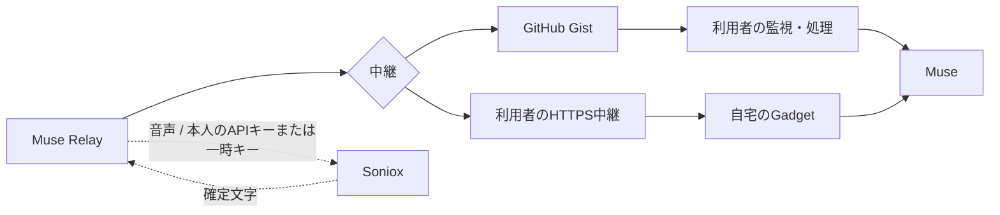

# Gist と Muse Gadget SDK

共通のEvenHubアプリを使用し、中継とMuse側の処理は利用者が用意します。SDKの全機能がMuse Relayの機能になるわけではありません。

| Muse Relayの操作 | Gist | Gadget / 参考ATOM S3 |
|---|---|---|
| テキスト送受信 | 利用者のwatcher/handler | ペアリング済みSDK接続 |
| 中継先で文字起こし | 送信された音声ファイルを利用者のハンドラーが処理 | 送信された音声ファイルをGadgetがSDK経由でMuseに渡す |
| Soniox（アプリから直接） | 音声はSonioxへ、確定文字だけをGistへ。個人APIキーまたは一時キーで接続 | 同じ経路で確定文字をHTTPS中継へ。中継から一時キーを取得する場合も音声はSonioxへ直接送信 |
| G2の話者選択 | 対応 | 対応 |
| Museからの画像・アバター | 対応。バイト列を書き出す | 対応。HTTPSのMuse用出力APIへ書き出す |
| アプリからMuseへ画像 | Gist添付を扱うハンドラーが必要 | 中継の `capabilities.images:true` 時のみ。参考機器の入力経路は未検証のため無効 |
| スペースのボタン・スライダー・選択・マイク | 宣言データの書き出しと操作処理で対応 | 同じ形式で対応 |
| スペース内画像 | 独自エクスポーターで対応。参考watcherの `spaces` 出力は文字・操作のみ | HTTPS出力APIで対応 |
| 機器オンライン表示 | 対象なし | 中継が受けた機器heartbeatの鮮度 |
| 外出先から使用 | GitHubへ接続 | 電源・Wi-Fiを維持した自宅機器と、外部到達可能なHTTPS中継 |
| 録音上限（現実装） | 120秒 | 30秒 |
| 送信後の受信 | 2秒後に1回、その後通常間隔 | 対応する返答を待つ間1秒、期限付き |

[公式SDK](https://github.com/facebookincubator/muse-gadget-sdk)は機器の画面・ボタン・センサー・アクチュエーター等との連携を提供します。Gist自体はデータを置く仕組みで、機器連携には別の実装が必要です。このプロジェクトの[ATOM S3ファームウェア](../firmware/guide.md)は中継専用で、SDKの機器画面や音声出力をG2へ転送するものではありません。G2のスペースは両方式ともMuseが作成したデータの書き出しで実現します。

アプリ内の中継選択には共通機能のアイコンと比較ヒント、Gadgetのチャットには画像受信のみの状態、音声設定には選択中の認証方式を表示します。接続確認とMuseからの応答確認を区別します。比較は参考実装の範囲であり、利用者が拡張した中継の動作保証ではありません。

Soniox接続方法は[公式WebSocket認証仕様](https://docs.soniox.com/authentication/websocket-authentication)に従います。APIキー入力方式は本人が設定したキーだけを使用し、共有アプリには含めません。保存場所・送信先はアプリ内ヒントと[データの流れ](data.md)を参照してください。
