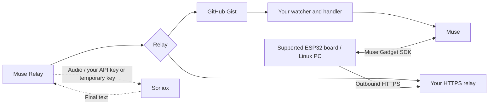

# Gist and Muse Gadget SDK

[English](relay-comparison.md) · [日本語](relay-comparison.ja.md)

Both use the same EvenHub app. Users supply the relay and Muse-side processing. The full Gadget SDK feature set is not automatically available through Muse Relay.

| Muse Relay operation | Gist | Gadget / reference ATOM S3 |
|---|---|---|
| Send and receive text | Your watcher/handler | Paired SDK connection |
| Optional phone location | The handler passes request.location to Muse in the same turn | The 0.3.30 reference relay includes the fix in the Muse message |
| Relay-side transcription | Your handler processes the submitted WAV | Gadget forwards WAV via the SDK. A live-caption relay transcribes during recording and sends final text |
| Soniox directly from the app | Audio goes to Soniox; only final text goes to Gist. Use your API key or a temporary key | The same path sends final text to the HTTPS relay. Even when the relay issues a temporary key, audio goes directly to Soniox |
| G2 speaker selection | Supported | Supported |
| Images and avatar from Muse | Export image bytes | Export through the HTTPS Muse-writer API |
| Images from the app to Muse | A handler that processes Gist attachments is required | Only when `capabilities.images:true`. The reference device input path is unverified and disabled |
| Space buttons, sliders, choices, and microphone | Export declarations and handle explicit actions | Same format |
| Images within Spaces | Custom exporter; reference watcher's `spaces` output contains text and controls only | HTTPS output API |
| Device online indication | Not applicable | Freshness of device heartbeats received by the relay |
| Mobile data (optional) | Connect to GitHub | Keep the device online so that both it and the phone can reach your HTTPS relay |
| Current recording limit | 120 seconds | 120 seconds |
| Polling after a send | Once after 2 seconds, then the normal interval | Every second while waiting for the matching reply, for a limited period |

Use firmware for your ESP32 model or a separate SDK adapter for Linux. The [official SDK](https://github.com/facebookincubator/muse-gadget-sdk) integrates device displays, buttons, sensors, and actuators. With Gist, hardware integration requires additional implementation. This project's [ATOM S3 firmware](../firmware/guide.md) relays requests and replies. SDK display and audio commands target the Gadget device. Both methods display Spaces through structured data exported by Muse.

The relay selector shows shared-feature icons and comparison hints. Gadget chat indicates when only image reception is available; voice settings show the selected authentication method. A successful connection check is distinct from receiving a Muse reply. This comparison covers the reference implementations, not every custom relay.

Soniox connections follow the [official WebSocket authentication contract](https://docs.soniox.com/authentication/websocket-authentication). Direct API-key mode uses the owner's key, never a key bundled in the shared app. See the in-app hints and [data flow](data.md) for storage and destinations.
