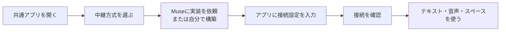
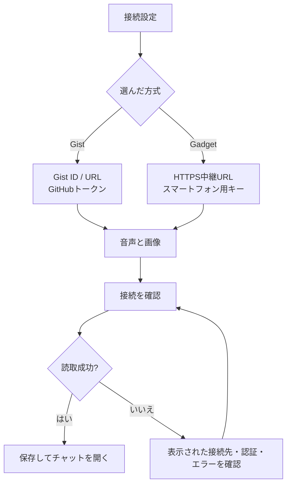
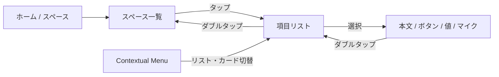

# 中継を設定する

[English](relay-setup.md) · [日本語](relay-setup.ja.md)

[画面で進める設定ガイドを開く](https://muse-relay-guide.spicy-cup-4319.chatgpt.site/ja/)

方式を選ぶ → Museに構築を頼む → 接続先を入力して保存します。

| 方式 | 操作 | 成功の目印 |
|---|---|---|
| Gist | 設定 → 接続 → Gist → 接続を確認 → 保存 | 上部に「Gist」 |
| Gadget | 設定 → 接続 → Muse Gadget SDK → 接続を確認 → 保存 | 上部に「Muse Gadget」 |
| 両方式 | チャット → 短文を入力 → 送信 | その発言へのMuse返信 |
| 両方式 | チャット → 音声 → 話す → 停止して送信 | 話した内容へのMuse返信 |
| 両方式 | Sonioxを選んだ場合：録音して送信 | 確定した入力とMuse返信 |
| 両方式 | 任意：スペース・受信画像・G2ホームを開く | 依頼した内容やアバター |
| 両方式 | 返信 → グラスに表示 | G2実機に返信を表示 |
| 両方式 | 外出先でモバイル通信 → 再度送信 | 新しい発言に対応する返信 |

音声は**設定 → 音声と画像**で保存した方法・マイクを使います。中継先の文字起こしは返ってきた場合に表示します。**接続済み／機器オンライン**だけではMuseの返信まで確認できません。

<details>
<summary>中継の準備と設定の選択</summary>

配布されるMuse Relayは全員同じアプリです。利用者ごとの中継を自分で用意するか、下の依頼文をMuseへ渡して作成します。接続先と資格情報はアプリ内で設定します。



## 1. 方式を選ぶ

| 方式 | 用意するもの | アプリへ入力するもの |
|---|---|---|
| GitHub Gist | 自分のGist、トークン、Muse側の受信処理 | Gist IDまたはURL、GitHubトークン |
| Muse Gadget SDK | 自分のHTTPS中継、SDK対応機器、SDKトークン、Museとのペアリング | 中継URL、スマートフォン用接続キー |

Gadget方式の画面では、参考機器として「ATOM S3」を表示します。中継は [アプリとの契約](protocol.ja.md) に合わせ、利用者のSDK対応機器・配置先で実装できます。同梱のサーバーやwatcherを使うこと、利用者ごとにEHPKを作り直すことは必須ではありません。

| 担当 | 引き渡すもの・操作 |
|---|---|
| 利用者・アプリ | 中継と機能を選び、資格情報を入力・保存して、下記の確認用メッセージを送る |
| Muse / 実装担当 | 稼働する受信処理またはSDK連携、対応する返信、依頼されたスペース・画像の書き出し。依頼文をコピーしただけでは中継は起動しない |
| 中継の所有者・運用担当 | 受信処理や自宅機器を稼働させ、資格情報・保持・清掃を管理する |

既存のG2Muse Gistを使う場合は共有履歴を残し、既存の書き込み処理にMuse Relayの依頼ファイルへの対応を追加します。共有ファイルの再初期化や書き込み処理の二重起動はしません。アバターは両方式とも任意です。画像を使いたい経路だけに書き出せばよく、もう一方へ複製する必要はありません。

## 2. Museへ依頼する

アプリで中継方式・音声・マイク・画像を選んでから「Museに渡す設定手順」をコピーします。生成文はその時点の選択を反映します。変更後はコピーし直してください。`docs/protocol.md` もMuseへ渡します。個人のURL・トークンは生成文に含みません。

| 選択した設定 | Museに渡る処理条件 |
|---|---|
| Gist / Muse Gadget SDK | 選んだ方式の入口・出口だけを使用 |
| Museで文字起こし | WAVをMuseへ送り、取得できた文字起こしを元の発言へ返す。Museの返信だけでは文字起こしの返却まで確認できない。[書き出しの条件](protocol.ja.md#文字起こしと返信の対応) |
| Soniox | 音声はSonioxへ、確定テキストだけMuseへ。Whisper処理を重ねない |
| G2 / スマートフォンのマイク | 選んだ音源で録音を確認 |
| 画像オフ / オン | テキストのみ / 依頼された画像出力を使用。アバターは別途依頼した場合のみ。どちらもスペース本文だけで内容が分かること |

アプリからコピーできない場合は、下の依頼文の「現在の設定」を選択値へ置き換えます。

</details>

<details>
<summary>Museに渡す：Gistの実装依頼文</summary>

### Gist用の依頼文

```text
Muse RelayのGist中継を、私の環境に作成してください。
配布済みのEvenHubアプリは変更せず、添付のdocs/protocol.mdのGist入出力を実装してください。
同梱のadapters/gistは任意の参考実装です。自分で同じ入出力を実装しても構いません。
現在の設定: 音声=<MuseまたはSoniox>、マイク=<G2またはスマートフォン>、録音対象=<すべて/自分/他の人>、画像=<オフまたはオン>、Soniox認証=<APIキー入力/一時キー発行サーバー>。
G2の話者選択はアプリ側で対象外と不明の音声を無音化します。スマートフォンのマイクは全音声です。除外された発言を推測して復元しないでください。
この選択に合わせて実装・確認し、選んでいない音声処理や画像の有効化は求めないでください。

準備:
- 私のGitHub Gistを再利用し、新規作成時のみg2muse-relay.jsonの初期値を{"messages":[]}にしてください。
- G2Museが既に書き込んでいる場合は履歴を残し、その既存処理にMuse Relayの依頼への対応を追加してください。別の書き込み処理の二重起動や共有履歴の上書きはしないでください。
- トークンは利用可能な安全な資格情報入力・保存機能で受け取り、チャット本文・コード・Gistには含めないでください。
- 私がアプリに入力するGist IDと、トークンの入力方法を案内してください。

入口:
- muse-relay-request-<id>.jsonを新規依頼として読み取ります。
- 形式は{protocol:"muse-relay/1",id,kind:"chat"|"space",text,created_at,space_id?,space_action?}です。
- 音声はaudio_file/audio_mime/audio_name、画像はimage_file/image_mime/image_nameを参照します。
- 参照先ファイルの内容はbase64です。音声の標準形式は16kHz・16bit・monoのWAVです。
- AIを定期起動せず、軽い監視処理で新規依頼があるときだけMuseの処理を起動してください。

処理:
- 同じidを重複処理しないよう、実行前のclaimと処理結果を永続化してください。
- 途中で停止して結果が不明な依頼を無条件に再実行しないでください。
- 音声設定がMuseなら、WAVをMuse側のWhisper互換モデル等で文字起こしし、元の依頼IDと同じidのYou発言を更新してください。Muse回答のreply_toもその依頼IDにします。参考watcherではハンドラーのtranscriptへ返します。
- 音声設定がSonioxなら、確定テキストをそのまま使い、再度文字起こししないでください。APIキー入力方式なら追加サーバーは不要です。本人がアプリへ入力するため、Museがキーを受け取ったりGistへ保存したりしないでください。一時キー方式を選んだ場合のみ指定された発行先を使用し、長期キーはそのサーバーに保存します。
- スペースを別途依頼した場合のみMuseで作成または調整し、layout:"list"を基本に、長い読み物は"cards"で書き出してください。
- 各項目にbutton・slider・choice・microphoneの組み込みcontrolを選ぶか、読取用ならcontrolを省略してください。項目IDを各処理に対応付け、タップ・上下スワイプ・ダブルタップで使えるようにしてください。HTMLや外部Webウィジェットは使いません。
- kind:"space"でspace_actionがなければ読取用更新だけです。space_action:{item_id,type,value?}があるときだけ、選んだ項目の処理を1回実行し、現在値と本文を更新して公開してください。sliderは数値、choiceは選択ID、buttonとmicrophoneはvalueなし。microphoneは選択済み音声方式での入力です。

出口:
- g2muse-relay.jsonへ{messages:[{id,from,type,text,ts,reply_to?}]}を書き出します。tsはUnix秒です。
- 画像オンの場合だけ、画像返信にimage_fileとmime_type、またはimage:{mime,name,data_base64}を使います。画像の説明文は任意です。オフならテキストだけを書き出してください。
- muse-relay-spaces.jsonへ{spaces:[{id,title,layout:"list"|"cards",updated_at,items:[{id,title,text,control?,ts?}]}]}を書き出します。
- 画像オンで、アバターを別途依頼した場合だけ、ホーム用にMuseで設定済みの自分のアバター画像を特定して読み込み、muse-relay-profile.jsonへ{profile:{name?,avatar:{mime,name?,data_base64},updated_at?}}を書き出してください。同じGist内のbase64ファイルを指すavatar_file+mime_typeでも構いません。PNG/JPEG/WebP、デコード後250000バイト以下です。見つからなければ未設定とし、別のアバターで代用しないでください。参考watcherはハンドラーのprofileを同形式で受け取り、別ファイルへ保存します。
- profileを省略した通常の返信は既存プロフィールを変更しません。解除する場合だけ{profile:{}}を書き出してください。
- スペースの更新は一覧全体の置換です。残すスペースも含め、IDは維持してください。
- 参考watcherのスペース出力はテキストと操作部品です。画像オンの独自エクスポーターならカードへimage添付、またはPNGのbase64ファイルを指すimage_fileを追加できます。画像だけに必要情報を置かないでください。
- g2muse-relay.jsonの更新者を1つにし、保持する他のメッセージを消さないでください。
- 保持方針と、処理済み依頼・音声・画像の清掃を決めてください。私が明示的に短縮を選ばない限り、既存の共有履歴を残してください。参考watcherの50件上限は自身のメッセージだけに適用し、既存の共有履歴を保持します。清掃も自分の処理が所有する記録に限定してください。ファイル一覧を全件取得できる件数に保ち、アプリの非表示・現在のファイル削除・Gistの過去履歴を区別してください。

完了時:
- アプリ用の接続設定を案内してください。秘密情報は安全な入力先へ渡してください。
- まず私が送信したテキスト1件と対応する返信を確認してください。録音・スペース・画像は私がその操作を依頼した場合だけ確認し、接続設定だけで新たなスペースやアバターを作らないでください。
- 受付・文字起こし・Museの返信・G2での表示を区別して、実際に確認した範囲を知らせてください。
```

</details>

<details>
<summary>Museに渡す：Gadget SDKの実装依頼文</summary>

### Muse Gadget SDK用の依頼文

```text
Muse RelayのMuse Gadget SDK中継を、私の環境に作成してください。
配布済みのEvenHubアプリは変更せず、添付のdocs/protocol.mdのアプリHTTP入出力を実装してください。
機器は私が指定するSDK対応機器を使います。自宅へ置いたまま、外出先のスマートフォンとG2から使える構成にしてください。
同梱のserver/とfirmware/は任意の参考実装です。私の機器やホスティングに合わせて構成できます。
現在の設定: 音声=<MuseまたはSoniox>、マイク=<G2またはスマートフォン>、録音対象=<すべて/自分/他の人>、画像=<オフまたはオン>、Soniox認証=<APIキー入力/一時キー発行サーバー>。
G2の話者選択はアプリ側で対象外と不明の音声を無音化します。スマートフォンのマイクは全音声です。除外された発言を推測して復元しないでください。
既存の接続があれば再利用し、この選択に合わせて実装・確認してください。

準備:
- 自分用のHTTPS接続先を用意し、機器側が外向きに接続する構成にしてください。
- スマートフォンの接続先を機器の家庭内LAN IPにはしないでください。
- 公式Muse Gadget SDKを使い、SDKトークンとMuseとのペアリングを設定してください。
- スマートフォン・機器・Museの更新用資格情報を分け、安全な入力・保存機能で管理してください。
- SDKトークンをアプリ用のHTTPキーとして使わないでください。

アプリの入口と出口:
- GET /v1/snapshot: {messages,spaces,profile?,device?,capabilities?}を返します。
- POST /v1/requests: {id,kind,text,created_at,space_id?,space_action?,audio?,image?}を受け取ります。
- GET /v1/files/:name: 必要な添付を{mime,name,data_base64}で返します。
- スマートフォンとの通信はAuthorization: Bearerによる認証と、アプリのOriginに合うCORSを設定してください。
- 添付・文字数・機器のメモリーに合う上限を守り、対応できない入力は明確に拒否してください。

Muse・機器側:
- 公式SDKで依頼をMuseへ渡し、依頼IDと返信IDを照合してください。
- 別のMuse会話をこのアプリへ流さないでください。
- サーバーの受付や機器への受渡しだけで、Museの返信完了と扱わないでください。
- 受渡し後に切断した依頼を無条件に再実行しないでください。
- スペースを別途依頼した場合のみMuseで作成または調整し、layout:"list"を基本に、長い読み物は"cards"で生成してください。未確認のSpaces APIは仮定しないでください。
- 各項目にbutton・slider・choice・microphoneのcontrolを選び、項目IDを処理に対応付けてください。キーボード・ポインター・外部ページ・長押しは不要にします。
- kind:"space"でspace_actionがなければ読取用更新だけです。space_action:{item_id,type,value?}があるときだけ宣言済みの操作を行い、結果の値・本文を更新して公開してください。sliderは数値、choiceは選択ID、buttonとmicrophoneはvalueなしです。
- 音声設定がMuseなら、WAVをMuse側で処理してください。参考サーバーはACKに一致するSDKのmessage.userにdisplay_text/text/contentがあると、元の依頼IDのYou発言を更新します。Muse回答のreply_toもその依頼IDにします。POST /v1/messagesはMuse返信専用です。SDKから文字起こしが届かなければ入力欄は「音声メッセージ」となります。アプリ側で確定文を得たい場合はSonioxを選択してください。
- 音声設定がSonioxなら、音声はアプリからSonioxへ直接送られ、Museには確定テキストだけ届きます。再度文字起こししないでください。APIキー方式なら利用者がアプリへ入力し、追加の発行サーバーは不要です。一時キー方式は中継の/v1/soniox-tokenまたは指定された発行先と専用認証を使います。キーを依頼文やGistへ入れないでください。

同梱サーバーを採用する場合のMuse出力:
- POST /v1/messagesをMuse用キーで呼び、{id:"muse_export_<unique-id>",type:"text"|"image",text?,ts?,reply_to?,image?}を送ります。textはテキスト投稿で必須、画像投稿では省略できます。
- 画像オンの場合だけ、ローカル写真や生成画像を読み込み、image:{mime,name,data_base64}にします。PNG/JPEG/WebP、デコード後250000バイト以下です。同じidで更新できます。URLやファイルパスだけを返さないでください。画像オフならテキストだけを書き出してください。
- G2への画像は「画像を読込→POST /v1/messages→EvenHubアプリ→G2」で送ります。SDKのdisplay.draw_file / display.draw_urlはSDK機器の画面向けであり、G2の描画には使いません。
- capabilities.imagesはアプリからMuseへの画像入力可否です。falseでもMuseからの画像出力はできます。
- 現在の書き出しは、Muse用キーでGET /v1/spacesを呼ぶと{spaces:[...]}で取得できます。
- 1件の追加・更新は、同じMuse用キーでPUT /v1/spaces/:idへ{id,title,layout:"list"|"cards",updated_at,items:[{id,title,text,control?,ts?}]}を送ります。本文のidをURLに合わせます。操作結果はこの方法で対象だけを更新してください。
- 画像オンで、アバターを別途依頼した場合だけ、ホーム用にMuseで設定済みの自分のアバター画像を特定して読み込み、Muse用キーでPUT /v1/profileへ{name?,avatar:{mime,name?,data_base64},updated_at?}を送ってください。PNG/JPEG/WebP、デコード後250000バイト以下です。未確認の取得APIやURLだけの指定は使わず、見つからなければ未設定とし、別のアバターで代用しないでください。
- profileのPUTは全体置換です。avatar_fileはサーバーの読取用なので書込には使いません。解除する場合は{}を送ってください。
- 画像オンならカードへimage添付も追加できます。参考Workerでは全スペースで合計8枚まで保存できます。必要な情報は本文にも含めてください。
- 一覧全体を入れ替えるときだけPUT /v1/spacesへ{spaces:[...]}を送ります。残すスペースも含めてください。
- /device/*は同梱ファームウェア向けの契約です。別の機器実装ならアプリ側の契約を保って内部を変更できます。

完了時:
- アプリに入力するHTTPS URLとスマートフォン用接続キーの設定方法を案内してください。
- まず私が送信したテキスト1件と対応する返信を確認してください。録音・スペースは私が依頼した場合だけ確認し、接続設定だけで作成しないでください。未選択の音声サービスは追加しないでください。
- 画像は有効かつ私が依頼した場合のみ確認してください。
- 外出先からの通信と実機表示は、実際に確認できた場合だけ成功と報告してください。
```

</details>

<details>
<summary>接続・音声の設定手順</summary>

## 3. アプリへ接続設定を入力する



| 音声設定 | 追加設定 | 音声の送信先 |
|---|---|---|
| 中継先で文字起こし | Gistは利用者のハンドラー、GadgetはSDK経由でMuseが処理 | 送信時に音声ファイルを中継へ。録音中の字幕は表示しない |
| Soniox・APIキーを入力（両方式） | アプリの音声設定に本人のSoniox APIキーを入力 | Sonioxへ直接送信。途中の文字をG2へ表示し、確定テキストをMuseへ |
| Soniox・一時キー発行サーバー（両方式） | 発行URLと認証。Gadgetでは既存の中継設定を再利用可能 | 音声の経路は同じ。長期キーは発行サーバーに保存 |

「Sonioxへの接続を確認」は1秒の無音データを使い、認証を含むセッションの完了を確認します。マイクやMuseは使いません。単にキー入力済み／サーバー設定済みでは確認済みと表示しません。既存の一時キー方式は更新後も維持されます。

画像は必要な場合だけオンにします。APIキー方式ではEvenの設定と端末バックアップにキーを保存します。端末へ保存しない場合は一時キー方式を選びます。接続設定JSONを読み込む場合も、スマートフォン用の設定だけを使用します。

</details>

<details>
<summary>詳しい確認・困ったとき</summary>

## 4. 最初の確認

保存した中継と、選んだ機能だけを試します。音声は先に**設定 → 音声と画像**で処理方法とマイクを保存し、見分けやすい短い言葉で確認します。

| 確認する経路 | アプリでの操作 | 確認する結果 |
|---|---|---|
| 使用中の中継・Gist／Gadget | **設定 → 接続**で方式と接続先 → **接続を確認 → 設定を保存**（初回は**保存して開く**） | 上部の**Gist／Muse Gadget**が保存した選択と一致。未保存の選択で確認しただけでは切り替わらない |
| テキスト・Gist／Gadget | **チャット → 送信**で新しい短文 → 返信の**グラスに表示** | 対応したMuseの返信がスマートフォンとG2に表示される |
| 中継先で文字起こし・Gist | **チャット → 音声** → 話す → **停止して送信** | 話した言葉が自分の入力に反映され、対応するMuse返信が届く |
| 中継先で文字起こし・Gadget | **チャット → 音声** → 話す → **停止して送信** | 録音に対応するMuse返信。文字起こしの有無は下の補足で別に確認する |
| Soniox・Gist／Gadget、選択時 | **音声と画像**でSoniox接続を確認・保存 → **チャット → 音声 → 停止して送信** | 字幕・確定した入力とMuse返信。無音の接続確認とは別 |
| スペース・Gist／Gadget、依頼時 | **スペース → 追加 → 受信済みから追加** → 更新・追加 → 項目を開く | 書き出された内容。操作部品があれば、受付後に結果の本文や値が更新される |
| 画像・Gist／Gadget、画像オン時 | Museへ画像を依頼 → 受信した返信 → **グラスに表示** | G2上の画像。Gadgetへの画像入力の確認とは別 |
| アバター・どちらの経路も任意 | **設定 → G2 表示 → Museにアバターを依頼** → コピーして送信 → **チャット → 更新** → G2ホーム | 画像オンなら既存のアバターが表示される。他方の経路への書き出しは不要 |
| モバイル回線・Gist／Gadget | 使用する機器・受信処理を稼働させたまま、外出先でスマートフォンのWi-Fiをオフ・モバイル通信をオン → **チャット → 送信**または**音声 → 停止して送信** | 新しい発言に対応する返信が、モバイル回線でスマートフォンとG2に届く |

**接続済み／機器オンライン**だけではMuseとの往復は確認できません。読取失敗は中継の運用担当へ、読取成功後に返信が来なければMuse／受信処理の実装担当へ確認します。スマートフォンにだけ届く場合は、EvenとG2の接続と**グラスに表示**を確認します。

<details>
<summary>返信は来たが、文字起こしがない場合</summary>

音声の表示のままなら、表示できる文字起こしがありません。音声の未達とは限りません。Gistでは受信処理の文字起こし出力、Gadgetでは対応するSDKユーザーイベントの文字が必要です。Museの回答内の文字起こしでは入力欄は更新されません。実装担当へ[文字起こしの契約](protocol.ja.md#文字起こしと返信の対応)を渡してください。Sonioxではアプリが確定した文字を入力にします。

</details>

<details>
<summary>履歴とGistの整理</summary>

| 操作 | 対象 |
|---|---|
| チャット → 非表示／履歴を整理 | 端末の表示だけ。中継やMuseの原本は消さない |
| 中継側の清掃 | 所有者／Museが処理済みの入力・未参照の出力を合意した方針で整理。既存の共有履歴は残す |
| Gist一覧を全件取得できない | 新しい送信を止め、運用担当へ処理済みファイルの照合を依頼。一覧にない要求を完了扱いにしない |
| Gistの現在のファイルを削除 | 過去の変更履歴・fork・他のコピーの削除とは別 |

[参考実装の清掃条件](protocol.ja.md#gistの清掃と保持) · [保存と削除](data.ja.md)。独自中継では保持方針も各自で決めます。

</details>

### スペースの操作条件

スマートフォンでグラスに表示するスペースを選びます。以後の閲覧と切替はグラスから操作できます。



部品定義・送信データ・確認付きボタン・スライダー範囲などは [スペースの仕様](spaces.ja.md) と [JSON例](../examples/spaces.json) をMuseに渡してください。マイクはその行をタップしたときだけ開始します。スライダーはタップで値を送るまで変更を確定せず、ダブルタップで中止できます。アプリ内の「スペース操作を試す」で送信せず練習できます。

</details>

<details>
<summary>参考実装の手順</summary>

## 参考実装を使う場合

| 対象 | 手順 |
|---|---|
| Gist監視処理 | [watcherの設定](../adapters/gist/README.ja.md) |
| HTTPS中継 | [ローカル設定UIと配備例](server.ja.md) |
| ATOM S3 | [ファームウェアとUSB設定](atoms3.ja.md) |
| 独自実装 | [アプリとの入出力仕様](protocol.ja.md) |

G2Museの既存メッセージは読み取れますが、旧watcherはMuse Relayの依頼ファイルに対応させる必要があります。参考ATOM構成でのMuseへの画像入力は初期無効です。画像返信と画像付きスペースの表示は別経路です。Gistの履歴保持、Muse / Soniox側のデータ管理は各サービスと利用者の設定に従います。

</details>
