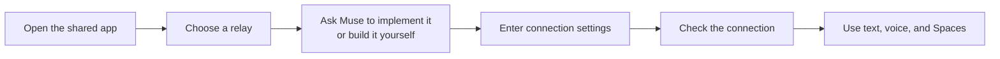
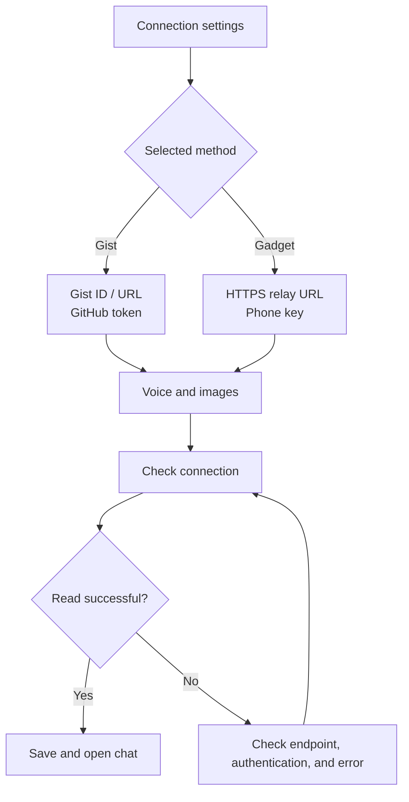
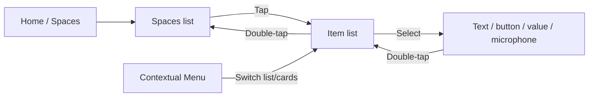

# Set up a relay

[English](relay-setup.md) · [日本語](relay-setup.ja.md)

Everyone receives the same Muse Relay app. Build your own relay, or give Muse the instructions below. Configure the endpoint and credentials in the app.



## 1. Choose a method

| Method | What you provide | What you enter in the app |
|---|---|---|
| GitHub Gist | Your Gist, token, and Muse-side handler | Gist ID or URL, GitHub token |
| Muse Gadget SDK | Your HTTPS relay, SDK-compatible device, SDK token, and Muse pairing | Relay URL, phone connection key |

The Gadget UI names ATOM S3 as the reference device. Implement the relay for your own SDK-compatible device and hosting while preserving the [app contract](protocol.md). You do not have to use the bundled server/watcher or rebuild an EHPK for each user.

## 2. Ask Muse to implement it

Choose the relay, voice mode, microphone, and image setting in the app, then copy the setup instructions for Muse. The generated text reflects those choices; copy it again after changing them. Also provide `docs/protocol.md`. Generated instructions do not contain your private URLs or tokens.

| Selection | Instructions for Muse |
|---|---|
| Gist / Muse Gadget SDK | Use only the selected method's input/output |
| Muse transcription | Send WAV to Muse. Gist uses `transcript`; Gadget may include a labeled transcript in the Muse reply when needed |
| Soniox | Audio goes to Soniox; only final text goes to Muse. Do not transcribe again with Whisper |
| G2 / phone microphone | Verify recording from the selected source |
| Images off / on | Text only / requested image output. Export an avatar only when separately requested. Space text must remain understandable without images |

If you cannot copy from the app, replace the current-settings placeholders below with your selected values.

### Instructions for Gist

```text
Implement a Gist relay for Muse Relay in my environment.
Keep the distributed EvenHub app unchanged and implement the Gist input/output in the attached docs/protocol.md.
The bundled adapters/gist is an optional reference. You may implement the same contract yourself.
Current settings: voice=<Muse or Soniox>, microphone=<G2 or phone>, recorded speakers=<all/me/others>, images=<off or on>, Soniox authentication=<API key input/temporary-key server>.
G2 speaker selection silences excluded and unknown audio in the app. The phone microphone records all audio. Do not infer or reconstruct excluded speech.
Implement and verify these choices. Do not require unselected voice services or enable images unnecessarily.

Preparation:
- Reuse my GitHub Gist. Only when creating a new Gist, initialize g2muse-relay.json to {"messages":[]}.
- Receive and store tokens through an available secure credential mechanism; never put them in chat text, source code, or the Gist.
- Tell me which Gist ID and credential-entry method to use in the app.

Input:
- Read new requests from muse-relay-request-<id>.json.
- Format: {protocol:"muse-relay/1",id,kind:"chat"|"space",text,created_at,space_id?,space_action?}.
- Resolve audio_file/audio_mime/audio_name and image_file/image_mime/image_name.
- Referenced files contain base64. Standard audio is 16 kHz, 16-bit mono WAV.
- Use a lightweight watcher. Invoke Muse only for new requests, rather than periodically launching an AI process.

Processing:
- Persist a claim before execution and save the result to avoid processing an ID twice.
- Do not blindly replay a request whose outcome became unknown after interruption.
- In Muse voice mode, transcribe WAV with a Muse-side Whisper-compatible model or equivalent. Update the You message using the original request ID; the Muse reply's reply_to must use that ID too. The reference watcher takes the handler's transcript field.
- In Soniox mode, use final text directly. Direct API-key mode needs no additional server; I enter the key in the app, so Muse must not receive it or store it in Gist. Only use the selected issuer when temporary-key mode is chosen; its long-lived key stays on that server.
- Create or adjust Spaces only if separately requested. Prefer layout:"list"; use "cards" for long reading.
- Choose built-in button, slider, choice, or microphone controls per item, or omit control for read-only content. Map item IDs to handlers and support tap, up/down swipe, and double-tap. Do not use HTML or external web widgets.
- A kind:"space" request without space_action only refreshes readable content. Execute an item once only when space_action:{item_id,type,value?} is present, then publish its current value and content. Sliders send numbers, choices send option IDs, and buttons/microphone omit value. Microphone input uses the selected voice mode.

Output:
- Write {messages:[{id,from,type,text,ts,reply_to?}]} to g2muse-relay.json. ts is Unix seconds.
- Only when images are on, use image_file plus mime_type, or image:{mime,name,data_base64}, for image replies. Captions are optional. Otherwise export text only.
- Write {spaces:[{id,title,layout:"list"|"cards",updated_at,items:[{id,title,text,control?,ts?}]}]} to muse-relay-spaces.json.
- Only with images on and a separate avatar request, locate and read Muse's existing configured avatar. Export {profile:{name?,avatar:{mime,name?,data_base64},updated_at?}} to muse-relay-profile.json, or use avatar_file plus mime_type for a base64 file in the same Gist. Use PNG/JPEG/WebP, at most 250000 decoded bytes. If unavailable, leave it unset; do not substitute another avatar. The reference watcher accepts handler.profile in this format and stores a separate image file.
- Omitting profile in an ordinary reply preserves the existing profile. Write {profile:{}} only to clear it.
- Space updates replace the entire list. Include Spaces to retain and preserve their IDs.
- The reference watcher's Space output contains text and controls. A custom exporter with images enabled may add an image attachment or image_file pointing to a PNG base64 file. Do not put essential information only in images.
- Keep one writer for g2muse-relay.json and retain unrelated messages that should remain.
- Set retention and cleanup for processed requests, audio, and images. Explain that Gist history may retain deleted content.

Completion:
- Provide app connection instructions; deliver secrets only through a secure destination.
- First verify one text message I sent and its matching reply. Verify recording, Spaces, or images only when I request those actions. Connection setup alone must not create a Space or avatar.
- Distinguish acceptance, transcription, Muse completion, and G2 display, and report only what was actually verified.
```

### Instructions for Muse Gadget SDK

```text
Implement a Muse Gadget SDK relay for Muse Relay in my environment.
Keep the distributed EvenHub app unchanged and implement the app HTTP contract in the attached docs/protocol.md.
Use the SDK-compatible device I specify. Keep it at home while my phone and G2 can be used away from home.
The bundled server/ and firmware/ are optional references; adapt the implementation to my device and hosting.
Current settings: voice=<Muse or Soniox>, microphone=<G2 or phone>, recorded speakers=<all/me/others>, images=<off or on>, Soniox authentication=<API key input/temporary-key server>.
G2 speaker selection silences excluded and unknown audio in the app. The phone microphone records all audio. Do not infer or reconstruct excluded speech.
Reuse existing connections where available, and implement/verify the selected settings.

Preparation:
- Provide my own HTTPS endpoint; the device must connect outbound.
- Do not use the device's home LAN IP as the phone's relay endpoint.
- Use the official Muse Gadget SDK, SDK token, and Muse pairing.
- Separate phone, device, and Muse-writer credentials, using secure input and storage.
- Do not use the SDK token as the app's HTTP key.

App input/output:
- GET /v1/snapshot returns {messages,spaces,profile?,device?,capabilities?}.
- POST /v1/requests accepts {id,kind,text,created_at,space_id?,space_action?,audio?,image?}.
- GET /v1/files/:name returns required attachments as {mime,name,data_base64}.
- Use Authorization: Bearer and CORS matching the app's Origin.
- Enforce attachment, text, and device-memory limits. Explicitly reject unsupported input.

Muse and device side:
- Pass requests to Muse through the official SDK and correlate request/reply IDs.
- Do not expose unrelated Muse conversations in this app.
- Server acceptance or device delivery is not a completed Muse response.
- Do not blindly resend a request after disconnecting following delivery.
- Create or adjust Spaces only if separately requested. Prefer layout:"list", or "cards" for long reading. Do not assume an unverified Spaces API.
- Map button, slider, choice, and microphone controls to item handlers. Do not require a keyboard, pointer, external page, or long press.
- kind:"space" without space_action only refreshes readable data. Only act on declared space_action:{item_id,type,value?}, then republish the resulting values/content. Sliders use numbers, choices use option IDs; buttons/microphone omit value.
- In Muse voice mode, process WAV in Muse. The reference relay updates the original You message when an ACK-matching SDK message.user contains display_text/text/content. Set the Muse reply's reply_to to the original request ID. POST /v1/messages is for Muse replies only. If the SDK provides no transcript, the input remains labeled as a voice message. Use Soniox if final text must be obtained in the app.
- In Soniox mode, audio goes directly from the app to Soniox and Muse receives final text only. Do not transcribe again. With API-key mode, I enter the key in the app and no additional issuer is required. Temporary-key mode uses /v1/soniox-token or the selected custom issuer and its own authentication. Never put keys in instructions or Gist.

Muse output when using the bundled server:
- POST /v1/messages with the Muse key and {id:"muse_export_<unique-id>",type:"text"|"image",text?,ts?,reply_to?,image?}. Text posts require text; image posts may omit it.
- Only with images on, read a local photo or generated image into image:{mime,name,data_base64}. PNG/JPEG/WebP, at most 250000 decoded bytes. Reuse the same id for updates. Do not return only a URL or file path. With images off, export text only.
- G2 images follow: read image → POST /v1/messages → EvenHub app → G2. SDK display.draw_file/display.draw_url target the SDK device display, not G2.
- capabilities.images describes image input from the app to Muse. Muse image output works even when it is false.
- Read current exports using the Muse key with GET /v1/spaces, returning {spaces:[...]}.
- Add/update one Space with the same key: PUT /v1/spaces/:id with {id,title,layout:"list"|"cards",updated_at,items:[{id,title,text,control?,ts?}]}. Match the body id to the URL. Use this route for action results so other Spaces remain intact.
- Only with images on and a separate avatar request, locate and read Muse's existing configured avatar, then PUT /v1/profile with the Muse key and {name?,avatar:{mime,name?,data_base64},updated_at?}. Use PNG/JPEG/WebP up to 250000 decoded bytes. Do not assume an unverified API or send only a URL. If unavailable, leave it unset rather than substitute another avatar.
- Profile PUT replaces the whole profile. avatar_file is a server-generated read reference, not writer input. Send {} to clear it.
- With images on, cards may include image attachments. The reference Worker retains at most 8 images across all Spaces. Keep essential information in text too.
- Use PUT /v1/spaces with {spaces:[...]} only to replace the complete list, including all Spaces to retain.
- /device/* is the bundled firmware contract. Another device implementation may change internals while preserving the app contract.

Completion:
- Provide the HTTPS URL and instructions for setting the phone connection key.
- First verify one text message I sent and its matching reply. Verify recording/Spaces only if requested; do not create them as a side effect of connection setup. Do not add unselected voice services.
- Verify images only when enabled and requested.
- Claim away-from-home access and physical G2 display only if actually verified.
```

## 3. Enter app connection settings



| Voice setting | Additional setup | Audio destination |
|---|---|---|
| Transcribe at the relay | Gist: your handler. Gadget: Muse via SDK | Upload the audio file when sending; no captions during recording |
| Soniox: enter API key, either relay | Enter your own key in app voice settings. New Gist setups use this mode | Audio directly to Soniox; interim text on G2, final text to Muse |
| Soniox: temporary-key server, either relay | Issuer URL and authentication. Gadget may reuse its relay settings | Same audio path; the long-lived key stays on the issuer |

The Soniox connection check completes an authenticated session using one second of silence. It uses neither the microphone nor Muse. Entering a key or configuring a server alone does not count as verification. Existing temporary-key configurations remain unchanged after an update.

Enable images only when needed. Direct API-key mode stores the key in Even settings and the device backup; use temporary-key mode if you do not want it stored on the device. Import only phone connection settings, not a device/server configuration JSON.

## 4. First checks

| Action | What to verify |
|---|---|
| Check connection | The relay is readable |
| Send a short text | Your message and Muse's reply |
| Record once using the selected microphone | Muse voice processing/reply, or Soniox interim/final text. Gadget may include a labeled transcript in the Muse reply |
| Open Spaces | Muse's exported list/cards |
| Select an item | Text, a button, value adjustment, choices, or recording |
| Submit an action | Sending → relay acceptance → Muse's published result |
| With images enabled, ask Muse for an image and open it | Image displayed on G2 through the EvenHub app |

A connection check does not verify a Muse response or physical G2 rendering. If Spaces are empty, ask Muse to create/export the intended content.

### Space interaction requirements

Select Spaces for the glasses on your phone. You can then browse and switch from G2.



Give Muse the [Space contract](spaces.md) and [JSON example](../examples/spaces.json) for controls, payloads, confirmation buttons, and slider bounds. A microphone starts only when its row is tapped. A slider does not submit until you tap; double-tap cancels. Use the in-app Space practice to try the controls without sending.

## Reference implementations

| Component | Instructions |
|---|---|
| Gist watcher | [Watcher setup](../adapters/gist/README.md) |
| HTTPS relay | [Local configuration UI and deployment examples](server.md) |
| ATOM S3 | [Firmware and USB setup](atoms3.md) |
| Custom implementation | [App input/output contract](protocol.md) |

Existing G2Muse messages are readable, but its watcher needs adaptation for Muse Relay request files. Image input to Muse through the reference ATOM is disabled by default. Image replies and image cards use separate output paths. Gist history and Muse/Soniox data handling follow those services and the user's settings.
