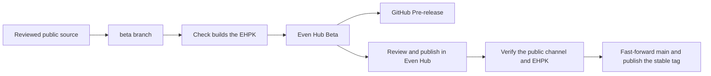

# Release workflow

English · [日本語](releases.ja.md)

| Change | GitHub destination | What users receive |
| --- | --- | --- |
| App code for testing | `beta` | Even Hub Beta and a GitHub **Pre-release** tagged `vX.Y.Z-beta.1` |
| Version available to everyone in the Even Hub store | `main` | A GitHub **Release** tagged `vX.Y.Z` with the store's EHPK |
| Guide, translations, contribution forms or release tooling | `main` | Updated material independently of the store version |

Muse Relay 0.4.1 is available from Even Hub. A stable GitHub tag identifies the commit that built that version. Later guide updates can advance `main`. [Even Hub catalogue](https://hub.evenrealities.com/catalogue/com.threemintimer.muserelay) · [GitHub Releases](https://github.com/3mintimer/muse-relay/releases)



### Owner-only Private pilot for 0.4.0 reply suggestions

1. Deploy the owner's relay at its existing URL with suggestions disabled. Exchange one ordinary chat from 0.3.36, then enable the VM suggestion writer.
2. Register the checked EHPK as Private with the changelog `preview build`. On the owner's G2, select **Ask every time** and reply twice from consecutive suggestion lists. Verify each chosen reply appears once in phone history. Review the on-glasses interaction before proceeding to Beta and publishing upgrade notes for Gist, Gadget and custom HTTPS.

If the pilot needs to be rolled back, remove `REPLY_SUGGESTIONS_WRITER_SHA256` and redeploy the same relay version. Ordinary chat continues on the existing URL and history.

### Prepare a candidate

`npm run pack` checks every contextual action against its reviewed wording in each supported language, including the 32-byte SDK limit and the compact menu width. Review each changed label in its screen context before updating `tests/context-menu.test.ts`. Packing rebuilds the app from the checked source.

1. Accept app changes on `beta`. Merge current documentation and other contributions from `main` before cutting a candidate. For private development checkouts, use the [allowlisted export](public-source.md). Apply its reviewed differences in an up-to-date clone of the public repository, preserving changes made by contributors.
2. Choose an unused numeric Even Hub version. Update `app.json`, `package.json` and the root package-lock metadata. Add user-facing notes to `changelog/X.Y.Z.md`, in English with optional Japanese. Push the candidate on `beta`.
3. Open the **Check** run for that commit. It builds the app, tests the app and guide, and keeps `muse-relay-ehpk-<commit>` as an Actions artifact. For the Hub upload, use the EHPK inside this artifact. The workflow needs no Even Hub credentials.
4. Upload the package and assign it to Beta using the authenticated Even Hub CLI. Wait for the Beta channel to point to the new build. Downloading the CI package takes a run ID and the full public commit SHA.

```sh
gh run download RUN_ID --repo 3mintimer/muse-relay --name muse-relay-ehpk-COMMIT_SHA --dir artifacts
npx --no-install evenhub upload artifacts/muse-relay-X.Y.Z.ehpk --package-id com.threemintimer.muserelay --changelog "preview build"
npx --no-install evenhub promote X.Y.Z --to beta --package-id com.threemintimer.muserelay
```

### Record the release

On a maintainer computer with Node.js, `npm ci`, a signed-in `gh`, and a signed-in Even Hub CLI, run:

```sh
node scripts/record-release.mjs --channel beta --commit COMMIT_SHA
node scripts/record-release.mjs --channel beta --commit COMMIT_SHA --publish
```

The first command checks the live channel, build ID, source commit and exact package bytes, then prints the plan. The second uploads that EHPK to a GitHub Pre-release. It leaves `main` at the previous app version. Without `--commit`, the command uses the current public `beta` tip. A missing or expired CI artifact can be rebuilt by rerunning **Check** for the same commit.

For a store release, confirm **Published** under **Public build** in the portal and the `public` channel in the CLI. After Beta withdrawal the CLI can show **Approved**. In that case the tool also checks the public catalogue for the same package, public branch, version, size and creation time.

Run the check and publish commands with `--channel public` and the commit that produced the store build. Update `changelog/X.Y.Z.md` in the maintainer checkout with the store installation instructions. Beta notes come from the candidate commit. The tool uploads the actual Even Hub download. For 0.4.1, the CI and store files have identical 198,226-byte payloads. The store file adds the package ID to the header and has a different 64-byte trailer. The [reviewed hashes](../changelog/0.4.1.store.json) bind both complete files to build 158450 and its source commit. An unreviewed difference stops publication.

The tool fast-forwards `main` and publishes the stable GitHub Release. If `main` already contains the release commit plus documentation changes, its CI package must still match the candidate. For a divergent `main`, merge its changes into `beta`, run Check and verify the merge. Conflicting tags or assets stop publication. Retrying the same completed release rechecks it.

Removing an old Hub build is a separate, manual operation. Confirm the new channel first and check the exact versions and build IDs. Preserve builds under review and builds still assigned to a channel. The release workflow never deletes builds.
