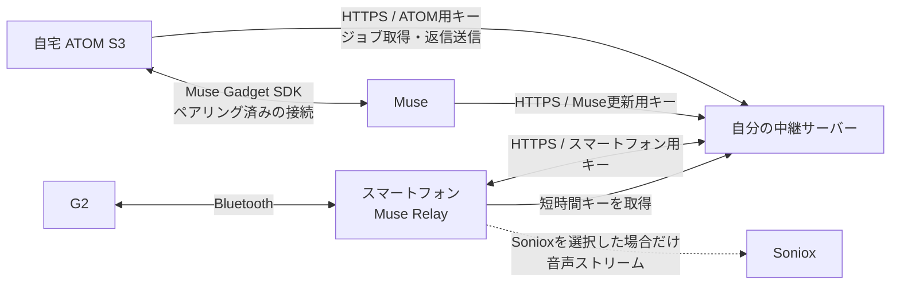
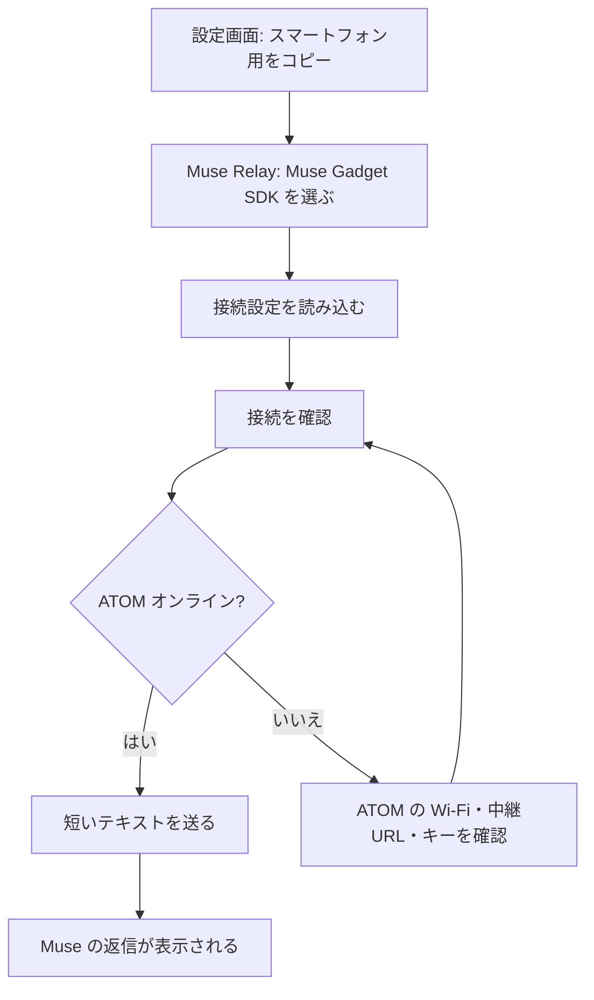

# HTTPS中継の参考実装

この文書は、同梱の `server/` を使う場合の任意の手順です。配布するEvenHubアプリは全利用者共通で、中継は各利用者が構築するかMuseに実装を依頼します。利用者ごとのEHPK作成や、この参考サーバーの採用は必須ではありません。

[設定チュートリアル](relay-setup.md) → [アプリとの入出力契約](protocol.md) → 必要に応じてこの手順、の順で進めます。

| 配置先 | 参考実装 |
|---|---|
| Node.js を常時起動する自分のサーバー | この文書の Node + HTTPS 構成 |
| Cloudflare Worker / Sites | [Worker + D1 + R2](../server/cloudflare/README.md) |

どちらも同じアプリ側の入出力と役割別認証を使用します。

以下は、SDK対応機器の一例としてATOM S3を自宅に置き、スマートフォンとG2を外へ持ち出す構成です。URL・トークン・利用機器は各利用者が設定します。



自宅ルーターへのポート開放は不要です。ATOM は外向きに通信します。スマートフォンに自宅の LAN IP を設定しても外出先からは利用できません。

## 1. 参考実装の設定画面を開く

Node.js 22 以降で、プロジェクトのルートから実行します。

```sh
node server/setup.mjs
```

[ローカル設定画面](http://127.0.0.1:8788) を開きます。

| 画面 | 操作 | 結果 |
|---|---|---|
| ① 接続先 | 自分の公開 HTTPS URL を入力し、Evenアプリのローカル接続を許可 | 外出先からの接続先と可変ポートへの対応を設定 |
| ② 音声 | Sonioxの一時キー方式を使う場合だけ API キーを入力 | サーバーだけに保存 |
| ③ 保存 | 「設定を保存」 | 3つの接続キーを生成 |
| ④ 接続する | 対象ごとの「設定をコピー」 | スマートフォン・ATOM・Museへ設定 |

設定は `.local/relay-config.json` に所有者のみ読み書きできる権限で保存します。スマートフォン用のコピーには Muse / ATOM / Soniox の長期キーを含めません。生成キーをチャットや Git に貼り付けず、対応する設定画面へ入力します。

Even アプリ内の Muse Relay で「接続設定」→「サーバー側の接続設定」を開き、「このアプリの接続元（Origin）」を確認します。ブラウザーのプレビューとは異なる場合があります。

| アプリに表示された Origin | 設定画面の操作 |
|---|---|
| `http://127.0.0.1:54914` など、起動ごとにポートが変わる | 「Evenアプリのローカル接続を許可」をオン |
| `null` | 「追加の許可 Origin」へ `null` を入力 |
| 固定の HTTPS Origin | 「追加の許可 Origin」へ表示された値を入力 |

`http://127.0.0.1:*` は明示した場合だけ有効な予約値です。正規の `http://127.0.0.1` Origin とその有効なポートだけを許可し、`localhost`・別ホスト・HTTPS・パス付きの値は対象外です。一般の `*` は使えません。Node の設定例は `"allowedOrigins":["http://127.0.0.1:*"]`、環境変数では `ALLOWED_ORIGINS=http://127.0.0.1:*` です。中継の接続先自体は HTTPS を使います。

一致しない Origin は HTTP 403 `origin_not_allowed` です。許可された Origin でも各データAPIには役割別キーが必要です。

## 2. 起動する

ローカル確認:

```sh
node server/index.mjs
```

`127.0.0.1:8787` で待ち受けます。`/health` は認証なしの稼働確認だけを返します。メッセージとスペースには接続キーが必要です。

この参考構成を外出先で使うには、利用者が用意する常時稼働サーバーとHTTPSが必要です。設定画面はローカルの設定ファイルを作るもので、ホスティングの契約や配備は行いません。HTTPのNodeサーバーをインターネットへ直接公開しないでください。

### Docker + Caddy の例

1. 自分のサーバーにこのプロジェクトと `.local/relay-config.json` を配置します。
2. サーバー上の秘密設定ファイルをコンテナの Node ユーザーだけが読めるようにします: `sudo chown 1000:1000 .local/relay-config.json`、`sudo chmod 600 .local/relay-config.json`。
3. DNS をサーバーへ向け、ホスト側で 80 / 443 を許可します。
4. サーバー上で以下を実行します。

```sh
RELAY_HOST=relay.example.com docker compose -f server/compose.yaml up -d --build
```

Caddy が HTTPS を終端し、Node は内部ネットワークだけに公開されます。家庭内の ATOM へ向けたポート開放は行いません。このコマンドはこのリポジトリの実装確認では実行していません。

環境変数で渡す場合は [設定例](../server/.env.example) を参照してください。`.env` を自動読込しないため、Node の `--env-file` またはホスティングの環境変数設定を使います。

## 3. 接続する



「接続確認」はサーバーの読み取りです。Museへの依頼を送信しません。ATOM の接続表示は直近45秒以内の通信を示し、Museとのペアリング成功までは意味しません。

## スペース

Muse の Spaces を直接読む公開 Gadget API は確認できていません。利用者が Muse にスペースを作らせ、その内容を読取用カードとして中継へ出力する構成です。アプリはスペース名やカードを表示・選択します。

Muse に設定する内容:

| 項目 | 値 |
|---|---|
| 読み取り | `GET https://relay.example.com/v1/spaces` |
| 1件の追加・更新 | `PUT https://relay.example.com/v1/spaces/news` |
| 認証 | `Authorization: Bearer <Muse更新用キー>` |
| 内容 | 下記の1件分の JSON。URLと本文の `id` は一致させる |
| 操作範囲 | 設定済みスペースの読取用エクスポート |

```json
{
  "id": "news",
  "title": "ニュース",
  "updated_at": 1794880000,
  "items": [{
    "id": "today",
    "title": "今日",
    "text": "Muse がスペースから生成した表示用テキスト"
  }]
}
```

最大20スペース・各50カードです。1件の更新では他のスペースを保持します。一括で入れ替える場合は `PUT /v1/spaces` へ `{spaces:[...]}` を送ります。操作指定のないアプリの更新要求は、設定済みIDの再出力だけを Muse に依頼します。

カードはタップで開く・ページ送り、上下スワイプで項目切替、ダブルタップで一覧へ戻る操作だけで読める内容にします。画像設定がオフでも本文だけで内容が分かるようにし、外部リンクや音声入力を必須にしません。画像を使う場合はアプリでもオンにし、カードの `image:{mime,name,data_base64}` を加えます。参考Workerでは全スペースの画像を合計8枚まで保存できます。

Muse方式の音声で文字起こしも表示したい場合は、Muse返信内に文字起こしであることを明記します。`POST /v1/messages` の送信者はサーバーが `Muse` に固定するため、同APIで `You` の文字起こしを追加することはできません。Soniox方式ではアプリから確定テキストが送られ、Muse側の再文字起こしは不要です。

## 参考実装の通信仕様

アプリとの必須境界と参考実装の内部接続の違いは [公開プロトコル](protocol.md#アプリのhttp境界と参考実装の管理口) を参照してください。

| 呼び出し元 | 方法・パス | 用途 |
|---|---|---|
| スマートフォン | `GET /v1/snapshot` | メッセージ・スペース・ATOMの接続状態 |
| スマートフォン | `POST /v1/requests` | テキスト・WAV・スペース更新要求 |
| スマートフォン | `GET /v1/files/:name` | 添付データ |
| スマートフォン | `POST /v1/soniox-token` | Sonioxの一時キー発行 |
| Muse | `POST /v1/messages` | テキスト・画像返信の追加または同じIDの更新 |
| Muse | `GET /v1/spaces` | 現在書き出しているスペース一覧 |
| Muse | `PUT /v1/spaces/:id` | 1件の追加・更新 |
| Muse | `PUT /v1/spaces` | スペース一覧の一括置換 |
| Muse | `PUT /v1/profile` | Museの名前と設定済みアバターを置換 |
| ATOM | `GET /device/jobs` | 次の要求を1件リース |
| ATOM | `GET /device/jobs/:id/request` | SDKに送るJSON本文。Content-Length付き |
| ATOM | `POST /device/events` | ACK・返信データ・heartbeat・エラー |

Deviceイベントは `{job_id,session_id,event_id,type,...}`。`session_id` はジョブの専用Muse会話ID、`event_id` は再送時も同じIDを使います。ACKには同じ `result.session_id` と `is_thread:true` が必要です。専用会話と自分の発言境界の照合は [公開プロトコル](protocol.md#atom--中継) に従います。

| type | 追加フィールド |
|---|---|
| `muse_ack` | `body`: SDKのACK JSON文字列またはオブジェクト |
| `muse_event` | `body`: NDJSONの完全な行またはイベントオブジェクト |
| `muse_chunk` | `body_base64`: NDJSONの生バイト。UTF-8文字の途中でも可 |
| `heartbeat` | なし。30秒以内に送信 |
| `error` | `error`: 資格情報を含まない短い説明 |

応答は `{ok:true,terminal:boolean}`。`terminal:true` ならその要求の購読を終了します。サーバーはACKのIDに関連付けられた返信のみ採用し、他のMuse会話を表示しません。

要求の受付・ATOMへの受渡し・Museの返信完了は別の状態です。本文の受渡し後に切断した要求は自動で再送せず、結果不明のメッセージを残します。再送前にMuse側を確認します。要求は15分で期限切れ、リースは180秒です。

### ホームのアバター

| 手順 | 操作 |
|---|---|
| 1 | Museに、自分の設定済みアバター画像を特定・読込してもらう。見つからなければ未設定のままにする |
| 2 | Muse用キーで `PUT /v1/profile` へ `{name?,avatar:{mime,name?,data_base64},updated_at?}` を送る |
| 3 | アプリの「画像」をオンにする。アプリが `snapshot.profile` と必要な添付を読み、G2ホームに表示する |
| 解除 | Muse用キーで `PUT /v1/profile` に `{}` を送る |

PNG / JPEG / WebP、デコード後250,000バイト以下です。PUTは全体置換で、`avatar_file` は中継が生成する読取用の値です。外部URLの自動取得やATOMの画面描画は行いません。スマートフォン・ATOM用キーでは書き込めません。[図とJSON例](protocol.md#museのアバター--g2ホーム)

## 保存と上限

- 直近100メッセージ、200要求の処理記録。`.local/relay-state.json` へ原子的に保存します。
- プロフィールは履歴件数とは別に1件保持します。更新・解除で未参照になった添付はNodeの状態から削除します。WorkerのR2は24時間の猶予・既存の上限付きGCに従います。
- 単一プロセス用です。複数レプリカは共有トランザクションキューに置換してから運用します。
- WAV は1.1MBまで。G2 のPCM音声では30秒をアプリ側上限にします。
- Gadgetへの画像ファイル入力は未実機検証のため初期値は無効です。確認後のみ `GADGET_IMAGES_ENABLED=true` を使います。Museからの画像返信（`POST /v1/messages`）・Gist画像・スペースカード画像は別経路で表示できます。
- Sonioxキーは有効60秒・1回使用・セッション150秒。発行は毎分5回までです。
- メッセージ本文・資格情報をアクセスログへ出力しません。HTTPSホスト・プロキシ側のログ設定は利用者が管理します。

## 確認範囲

`node --test tests/server.test.mjs` で、認証の分離、重複送信、ジョブの受渡し、別会話の除外、分割UTF-8、返信完了、期限切れ後の再実行防止、スペース永続化、Soniox要求形式を1つの通信テストで確認します。Muse / Sonioxへの実通信はこのテストに含めません。

参照: [Muse Gadget SDK](https://github.com/facebookincubator/muse-gadget-sdk)、[Soniox temporary API keys](https://docs.soniox.com/authentication/temporary-api-keys)。
