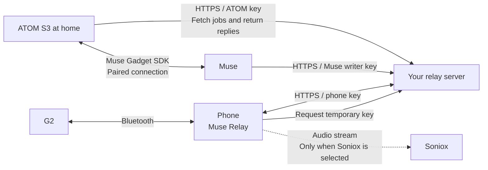
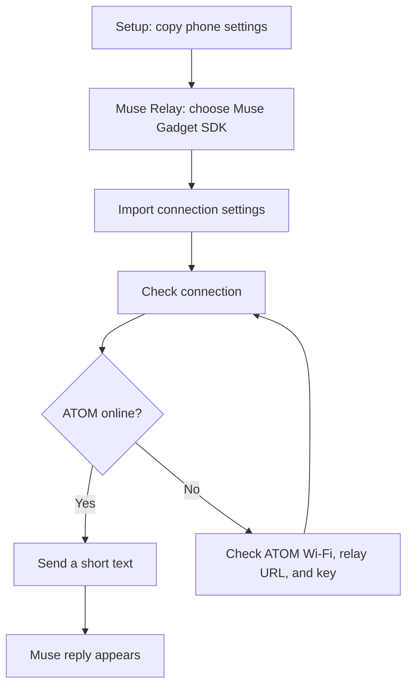

# HTTPS relay reference implementation

[English](server.md) · [日本語](server.ja.md)

These optional instructions use the bundled `server/`. The distributed EvenHub app is shared by all users. Each user builds their relay or asks Muse to implement it. Neither a separate EHPK per user nor this reference server is required.

Start with the [setup tutorial](relay-setup.md), then the [app input/output contract](protocol.md), and use this guide when needed.

| Hosting | Reference |
|---|---|
| Your always-on Node.js server | Node + HTTPS in this guide |
| Cloudflare Worker / Sites | [Worker + D1 + R2](../server/cloudflare/README.md) |

Both use the same app contract and role-specific authentication.

This example leaves an ATOM S3, one possible SDK device, at home while you take your phone and G2 outside. Every user configures their own URL, tokens, and hardware.



ATOM initiates outbound connections; no home-router port forwarding is needed. A home LAN IP entered on the phone will not work away from home.

## 1. Open the reference setup UI

With Node.js 22 or later, run from the project root:

```sh
node server/setup.mjs
```

Open the [local setup page](http://127.0.0.1:8788).

| Step | Action | Result |
|---|---|---|
| 1. Endpoint | Enter your public HTTPS URL and allow the Even app's local connection | Configures outside access and variable local ports |
| 2. Audio | Enter a Soniox API key only if using server-issued temporary keys | Stored only on the server |
| 3. Save | Save settings | Generates three connection keys |
| 4. Connect | Copy settings for each target | Configure the phone, ATOM, and Muse |

Settings are saved to `.local/relay-config.json` with owner-only read/write permissions. The phone export excludes long-term Muse, ATOM, and Soniox keys. Enter generated keys into their corresponding settings screens; do not paste them into chats or Git.

In Muse Relay inside Even, open connection settings → server-side connection settings and check this app's Origin. It may differ from the browser preview.

| Origin shown in the app | Setup action |
|---|---|
| `http://127.0.0.1:54914`, or another port that changes on startup | Enable local connections from the Even app |
| `null` | Add `null` to additional allowed Origins |
| A fixed HTTPS Origin | Add that exact value to additional allowed Origins |

`http://127.0.0.1:*` is a reserved opt-in value. It allows only canonical `http://127.0.0.1` Origins with valid ports, excluding `localhost`, other hosts, HTTPS, and paths. A general `*` is not allowed. Node example: `"allowedOrigins":["http://127.0.0.1:*"]`; environment variable: `ALLOWED_ORIGINS=http://127.0.0.1:*`. The relay endpoint itself still uses HTTPS.

An unmatched Origin returns HTTP 403 `origin_not_allowed`. Even allowed Origins need role-specific keys for every data API.

## 2. Start the server

For local verification:

```sh
node server/index.mjs
```

It listens on `127.0.0.1:8787`. `/health` returns only unauthenticated health information. Messages and Spaces require a connection key.

To use this reference configuration away from home, supply an always-on server and HTTPS. The setup UI creates a local configuration file; it does not provision or deploy hosting. Do not expose the Node HTTP server directly to the internet.

### Docker + Caddy example

1. Place this project and `.local/relay-config.json` on your server.
2. Restrict the secret file to the container's Node user: `sudo chown 1000:1000 .local/relay-config.json`, then `sudo chmod 600 .local/relay-config.json`.
3. Point DNS to the server and allow host ports 80 / 443.
4. Run on the server:

```sh
RELAY_HOST=relay.example.com docker compose -f server/compose.yaml up -d --build
```

Caddy terminates HTTPS; Node is exposed only on the internal network. Do not forward ports to ATOM at home. This command was not run as part of this repository's implementation checks.

For environment variables, see the [example configuration](../server/.env.example). `.env` is not loaded automatically; use Node's `--env-file` or your hosting environment settings.

## 3. Connect



The connection check reads the server; it does not send a Muse request. ATOM's online indicator means it communicated within the last 45 seconds, not that Muse pairing succeeded.

## Spaces

No public Gadget API for reading Muse Spaces directly has been verified. The user asks Muse to create a Space and export its content as readable cards to the relay. The app displays and selects Space names and cards.

Configure Muse with:

| Item | Value |
|---|---|
| Read | `GET https://relay.example.com/v1/spaces` |
| Add/update one | `PUT https://relay.example.com/v1/spaces/news` |
| Authentication | `Authorization: Bearer <Muse-writer-key>` |
| Body | One Space as below; URL and body `id` must match |
| Scope | Readable export of configured Spaces |

```json
{
  "id": "news",
  "title": "News",
  "updated_at": 1794880000,
  "items": [{
    "id": "today",
    "title": "Today",
    "text": "Display text generated by Muse from the Space"
  }]
}
```

Limits are 20 Spaces and 50 cards each. Updating one preserves the others. To intentionally replace the whole list, send `{spaces:[...]}` to `PUT /v1/spaces`. An app refresh request without an action asks Muse only to re-export the configured ID.

Cards must be readable with taps to open/page, vertical swipes to change items, and a double tap to return to the list. Keep text useful with images off; do not require external links or voice input. For images, enable them in the app and add `image:{mime,name,data_base64}` to a card. The reference Worker stores at most eight images across all Spaces.

To show a transcript produced by Muse processing, label it as a transcript in Muse's reply. `POST /v1/messages` fixes the sender to `Muse`, so that route cannot add a `You` transcript. Soniox sends final text from the app and does not need Muse to transcribe it again.

## Reference transport

See the [public protocol](protocol.md#app-http-boundary-and-reference-management-routes) for the distinction between the required app boundary and internal reference routes.

| Caller | Method / path | Purpose |
|---|---|---|
| Phone | `GET /v1/snapshot` | Messages, Spaces, and ATOM connection state |
| Phone | `POST /v1/requests` | Text, WAV, and Space refresh requests |
| Phone | `GET /v1/files/:name` | Attachment data |
| Phone | `POST /v1/soniox-token` | Issue a temporary Soniox key |
| Muse | `POST /v1/messages` | Add text/image replies or update the same ID |
| Muse | `GET /v1/spaces` | Current exported Spaces |
| Muse | `PUT /v1/spaces/:id` | Add/update one Space |
| Muse | `PUT /v1/spaces` | Replace all Spaces |
| Muse | `PUT /v1/profile` | Replace Muse's name and configured avatar |
| ATOM | `GET /device/jobs` | Lease one next request |
| ATOM | `GET /device/jobs/:id/request` | JSON body for the SDK, with Content-Length |
| ATOM | `POST /device/events` | ACK, reply data, heartbeat, and errors |

Device events use `{job_id,session_id,event_id,type,...}`. `session_id` is the job's dedicated Muse chat ID. Keep `event_id` unchanged on retries. The ACK needs matching `result.session_id` and `is_thread:true`. Follow the [public protocol](protocol.md#atom-and-relay) for dedicated-session and own-user-boundary correlation.

| type | Additional fields |
|---|---|
| `muse_ack` | `body`: SDK ACK JSON string or object |
| `muse_event` | `body`: complete NDJSON line or event object |
| `muse_chunk` | `body_base64`: raw NDJSON bytes, including splits within UTF-8 characters |
| `heartbeat` | None; send at least every 30 seconds |
| `error` | `error`: short description without credentials |

The response is `{ok:true,terminal:boolean}`. Stop the request's subscription on `terminal:true`. The server accepts only replies correlated to the ACK's IDs and does not display other Muse conversations.

Request acceptance, delivery to ATOM, and Muse reply completion are separate states. Disconnection after handing over the body does not trigger automatic replay; the server records an unknown outcome. Check Muse before retrying. Requests expire after 15 minutes; leases last 180 seconds.

### Home avatar

| Step | Action |
|---|---|
| 1 | Ask Muse to locate and read your configured avatar image. Leave it unset if unavailable |
| 2 | With the Muse key, send `{name?,avatar:{mime,name?,data_base64},updated_at?}` to `PUT /v1/profile` |
| 3 | Enable images in the app. It reads `snapshot.profile` and the attachment and displays the avatar on G2 home |
| Clear | Send `{}` to `PUT /v1/profile` with the Muse key |

PNG / JPEG / WebP, at most 250,000 decoded bytes. PUT replaces the whole profile; `avatar_file` is a server-generated read value. No external URL is fetched automatically, and this does not draw on ATOM's screen. Phone/device keys cannot write a profile. [Diagram and JSON](protocol.md#muse-avatar-on-g2-home)

## Storage and limits

- Keeps the latest 100 messages and 200 request records, saved atomically to `.local/relay-state.json`.
- Stores one profile separately from history limits. Node removes attachments no longer referenced after profile replacement/clear. Worker R2 uses the 24-hour grace period and bounded garbage collection.
- Node is a single-process reference. Replace its queue with shared transactional storage before using replicas.
- WAV limit: 1.1 MB. Longer recordings use 8 kHz, 8-bit mono PCM to fit up to 120 seconds in one WAV.
- Gadget image-file input is disabled by default because it has not been physically verified. Use `GADGET_IMAGES_ENABLED=true` only after verification. Muse image replies (`POST /v1/messages`), Gist images, and Space-card images are separate display paths.
- Soniox temporary keys: 60 seconds to start, single use, 150-second session. Issuance is limited to five per minute.
- Message bodies and credentials are not written to access logs. You manage HTTPS host/proxy logging separately.

## Verification scope

`node --test tests/server.test.mjs` checks role separation, duplicate requests, job delivery, unrelated-conversation rejection, split UTF-8, reply completion, prevention of replay after expiry, persisted Spaces, and Soniox request format in one transport integration test. It does not make live Muse or Soniox calls.

References: [Muse Gadget SDK](https://github.com/facebookincubator/muse-gadget-sdk), [Soniox temporary API keys](https://docs.soniox.com/authentication/temporary-api-keys).

## ATOM maintenance and updates

Configure a dedicated administrator credential to view diagnostics and send recovery commands at `/maintenance` on your relay. You can also stage a board-specific firmware image. [Setup and recovery instructions](atoms3.md).
