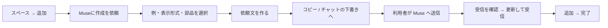
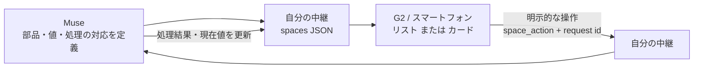
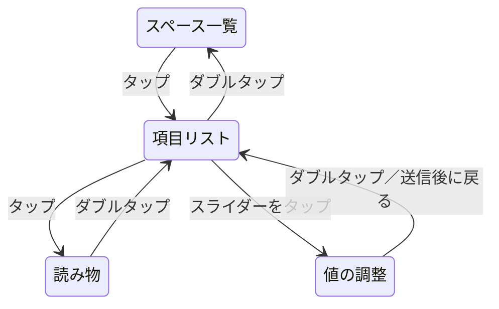

# スペースの表示と操作

[English](spaces.md) · [日本語](spaces.ja.md)

## 作成を依頼して登録する

スマートフォンの「スペース」→「追加」から始めます。アプリで希望を選び、Muse がスペースと中継への書き出しを作ります。



| 手順 | 操作 |
| --- | --- |
| 例を選ぶ | 「予定」「集中タイマー」「音声メモ」から始め、名前と用途を編集 |
| 表示と部品を選ぶ | リスト／カード、ボタン・スライダー・選択肢・マイクを選ぶ |
| 依頼文を確認 | 「依頼文を作る」で内容を確認。「編集」で戻れる |
| Muse へ渡す | コピーして Muse に貼り付けるか、「チャットの下書きへ」で追加してから送信。下書きへの追加だけでは送らない |
| 書き出しを受信 | Muse 側で作成・書き出しが済んだら「受信を確認」→「更新して受信」 |
| 登録 | 受信済みスペースの「追加」→「完了」。スマートフォンと G2 の一覧に表示 |

例は作成依頼のひな形です。選ぶだけでタイマーや予定の処理が完成するわけではありません。実際の内容と動作は Muse 側で作成します。すでに書き出し済みなら「追加」→「受信済みから追加」から進めます。

## 並べ替えと登録解除

| 操作 | 結果 |
| --- | --- |
| 「並べ替え・削除」→ ↑／↓ | 登録済みスペースを上下に移動。スマートフォンと G2 に同じ順序を保存 |
| 「削除」→ 確認画面で「削除」 | このアプリの登録を解除。Muse のスペースと中継の書き出しは残る |
| 「追加」→「受信済みから追加」 | 登録解除したスペースも再追加可能 |

表示順と登録はこのアプリの設定です。Muse の元データや中継の並び順を書き換えません。

## Muse が書き出す表示と操作

Museが [JSON例](../examples/spaces.json) の `layout` と各項目の `control` に希望を反映します。スマートフォンとG2は同じ定義を表示します。



| 表示 | 指定 | G2での動き |
|---|---|---|
| リスト（初期値） | `"layout":"list"` | 複数行に項目名・現在値。スワイプで選択、タップで開く／操作 |
| カード | `"layout":"cards"` | 1項目ずつ表示。スワイプで項目切替 |

G2のContextual Menuから「リスト表示」「カード表示」へ切替できます。この上書きは起動中だけ有効です。リストが18項目を超えると「次の項目」「前の項目」を表示します。スペースの本文にはアプリ名・時計の専用行を設けません。ホームの日付・時計とは別の表示です。

| 部品 | `control` | 選択後の操作 |
|---|---|---|
| 読み物・画像 | 省略 | タップで本文の次ページ、ダブルタップで戻る |
| ボタン | `{"type":"button","label":"要約する"}` | タップで1回送信 |
| 確認付きボタン | `{"type":"button","label":"完了にする","confirm":"この項目を完了にしますか？"}` | もう一度タップで実行。ダブルタップで中止 |
| スライダー | `{"type":"slider","min":5,"max":60,"step":5,"value":25,"unit":"分"}` | 上スワイプで増加、下で減少。タップで送信、ダブルタップで破棄 |
| 選択肢 | `{"type":"choice","options":[{"id":"short","title":"短く"},{"id":"full","title":"詳しく"}],"value":"short"}` | スワイプで選び、タップで送信 |
| マイク | `{"type":"microphone"}` | タップで録音開始、タップで送信、ダブルタップで中止 |

どの部品にも `"disabled":true` を指定できます。スライダーは有限数、範囲±1,000,000、刻み0.000001以上、最大10,000段階、範囲を刻みで割り切れることが条件です。選択肢は1〜12件。ボタンの確認文は300文字までです。未知・不正な部品はアプリで「未対応」と表示し実行しません。

マイクは既存の音声設定を使います。Muse方式はWAV、Soniox方式は確定テキストを、選んだ項目に紐付けて送ります。スペースを開いただけでは録音しません。



## 入り口と出口

| 用途 | Gist | HTTPS中継 |
|---|---|---|
| Museの出力 | `muse-relay-spaces.json` | Muse用キーで `PUT /v1/spaces/:id`（1件）または `PUT /v1/spaces`（全件置換） |
| 利用者の操作 | `muse-relay-request-<id>.json` | スマートフォン用キーで `POST /v1/requests` |
| 結果 | spacesの現在値・本文を更新、返信に `reply_to` | 同左 |

スライダー送信の例:

```json
{
  "id":"r_unique_action_id",
  "kind":"space",
  "space_id":"daily",
  "space_action":{"item_id":"focus","type":"slider","value":30},
  "text":"集中時間: 30",
  "created_at":1794880000
}
```

`space_action` のない `kind:"space"` は閲覧用データの更新のみです。ボタンとマイクでは `value` を付けず、選択肢は選んだID、スライダーは数値を渡します。マイクの音声添付は通常チャットと同じ形式です。

Muse側は `space_id` と `item_id` を自分の処理へ対応付けます。IDは安定させ、再配置だけで意味を変えません。同じ依頼IDを重複実行せず、処理が済んだらスペースの現在値・本文を再公開します。HTTPS中継では、Muse用キーで `GET /v1/spaces` から現在の書き出しを読めます。処理結果は `PUT /v1/spaces/:id` で対象だけを更新します。アプリは「送信中」「中継が受け付けました」「失敗」を区別します。受付は処理完了を意味せず、確定値を楽観的に変更しません。送信失敗のG2再試行では同じ依頼IDを使います。

既存の中継は `layout`・`control`・`space_action` を保持する実装へ更新してください。参照実装はNode、Worker、Gist watcherに対応し、共有検証は [protocol/space-controls.mjs](../protocol/space-controls.mjs) にあります。ATOMはSDK本文を中継するため、操作部品は中継とMuse側で処理します。独自ハンドラーは宣言済みの操作を検証してから実行します。

スペースの作成依頼は「スペース → 追加」、中継全体の設定手順は設定画面からコピーできます。操作練習は「設定 → 使い方 → スペース操作を試す」です。HTML・JavaScript・外部ページの埋め込みは使いません。
