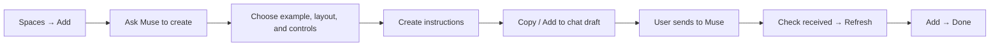
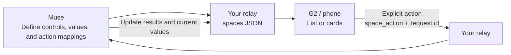
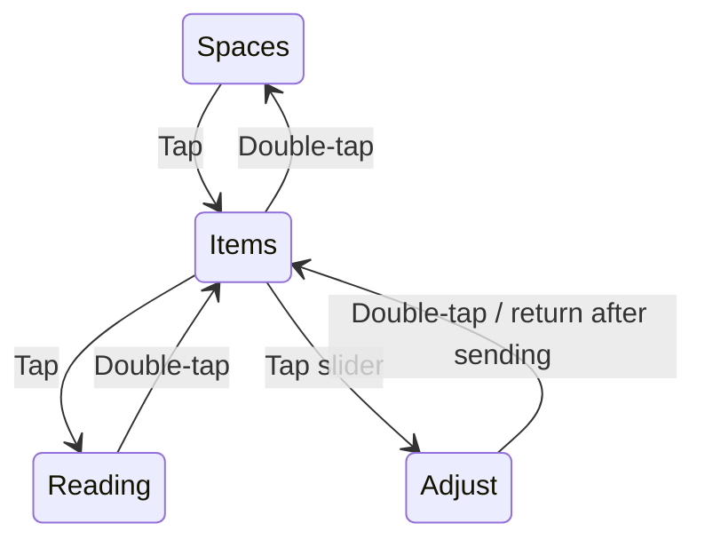

# Displaying and operating Spaces

[English](spaces.md) · [日本語](spaces.ja.md)

## Request creation and add a Space

On your phone, open **Spaces → Add**. Choose what you need; Muse creates the Space and its relay export.



| Step | Action |
| --- | --- |
| Choose an example | Start with a schedule, focus timer, or voice memo, then edit its name and purpose |
| Choose layout and controls | List/cards and buttons, sliders, choices, or microphone |
| Review instructions | Generate the instructions; use Edit to return |
| Give them to Muse | Copy into Muse, or add to the chat draft and then send. Adding a draft does not send it |
| Receive the export | After Muse creates and exports it, check received Spaces and refresh |
| Add to the app | Add a received Space, then choose Done. It appears on your phone and G2 |

Examples are request templates. Selecting one does not implement a timer or schedule; Muse supplies the actual content and behavior. If an export already exists, choose **Add → Add from received**.

## Reorder and remove

| Action | Result |
| --- | --- |
| Reorder/remove → ↑/↓ | Move registered Spaces up or down; save the same order for phone and G2 |
| Remove → confirm Remove | Remove this app's registration. The Muse Space and relay export remain |
| Add → Add from received | Add a removed Space again |

Registration and display order are app settings. They do not rewrite the original Muse data or the relay's order.

## What Muse exports

Muse expresses the desired layout and controls using `layout` and each item's `control` in the [JSON example](../examples/spaces.json). The phone and G2 use the same definitions.



| Layout | Declaration | G2 behavior |
|---|---|---|
| List, default | `"layout":"list"` | Multiple item names/current values. Swipe to select; tap to open or act |
| Cards | `"layout":"cards"` | One item at a time. Swipe between items |

Use G2's Contextual Menu to switch between list and cards. This override lasts only for the current app session. Lists over 18 items show next/previous-item entries. Space content does not reserve a row for the app name or clock; the home date/clock is separate.

| Control | `control` | Action after selection |
|---|---|---|
| Reading or image | Omit | Tap for the next text page; double-tap to return |
| Button | `{"type":"button","label":"Summarize"}` | Tap to submit once |
| Confirmed button | `{"type":"button","label":"Complete","confirm":"Mark this item complete?"}` | Tap again to execute; double-tap to cancel |
| Slider | `{"type":"slider","min":5,"max":60,"step":5,"value":25,"unit":"min"}` | Swipe up to increase, down to decrease; tap to submit, double-tap to discard |
| Choice | `{"type":"choice","options":[{"id":"short","title":"Brief"},{"id":"full","title":"Detailed"}],"value":"short"}` | Swipe to choose, then tap to submit |
| Microphone | `{"type":"microphone"}` | Tap to start; tap to send; double-tap to cancel |

Any control may set `"disabled":true`. Sliders require finite numbers within ±1,000,000, a step of at least 0.000001, no more than 10,000 steps, and a range evenly divisible by the step. Choices have 1–12 options. Button confirmation text is limited to 300 characters. Unknown or invalid controls show as unsupported and cannot execute.

Microphone controls use the existing voice settings. Muse mode sends WAV; Soniox mode sends final text, associated with the selected item. Merely opening a Space does not start recording.



## Input and output

| Purpose | Gist | HTTPS relay |
|---|---|---|
| Muse output | `muse-relay-spaces.json` | Muse key: `PUT /v1/spaces/:id` for one Space or `PUT /v1/spaces` to replace all |
| User action | `muse-relay-request-<id>.json` | Phone key: `POST /v1/requests` |
| Result | Update Space values/content; set reply `reply_to` | Same |

Example slider submission:

```json
{
  "id":"r_unique_action_id",
  "kind":"space",
  "space_id":"daily",
  "space_action":{"item_id":"focus","type":"slider","value":30},
  "text":"Focus time: 30",
  "created_at":1794880000
}
```

A `kind:"space"` request without `space_action` only refreshes readable data. Buttons and microphone omit `value`; choices send the selected ID and sliders send a number. Microphone attachments use the same format as chat audio.

Muse maps `space_id` and `item_id` to its own handlers. Keep IDs stable; reordering must not change their meaning. Do not execute a request ID twice. Republish current values/content after processing. For HTTPS, the Muse key can read current exports through `GET /v1/spaces`; update only the affected Space with `PUT /v1/spaces/:id`. The app distinguishes sending, accepted by relay, and failure. Acceptance is not completion, and the app does not optimistically change confirmed values. G2 retries after a send failure reuse the request ID.

Existing relays must preserve `layout`, `control`, and `space_action`. Node, Worker, and the Gist watcher support this contract; shared validation is in [protocol/space-controls.mjs](../protocol/space-controls.mjs). ATOM forwards the SDK body, so control processing belongs in the relay and Muse. Custom handlers must validate declared actions before executing them.

Create Space instructions from **Spaces → Add**, and copy overall relay instructions from Settings. Practice through **Settings → Help → Try Space controls**. The app does not embed HTML, JavaScript, or external pages.
