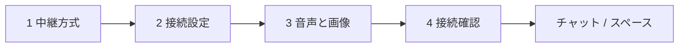
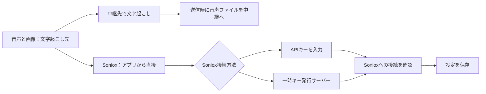
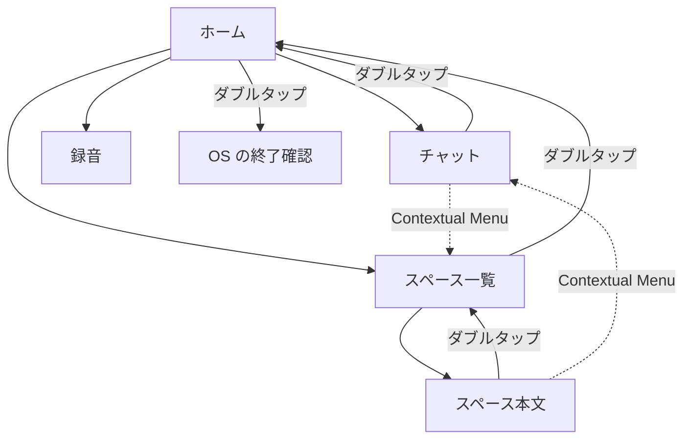
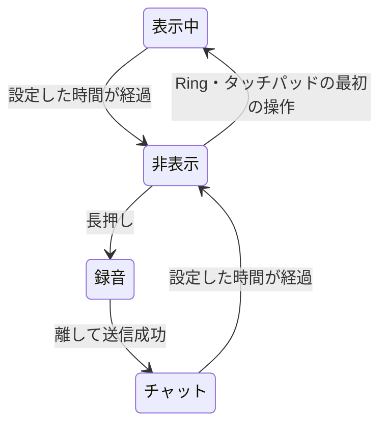

# スマートフォン画面

[English](ui.md) · [日本語](ui.ja.md)

設定はアプリ内のウィザードで行います。

| 画面 | 操作 |
|---|---|
| 接続ウィザード | Gist / Muse Gadget SDK の選択、接続先とトークン入力、接続確認 |
| Muse Gadget SDK の接続設定 | サーバーのセットアップ画面から接続設定 JSON を貼り付けて読み込み |
| チャット | テキスト送信、音声録音、画像添付、グラス表示、端末内で非表示 |
| スペース | Muse への作成依頼、受信済みスペースの登録、上下並べ替え・登録解除、項目を開く、更新依頼 |
| 設定 | ライト / ダーク / システム、表示言語（9 言語）、音声処理、画像、更新間隔 |
| 操作の練習 | スワイプ、タップ、長押し、ダブルタップを画面上で確認。通信なし |
| スペース操作の練習 | タップ、スワイプ、ダブルタップの3操作を画面上で確認。通信なし |
| 設定 → G2 表示 | 自動非表示までの時間、送信後のチャット復帰、Muse のアバター、復帰操作の練習 |

## 設定とヒント

設定を「接続」「音声と画像」「G2表示」「表示」「使い方」に分け、必要なグループだけ開きます。見出しに現在の選択を表示し、変更中は「未保存の変更」を表示します。補足は項目横の「？」から開くポップアップに配置します。閉じる／Escapeで元の操作へ戻り、設定や入力を維持します。

| 状態 | 表示・次の操作 |
|---|---|
| 新しいGist接続でSonioxを選ぶ | APIキー入力欄を表示。追加サーバーは不要 |
| 既存の一時キー方式 | 既存の接続を維持。Gadgetは中継設定を再利用 |
| キー未入力 | 入力欄の近くに必要な項目を表示 |
| キー入力済み | 接続は未確認。確認ボタンから無音データで検証 |
| 認証失敗 | APIキーの確認を案内し、再試行可能 |
| 確認完了 | Soniox接続確認済み。キーや接続方式を変えると未確認へ戻る |
| 中継先を変更して保存 | 接続グループを開いて確認へ誘導 |
| 中継方式の選択（初回設定・設定 → 接続） | 選択肢の直下に「データの流れ」を常時表示。方式を切り替えると保存前に図も切り替わる。機能の比較は「？」で開く |

初回のMuse向け依頼文は、音声と画像の選択後に生成します。接続設定・スペース作成・アバター取得は別の依頼文です。[機能比較](relay-comparison.ja.md)

## 録音する話者

設定 → 音声と画像 → G2 グラス → 録音対象。接続ウィザードにも同じ選択を表示します。

| 選択 | 音声の扱い |
| --- | --- |
| すべて（そのまま） | 初期値。自分・他の人・判定不明をそのまま使用 |
| 自分のみ | SDK が `self` と判定した音声を使用 |
| 他の人のみ | SDK が `other` と判定した音声を使用 |

Muse での文字起こしと Soniox の両方、チャットとスペースのマイクに適用。絞り込み時は対象外・判定不明の部分を無音化し、録音の時間間隔を維持します。対象の音声が足りない場合は送信せず、再録音または「すべて」への変更を案内します。既存の設定を開いた場合も初期値は「すべて」です。

スマートフォンのマイクはすべての音声を使用します。G2 用の選択は保存し、マイクを G2 へ戻したときに復元します。[SDK の話者判定](https://www.npmjs.com/package/@evenrealities/even_hub_sdk) はフレームごとの推定で、スマートフォンや旧ホストでは `unknown` になります。

## スペースの追加・管理

| 画面の順序 | 操作 |
| --- | --- |
| スペース → 追加 → Museに作成を依頼 | 「例から始める」で予定／集中タイマー／音声メモを選び、名前・用途を編集 |
| 表示形式・追加する操作 | リスト／カードと、ボタン・スライダー・選択肢・マイクを選択 |
| 依頼文を作る | 内容を確認してコピー、または「チャットの下書きへ」。自動送信しない |
| 受信を確認 → 更新して受信 | Muse が中継へ書き出したスペースを取得 |
| 追加 → 完了 | 選んだスペースをスマートフォンと G2 の一覧へ登録 |
| 並べ替え・削除 → ↑／↓ | 登録順を変更。G2 にも同じ順序を反映 |
| 並べ替え・削除 → 削除 | 確認後にアプリの登録だけを解除。Muse と中継の原本は残る |

登録解除後は「追加 → 受信済みから追加」で戻せます。例の選択は Muse への依頼文を作る操作で、アプリだけでスペースの処理を生成・実行するものではありません。[表示部品と操作の詳細](spaces.ja.md)

## 接続状態の表示

「中継に接続済み」「機器 オンライン」「G2 接続済み」は別々に表示します。接続確認は中継の応答を確かめる操作です。Muse の返答と実際のグラス表示は、設定後の送受信で確認します。

入力途中の文章と設定は、通信状態の更新や言語切替で消さない構成です。接続先を変更した場合は、接続確認後に保存します。コピーする Muse 向け設定手順にトークンは含めません。

起動時は設定を読み込んでから操作画面を表示します。グラスの接続状態と設定保存は独立し、Evenアプリへの保存と端末バックアップのみの保存を区別します。読み込みに失敗した場合は、バックアップの利用状態と「設定を再読み込み」を表示します。

## 表示

テーマ CSS を使用し、フォントは OS 標準のサンセリフ、日本語は Hiragino / Yu Gothic / Noto Sans JP の順で利用可能なものへフォールバックします。Even 本体のテーマ・言語との同期は仮定しません。「システム」は OS / WebView の配色設定です。

G2 の画像・音声・操作はアプリ本体が担当します。ブラウザでの UI 確認は、Even 内 WebView と実機の確認を兼ねません。

G2のホームメニューでは、上1行にスマートフォンの現在の日付・曜日と24時間表記の時刻を表示します。毎分更新し、選択中のメニュー項目は保持します。自動非表示・録音・Contextual Menu中は時計の更新を止め、ホームへ戻ると現在時刻で表示します。

| ホームの領域 | 表示 |
| --- | --- |
| 上部 | 日付・曜日・時計 |
| メニュー | チャット・スペース・録音。アバターがある場合は左側に配置 |
| 右側 | Muse で使用中のアバター。画像が有効で受信済みの場合だけ表示 |

アバターの設定は「設定 → G2 表示 → Museにアバターを依頼」です。依頼文をコピーして Muse に貼り付けるか、チャットの下書きへ追加してから送信します。Muse に既存のアバターを書き出させる手順で、新しい画像の生成は依頼しません。画像がオフなら「画像を有効にする」を選び、「設定を保存」します。Muse の書き出し後に更新するとホームへ反映します。

未受信・取得失敗時はアバターなしでメニューを使えます。個人のアバターは利用者の中継から取得し、共通ビルドや公開資料には含めません。

チャットやスペースの本文にはアプリ名・時計を表示しません。本文を上端から表示し、本文ページは7行です。画像は288×144のまま上部へ配置します。本文の送信者やカード見出しも7行に含めてページ分割し、最終行を切り落としません。

Contextual Menu は現在の画面で必要な操作だけを表示します。ホームでは「更新」、閲覧中はチャット／スペースへの切替・録音・更新、チャット本文ではさらに「このメッセージを隠す」を表示します。終了はOSの標準項目を使います。

| グラスの画面 | タップ | 上下スワイプ | ダブルタップ |
|---|---|---|---|
| ホーム | チャット・スペース・録音を開始 | 選択を移動 | 終了確認 |
| スペース一覧 | 選択スペースを開く | 選択を移動 | ホームへ戻る |
| スペース本文 | 次のページへ。最後は先頭へ | 前後の項目へ | スペース一覧へ戻る |
| チャット本文 | 次のページへ | 前後のメッセージへ | ホームへ戻る |
| 処理中 | 重複実行しない | 移動しない | 表示を戻す。録音準備中なら中止 |
| 更新失敗 | 再試行 | 移動しない | 元の画面へ戻る |
| 処理完了 | 元の画面へ戻る | 移動しない | 元の画面へ戻る |

長押し開始の録音は離すと送信、メニューから開始した録音はタップで送信します。G2の下端にも該当する操作を表示します。準備中・送信中・完了・失敗をG2に表示し、メッセージやスペースがない場合も空の理由と戻り方を表示します。スペースの閲覧に録音操作は必要ありません。Museには、短い見出しと自己完結した読取用カードでスペースを作成する条件を渡します。

| グラスに新しい画像が届いたとき | 表示 |
|---|---|
| ホーム・画像がオン | 新着メッセージ／画像ページを開く。タップで本文へ |
| ホーム・画像がオフ | 画像メッセージのキャプション、または「画像」を表示 |
| 録音の準備中・録音中・閲覧中 | 操作中の表示を維持 |

Contextual Menu の開閉通知（4→選択→5）は、アプリを終了する通知として扱いません。メニュー表示中はページを描き換えず、閉じた後に選択した操作を実行します。Even内ではWebViewが非表示でも操作・受信を維持し、終了はシステム終了通知で処理します。[公式仕様](https://hub.evenrealities.com/docs/build/contextual-menu)

## G2 表示の自動非表示と復帰

| 設定・状態 | 動作 |
|---|---|
| 自動で非表示 | オフ（初期値）／5／10／15／20／25／30秒 |
| 表示中の操作 | アプリが受け取った操作から数え直す。受信・定期更新では延長しない |
| 録音準備・録音・送信・OSメニュー | 時間を数えず、完了後から数え直す |
| 非表示 | 本文・フッター・リスト・画像を消す。受信は続け、新着だけでは表示を戻さない |
| 最初のタップ・スワイプ・ダブルタップ | 直前の画面に戻す。見えていない項目は実行しない |
| 長押し | 表示を戻してチャットのマイクを開始。離すと送信 |
| 頭上げ表示（Beta 0.3.13） | 初期値オフ。10〜60°の角度計で調整（初期値30°）。自動非表示がオフの場合、オンにすると15秒に設定 |
| 0°位置を再調整 | 正面を向いて静止し、測定後に設定を保存。角度計のリセットはしきい値だけを30°に戻す |
| 表示と同時に録音 | 初期値オフ。頭上げでアプリの非表示画面から録音を開始。ライブ字幕の発話終了通知から約1秒待って送信。声が入ると最大でもう1秒待ち、続きの字幕が届くと録音を継続。タップでも送信、ダブルタップで中止。上限2分で自動送信 |
| スマートフォンの「表示を戻す」 | グラスの操作と同じ画面に復帰 |
| 送信後にチャットへ戻る | 初期値オン。テキスト・チャット音声の送信成功後にチャットを表示。失敗・中止・スペースへの入力は対象外 |

ネイティブリスト内の選択移動はSDK内部で処理され、各スワイプはアプリへ通知されません。その間も設定時間は進みます。タップなどアプリに届く操作で数え直します。非表示中の復帰操作は空のテキストコンテナで受け取ります。表示時間・チャット復帰の設定は既存の設定保存に含み、非表示状態自体は次回起動に持ち越しません。

**v0.3.6 Beta** からは、チャットの応答待ちで自動非表示になったとき、自分が送った依頼に対応する返信が届くと一度だけその返信を表示します。表示後は設定した秒数を数え直します。関係のない着信や受付通知では画面は休止したままです。次のページがあるときは、単タップで次のページ、ダブルタップでホームの両方を同じ行に案内します。

設定内の「復帰操作を試す」では、空画面 → タップ → 本文の切替を通信せずに練習できます。

## チャットの入力と回答

| 領域 | 表示 |
|---|---|
| 上2行 | 自分の入力・取得できた文字起こし。文字輝度1 |
| 下6行 | Museの回答。文字輝度4（最大）。タップで次のページ |
| 下端 | ページ数と操作案内。文字輝度4 |
| 画像のページ | 上に入力、中央に288×144画像、下に本文を開く案内 |

初期値は「入力と回答」です。設定の「G2 表示 → チャット表示」、またはチャットのContextual Menuで「1件ずつ」へ切り替えられます。長い入力の併記は2行に収めて末尾を「…」にし、「1件ずつ」では全文をページ送りで読めます。回答に入力が併記されている間は、その入力だけの重複ページをスワイプで経由しません。

入力と回答は `You.id` と `Muse.reply_to` で対応付けます。Gadgetから独立して届いた写真など、対応IDがない投稿に別の質問を添えません。旧形式だけのGistは並び順で対応付けます。文字起こしがまだ返っていない音声は「音声メッセージ」と表示し、未取得の発話内容は作りません。

文字輝度は[SDKのtextColor](https://www.npmjs.com/package/@evenrealities/even_hub_sdk)で指定します。回答・スペース本文・操作案内は4、標準リストも既定の最大輝度です。G2全体の明るさはOS側の設定に従います。
