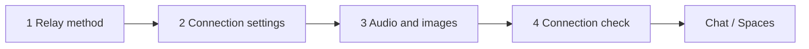
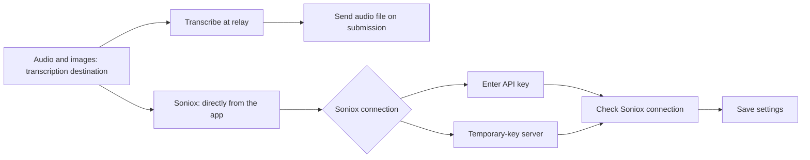
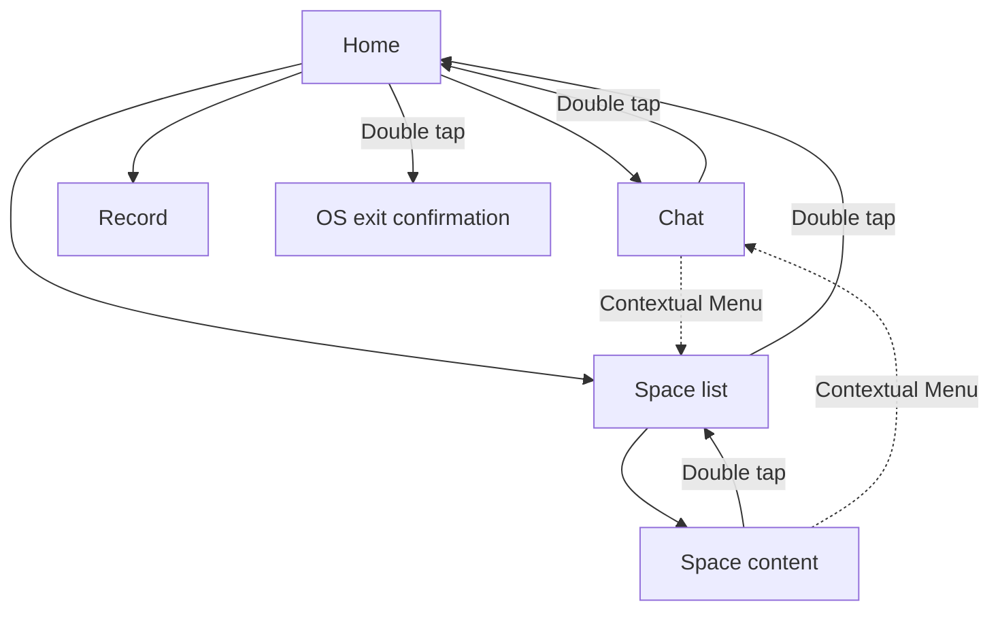
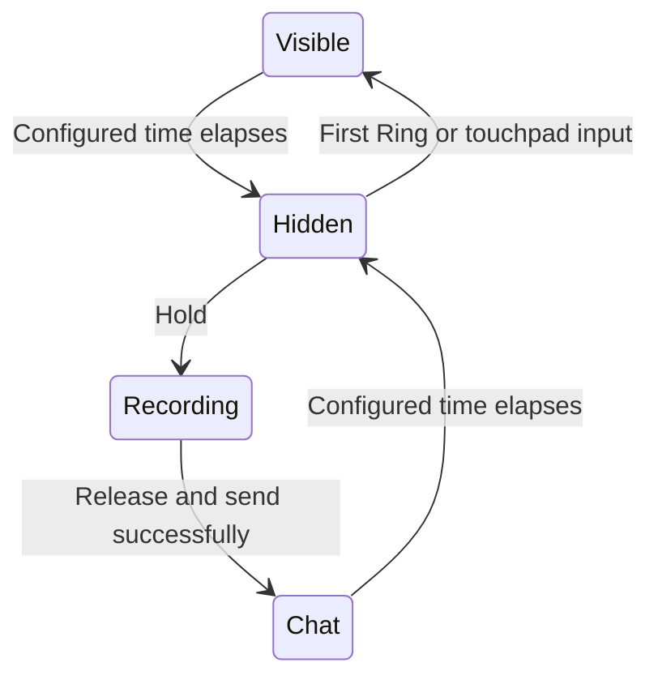

# Phone UI

[English](ui.md) · [日本語](ui.ja.md)

Configure the app through its setup wizard.

| Screen | Actions |
|---|---|
| Connection wizard | Choose Gist / Muse Gadget SDK, enter endpoint/tokens, check the connection |
| Muse Gadget SDK connection | Paste and import connection JSON from the server setup UI |
| Chat | Send text, record audio, attach an image, show on glasses, hide locally |
| Spaces | Ask Muse to create a Space, register received Spaces, reorder/unregister, open items, request a refresh |
| Settings | Light / dark / system, display language (nine languages), audio processing, images, refresh interval |
| Practice controls | Try swipe, tap, hold, and double tap on screen without network requests |
| Practice Space controls | Try tap, swipe, and double tap without network requests |
| Settings → G2 display | Auto-hide duration, return to chat after sending, Muse avatar, wake-control practice |

## Settings and help

Settings are grouped into connection, audio/images, G2 display, appearance, and usage. Open only the group you need. Headings show current selections; unsaved changes are marked. Supplemental help opens from the “?” next to a setting. Close it or press Escape to return without losing settings or input.

| State | Display / next action |
|---|---|
| Select Soniox for a new Gist connection | Shows API-key input; no additional server needed |
| Existing temporary-key setup | Preserves the existing connection; Gadget reuses relay settings |
| Missing key | Shows the required field beside the input |
| Key entered | Connection remains unverified; the check button verifies with silent audio |
| Authentication failure | Prompts you to check the API key and allows retry |
| Check completed | Shows verified Soniox connection; changing the key or method resets verification |
| Save a different relay endpoint | Opens the connection group and guides you to check it |
| Relay selection in setup or Settings → Connection | Always shows the data-flow diagram below the options; switching methods updates it before saving. “?” opens feature comparison |

Initial Muse instructions are generated after selecting audio and images. Connection setup, Space creation, and avatar export have separate prompts. [Feature comparison](relay-comparison.md)

## Recording speakers

Settings → Audio and images → G2 glasses → Recording target. The setup wizard provides the same selection.

| Selection | Audio handling |
| --- | --- |
| Everyone, unchanged | Default. Uses self, others, and unknown speakers unchanged |
| Only me | Uses audio the SDK classifies as `self` |
| Only others | Uses audio the SDK classifies as `other` |

Applies to both Muse and Soniox transcription, and to chat and Space microphones. Filtering silences excluded and unknown segments while preserving recording timing. If too little target audio is detected, the app does not send; it asks you to record again or select everyone. Existing settings also default to everyone.

The phone microphone uses all audio. The app preserves the G2 selection and restores it when switching back to G2. [SDK speaker classification](https://www.npmjs.com/package/@evenrealities/even_hub_sdk) is estimated per frame; phone microphones and older hosts report `unknown`.

## Add and manage Spaces

| Screen sequence | Action |
| --- | --- |
| Spaces → Add → Ask Muse to create | Start from a schedule, focus timer, or voice-note example, then edit name/purpose |
| Layout and controls | Choose list/cards and buttons, sliders, choices, or microphones |
| Generate instructions | Review and copy, or move to the chat draft. Nothing is sent automatically |
| Check received → Refresh | Fetch the Spaces exported by Muse to the relay |
| Add → Done | Register selected Spaces in the phone and G2 lists |
| Reorder/remove → ↑ / ↓ | Change registration order; G2 uses the same order |
| Reorder/remove → Remove | Confirm to unregister only in the app; Muse and relay originals remain |

After unregistering, restore a Space with Add → Add from received. Selecting an example generates instructions for Muse; the app itself does not create or run the Space's processing. [Display controls and interactions](spaces.md)

## Connection status

Relay connected, device online, and G2 connected are separate indicators. The connection check verifies a relay response. Confirm a Muse reply and actual glasses display by sending and receiving after setup.

Network-status updates and language changes preserve drafts and settings. After changing an endpoint, check the connection before saving. Copied Muse setup instructions contain no tokens.

Startup loads settings before showing controls. Glasses connectivity and settings persistence are separate; the UI distinguishes saving through Even from a device-backup-only save. On load failure it shows backup status and a reload-settings action.

## Display

Theme CSS uses the system sans-serif font, with Japanese fallbacks through Hiragino / Yu Gothic / Noto Sans JP. Synchronization with the Even device's theme or language is not assumed. “System” follows OS/WebView color settings.

The app handles G2 images, audio, and interaction. Browser UI checks do not substitute for checks in the Even WebView and on physical glasses.

G2 home's top row shows the phone's current date, weekday, and 24-hour time. It updates every minute while preserving the selected menu item. Clock updates pause during auto-hide, recording, and the Contextual Menu; returning home shows the current time.

| Home region | Content |
| --- | --- |
| Top | Date, weekday, clock |
| Menu | Chat, Spaces, record; placed on the left when an avatar is present |
| Right | The avatar used in Muse, only when received and images are enabled |

Use Settings → G2 display → Ask Muse for avatar. Copy the instructions into Muse, or add them to a chat draft before sending. This asks Muse to export the existing avatar, not generate a new image. If images are off, enable them and save settings. Refresh after Muse exports to update home.

The menu remains usable without an avatar when none has arrived or loading fails. Personal avatars come from the user's relay and are not included in the shared build or public documentation.

Chat and Space body pages omit the app name and clock. Text begins at the top and uses seven lines per body page. Images remain 288×144 at the top. Sender labels and card headings count within the seven lines, so pagination does not cut off the last line.

The Contextual Menu shows only actions relevant to the current screen. Home offers refresh; reading screens offer switching to chat/Spaces, recording, and refresh; chat also offers hiding the current message. Exit uses the standard OS item.

| Glasses screen | Tap | Vertical swipe | Double tap |
|---|---|---|---|
| Home | Open Chat, Spaces, or recording | Move selection | Exit confirmation |
| Space list | Open selected Space | Move selection | Return home |
| Space content | Next page; last wraps to first | Previous/next item | Return to Space list |
| Chat content | Next page | Previous/next message | Return home |
| Processing | Does not duplicate execution | No navigation | Return display; cancel if preparing to record |
| Refresh failed | Retry | No navigation | Return to previous screen |
| Processing complete | Return to previous screen | No navigation | Return to previous screen |

For hold-started recording, release to send. For menu-started recording, tap to send. The G2 footer shows the applicable action. G2 shows preparing, sending, complete, and failed states; empty chats/Spaces explain why and how to return. Reading Spaces does not require recording. Muse receives instructions to create short headings and self-contained readable cards.

| When a new image arrives | Display |
|---|---|
| Home, images on | Opens the new message/image page; tap for text |
| Home, images off | Shows its caption or “Image” |
| Preparing to record, recording, or reading | Preserves the current interaction |

Contextual Menu notifications (4 → selection → 5) are not app-exit events. Pages are not redrawn while it is open; the selected action runs after it closes. Inside Even, interaction and receiving continue while the WebView is hidden; the system exit event handles termination. [Official specification](https://hub.evenrealities.com/docs/build/contextual-menu)

## G2 auto-hide and wake

| Setting / state | Behavior |
|---|---|
| Auto-hide | Off by default, or 5 / 10 / 15 / 20 / 25 / 30 seconds |
| Input while visible | Restarts from inputs delivered to the app; receiving and polling do not extend it |
| Preparing, recording, sending, OS menu | Pauses the timer and restarts after completion |
| Hidden | Clears body, footer, lists, and images. Receiving continues; new content alone does not wake the display |
| First tap, swipe, or double tap | Restores the previous screen without activating an unseen item |
| Hold | Wakes the display and starts the chat microphone; release to send |
| Head-up display (Beta 0.3.13) | Choose the wake angle on the dial (10–60°, default 30°). Turning it on sets auto-hide to 15 seconds if previously off |
| Recalibrate zero | Face forward and hold still, then save settings. Reset on the dial restores the 30° threshold |
| Record on wake | Off by default. Raise your head from the app’s hidden display, tap the glasses to send, or double-tap to cancel. Recordings send automatically at two minutes |
| Restore display on the phone | Returns to the same screen as glasses input |
| Return to chat after sending | On by default. Shows chat after successfully sending text or chat audio; excludes failure, cancellation, and Space input |

Native-list selection changes are handled inside the SDK; each swipe is not delivered to the app. The timer continues during those movements and restarts on delivered inputs such as taps. While hidden, an empty text container receives wake input. Duration and return-to-chat settings are persisted; the hidden state itself is not restored on next startup.

From **v0.3.6 Beta**, a reply to a chat request you sent wakes the automatically hidden display once and opens that reply. The timeout starts again after it appears. Unrelated messages and receipt status updates keep the display asleep. When a chat has another page, the footer shows both the single tap for the next page and the double-tap for Home.

The wake-control practice in settings lets you try blank screen → tap → content without network requests.

## Chat input and reply

| Region | Content |
|---|---|
| Top two lines | Your input or received transcript; text brightness 1 |
| Lower six lines | Muse reply; text brightness 4 (maximum). Tap for the next page |
| Footer | Page count and control hints; text brightness 4 |
| Image page | Input above, 288×144 image in the center, and a hint below to open the text |

The default is input and reply together. Switch to one at a time in Settings → G2 display → Chat layout, or in chat's Contextual Menu. Long input is truncated to two lines with “…”; one-at-a-time mode lets you page through the full text. While input is shown beside its reply, swiping skips the duplicate input-only page.

Input/reply pairing uses `You.id` and `Muse.reply_to`. An independently published Gadget photo without a matching ID is not given an unrelated question. Legacy-only Gist data is paired by order. Audio without a returned transcript is labeled “Voice message”; missing speech content is never invented.

Text brightness uses [SDK textColor](https://www.npmjs.com/package/@evenrealities/even_hub_sdk). Replies, Space content, and hints use 4; native lists retain their default maximum brightness. Overall G2 brightness follows OS settings.
