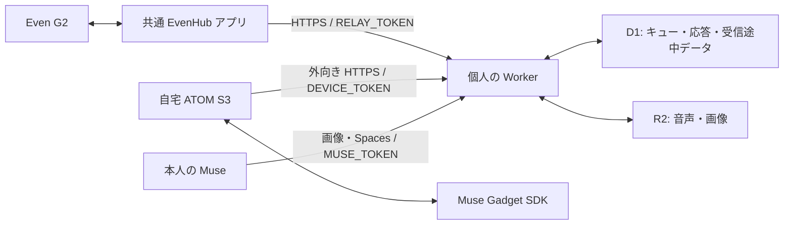
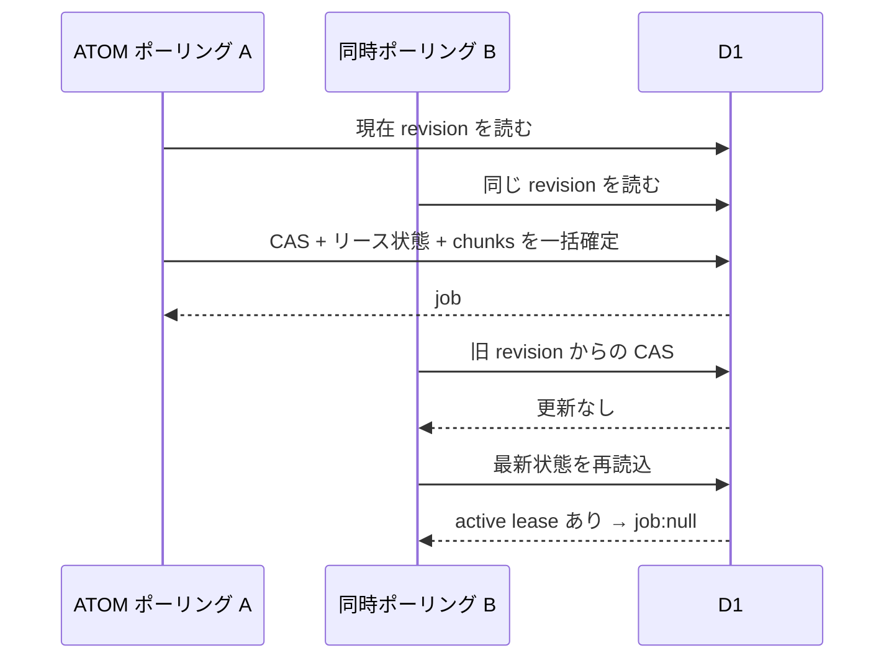

# Cloudflare Worker リレー参考実装

[English](README.md) · [日本語](README.ja.md)

公開する EvenHub アプリは全員共通です。このフォルダーは、各ユーザーが自分の HTTPS リレーを用意するための任意の参考実装です。個人の URL・鍵・Site ID は含みません。



アプリが使う入口・出口は [protocol.md](../../docs/protocol.ja.md)、設定手順は [relay-setup.md](../../docs/relay-setup.ja.md) を参照してください。Worker と Node 版は `server/core.mjs` の検証・キュー・Muse 応答照合を共有します。操作部品の検証は `protocol/space-controls.mjs` も使用するため、配備用の別リポジトリへコピーする際はこのファイルも含めます。

## ビルド

プロジェクトルートで実行します。Node.js 22 以降が必要です。添付を含む検証には `node:sqlite` がある Node.js を使用します。

```sh
npm ci --prefix server/cloudflare
node server/cloudflare/build.mjs
node --test server/cloudflare/worker.test.mjs
```

| 出力 | 用途 |
|---|---|
| `server/cloudflare/dist/server/index.js` | 外部ランタイム依存のない Worker ESM。default export の `fetch` |
| `server/cloudflare/dist/.openai/drizzle/` | スキーマ変更 SQL・journal・snapshot |
| `server/cloudflare/drizzle/` | スキーマ変更の原本。適用後は編集せず次の migration を追加 |

別のデプロイ作業ディレクトリへ出力する場合:

```sh
node server/cloudflare/build.mjs --outdir /path/to/hosting-project/dist
```

この操作はビルドのみです。Site 作成、鍵登録、デプロイ、公開範囲の変更は行いません。ルートの EvenHub 用 `dist` は既定では使いません。

## ホスト側の設定

| 種別 | 名前 | 値 |
|---|---|---|
| D1 binding | `DB` | このリレー専用の D1 |
| R2 binding | `BUCKET` | このリレー専用の R2 |
| Secret | `RELAY_TOKEN` | スマートフォン用。32 文字以上のランダムな base64url 文字列 |
| Secret | `DEVICE_TOKEN` | ATOM 用。上記と別の値 |
| Secret | `MUSE_TOKEN` | Muse の出力用。上記と別の値 |
| Secret・任意 | `SONIOX_API_KEY` | Soniox の長期キー。端末には渡さない |
| Variable | `ALLOWED_ORIGINS` | 許可 Origin のカンマ区切り。例: `https://app.example,http://127.0.0.1:*` |
| Variable・任意 | `PUBLIC_URL` | 自分の HTTPS URL。設定した場合は HTTPS であることを検証 |
| Variable・任意 | `GADGET_IMAGES_ENABLED` | 検証済みの機器で画像入力を使う場合だけ `true` |

Origin は完全一致で照合します。Even iPhone のポートが起動ごとに変わる場合だけ、予約値 `http://127.0.0.1:*` を追加します。正規の `http://127.0.0.1` とその有効なポートに限定され、HTTPS・別ホスト・userinfo・パス・query・fragment は許可しません。応答の `Access-Control-Allow-Origin` は要求元の値をそのまま返します。一般の `*` は使えません。

`null` Origin は使用する EvenHub WebView がそれを送る場合だけ別途追加します。Origin の許可や OPTIONS の通過は認証を置き換えません。Origin がない ATOM/Muse クライアントを含め、各データAPIで役割別 Bearer 認証が必要です。

Sites を使う場合、個人の作業ディレクトリにある `.openai/hosting.json` の binding は `hosting.example.json` と同じ `"d1":"DB","r2":"BUCKET"` です。個人の Site ID はその作業ディレクトリだけに設定します。Sites の packaging helper 用に `server/cloudflare/drizzle/` を作業ディレクトリの `drizzle/` にコピーしてください。Sites が migration を適用してから Worker をアップロードします。通常の Cloudflare 環境でも、最初の起動前に同じ SQL を D1 へ適用します。リクエスト処理中にテーブルを作成・変更しません。

Sites の所有者限定ゲートウェイを使う場合:

```text
Authorization: Bearer <役割別トークン>
OAI-Sites-Authorization: Bearer <本人のゲートウェイキー>
```

2 つのヘッダーを併用します。後者はホスト側で検証され、Worker の役割別認証を置き換えません。アプリ・ATOM・Muse に設定する値は各ユーザーのローカル設定です。CORS preflight は両ヘッダーを許可しますが、ホスト側の preflight 通過も確認が必要です。

## 保存と同時実行



| 状態 | 保存方法・制限 |
|---|---|
| キュー・応答・event ID・部分 NDJSON・ACK 前イベント | D1。Worker をまたいで復元 |
| メタデータ | UTF-8 128 KiB ごとに base64 化した行。合計 8 MiB 上限 |
| 同時更新 | D1 `batch` で revision CAS と全 chunk 置換を原子的に実行。競合は最大 8 回再読込 |
| 音声・画像 | R2。リクエストごとに新しい不透明キー。D1 には参照とサイズのみ |
| 初回 request body 取得後のタイムアウト | 自動再配送しない。Muse が受信した可能性を表示 |
| 応答 | ACK の message ID と照合したイベントのみ表示 |

この構成は単独ユーザー・単独 ATOM 向けです。状態全体の CAS は小規模な利用を想定しており、多人数用の高スループットキューではありません。D1 の [batch transaction](https://developers.cloudflare.com/d1/worker-api/d1-database/#batch) と [行サイズ制限](https://developers.cloudflare.com/d1/platform/limits/) に合わせています。

## 添付と削除

| 対象 | 上限・削除条件 |
|---|---|
| HTTP JSON body | 2,000,000 bytes |
| WAV 音声 | デコード後 1,100,000 bytes。Gadget 録音はアプリ側で 30 秒 |
| 画像 | 1 枚 250,000 bytes。PNG / JPEG / WebP |
| Spaces の画像 | 保存済みのスペース全体で合計 8 枚まで。書き込みごとに HTTP body 上限も適用 |
| キュー / 履歴 | 未完了 20 件、ジョブ記録は約 200 件、表示メッセージ 100 件 |
| 参照中の添付 | メッセージまたは Spaces が参照する間は保持 |
| 参照がなくなった添付・失敗したアップロード | 作成から 24 時間後に GC 対象 |
| 自動 GC | メディアを書いたリクエストの `waitUntil`。最大 80 件を確認し、最大 5 件削除 |
| 明示 GC | `POST /admin/gc` + `MUSE_TOKEN`。最大 80 件を確認し、最大 20 件削除 |

```json
{"ok":true,"deleted":5,"scanned":80,"grace_hours":24}
```

保持中の先頭オブジェクトだけを繰り返し調べないよう、確認済みの行を巡回します。1 回の GC で全件を消す保証はありません。24 時間の猶予、複数回の呼び出し、ホスト側の実行・容量制限により孤立した添付が残ることがあります。定期処理は自動登録しません。必要なら本人または Muse が `POST /admin/gc` を定期実行してください。利用しなくなったリレーの D1/R2 の削除、バックアップと保存期間は所有者が管理します。

画像出力と画像入力は別です。`POST /v1/messages` による Muse の画像出力、Spaces の画像表示は利用できます。Gadget を通す画像入力は実機未検証のため既定で無効です。Spaces は Muse が作成する読み取り用の構造化エクスポートです。直接の Muse Spaces API は仮定していません。

## 確認した範囲

1 つの SQLite/R2 代替による結合テストで、同時リース競合・新しい Worker invocation への引継ぎ・ACK 前イベント・分割された日本語・重複イベント・画像と Spaces・孤立添付の削除を確認します。Node 参考実装の既存テストも使用します。Cloudflare 実環境、Sites ゲートウェイ、Muse、Soniox、ATOM の通信成功をこのテストだけで保証するものではありません。

スキーマを変更するときだけ:

```sh
npm --prefix server/cloudflare run db:generate
```

生成された SQL がスキーマ変更だけであることを確認し、SQL と `drizzle/meta/` を一緒に保存してください。
