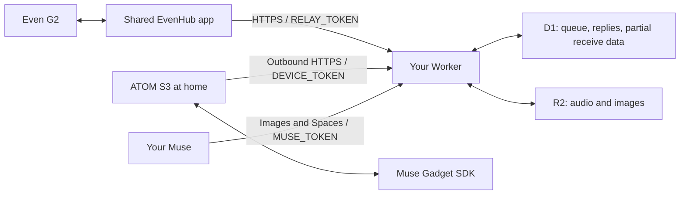
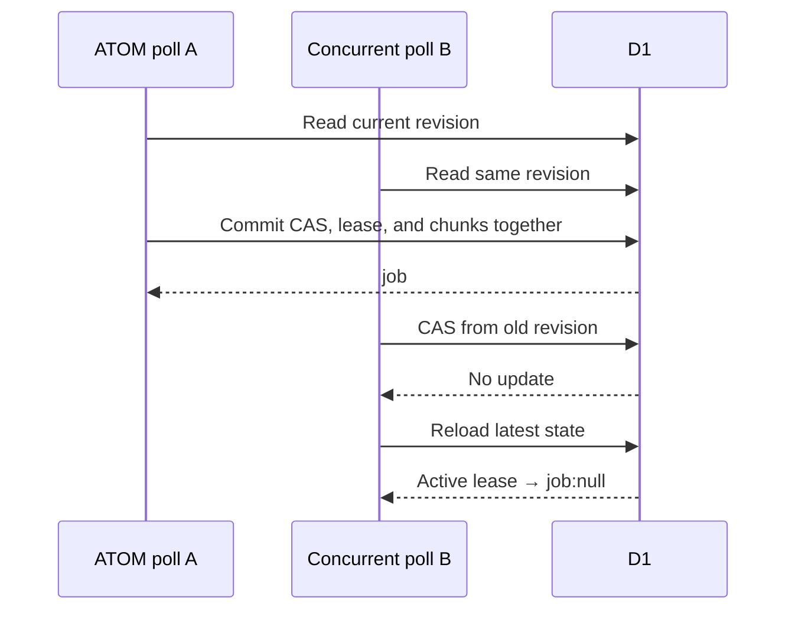

# Cloudflare Worker relay reference

[English](README.md) · [日本語](README.ja.md)

Every user runs the same public EvenHub app. This folder is an optional reference for hosting your own HTTPS relay. It contains no personal URL, key, or Site ID.



See [protocol.md](../../docs/protocol.md) for app input/output and [relay-setup.md](../../docs/relay-setup.md) for setup. Worker and Node share validation, queue logic, and Muse reply correlation in `server/core.mjs`. Build from the [0.3.30 source](https://github.com/3mintimer/muse-relay/tree/v0.3.30-beta.1) for location support. To build in a separate deployment repository, copy `server/` and `protocol/` from that version as siblings at its root. This includes both `protocol/chat-location.mjs` and `protocol/space-controls.mjs`. To run the tests below in that copy, also include `tests/maintenance-contract.mjs` at the same relative path.

## Build

Run from the project root with Node.js 22 or later. Tests involving attachments require a Node version with `node:sqlite`.

```sh
npm ci --prefix server/cloudflare
node server/cloudflare/build.mjs
node --test server/cloudflare/worker.test.mjs
```

| Output | Purpose |
|---|---|
| `server/cloudflare/dist/server/index.js` | Worker ESM with no external runtime dependencies; default export provides `fetch` |
| `server/cloudflare/dist/.openai/drizzle/` | Schema migration SQL, journal, and snapshot |
| `server/cloudflare/drizzle/` | Migration source; add a new migration instead of editing one already applied |

To output into a separate deployment workspace:

```sh
node server/cloudflare/build.mjs --outdir /path/to/hosting-project/dist
```

This builds only. It does not create a Site, register secrets, deploy, or change audience settings. By default it does not use the root EvenHub `dist` directory.

For an existing Worker, deploy the rebuilt bundle with the same D1, R2 and role keys. Location support adds no binding or secret. Verify using a newly sent chat after deployment. Jobs queued before the update retain the format they were accepted with. [Check a sent location](../../docs/relay-setup.md#relay-upgrade)

## Host configuration

| Type | Name | Value |
|---|---|---|
| D1 binding | `DB` | D1 dedicated to this relay |
| R2 binding | `BUCKET` | R2 dedicated to this relay |
| Secret | `RELAY_TOKEN` | Phone key: random base64url string, at least 32 characters |
| Secret | `DEVICE_TOKEN` | ATOM key, different from the above |
| Secret | `MUSE_TOKEN` | Muse export key, different from the above |
| Optional secret | `SONIOX_API_KEY` | Long-term Soniox key; never passed to the device |
| Optional variable | `SONIOX_RELAY_LIVE` | Set `true` to enable live relay transcription on a WebSocket-capable host |
| Variable | `ALLOWED_ORIGINS` | Comma-separated allowed Origins, e.g. `https://app.example,http://127.0.0.1:*` |
| Optional variable | `PUBLIC_URL` | Your HTTPS URL; checked for HTTPS when provided |
| Optional variable | `GADGET_IMAGES_ENABLED` | Set `true` only for image input on a verified device |

Origins match exactly. If the Even iPhone app's port changes on startup, add the reserved value `http://127.0.0.1:*`. It allows only canonical `http://127.0.0.1` Origins and valid ports, excluding HTTPS, other hosts, userinfo, paths, queries, and fragments. `Access-Control-Allow-Origin` echoes the actual accepted Origin. A general `*` is not allowed.

Add `null` separately only if your EvenHub WebView sends that Origin. Origin permission and successful OPTIONS do not replace authentication. HTTP data APIs require a role-specific Bearer token, including ATOM/Muse clients without an Origin.

### ChatGPT Sites

Deploy as a server-backed Site. In the deployment workspace, set your Site ID and `"d1":"DB","r2":"BUCKET"` in `.openai/hosting.json` as in `hosting.example.json`. Copy `server/cloudflare/drizzle/` to the workspace's `drizzle/` for the Sites packaging helper. Sites applies migrations before uploading the Worker.

When using a Sites owner-only gateway:

```text
Authorization: Bearer <role-token>
OAI-Sites-Authorization: Bearer <your-gateway-key>
```

Use both headers. The host validates the latter; it does not replace Worker role authentication. Values configured on the app, ATOM, and Muse belong in each user's local settings. Worker CORS allows both headers, but you must also verify that the hosting gateway accepts preflight requests.

### Cloudflare Workers

1. Create a D1 database and an R2 bucket in your Cloudflare account. In your Wrangler configuration at the project root, set the Worker name and `compatibility_date`, and set `main` to `server/cloudflare/dist/server/index.js`. Bind D1 as `DB` and R2 as `BUCKET`, and set the D1 `migrations_dir` to `server/cloudflare/drizzle`. [Wrangler configuration](https://developers.cloudflare.com/workers/wrangler/configuration/)
2. Run `npx wrangler d1 migrations apply DATABASE_NAME --remote` with your database name. Set the variables from the table above and run `npx wrangler deploy`. Register the role-specific secrets in the Cloudflare dashboard or with `wrangler secret put`. [D1 migrations](https://developers.cloudflare.com/d1/reference/migrations/) · [Workers secrets](https://developers.cloudflare.com/workers/configuration/secrets/)

### Cloudflare Pages Functions

1. Use [Advanced mode](https://developers.cloudflare.com/pages/functions/advanced-mode/) and copy `server/cloudflare/dist/server/index.js` to the root of the Pages output directory as `_worker.js`. For a dedicated relay project, this file serves the API.
2. Configure `DB`, `BUCKET`, the role-specific secrets, and `ALLOWED_ORIGINS` in the target Pages environment. Apply the same D1 migrations first, then deploy through the Git integration or with `wrangler pages deploy`. [Pages bindings](https://developers.cloudflare.com/pages/functions/bindings/) · [Wrangler upload](https://developers.cloudflare.com/pages/get-started/direct-upload/#wrangler-cli)

After deployment, open `/health` at your HTTPS URL. Then use **Check connection** in the app to verify the authenticated `/v1/snapshot` read. Set the same base URL in the app and on the ATOM, with the key for each role.

## Live relay transcription

With Muse Relay 0.3.12 or later, **Transcribe via relay** shows captions during recording if the relay advertises `capabilities.live_transcription`. The Worker receives filtered 16 kHz mono PCM over `/v1/voice/live`, connects to Soniox using its server key, and relays interim and final results to the app. The app submits the final text to Muse through the regular request route. WAV remains the input format for this setting on relays that omit the capability.

Store `SONIOX_API_KEY` as a secret, apply the D1 migrations, set `SONIOX_RELAY_LIVE=true`, and deploy. The host must forward WebSocket upgrades and allow the app's Origin. The browser authenticates to the Worker using the phone token in the WebSocket protocols list. An owner-only gateway that requires `OAI-Sites-Authorization` cannot use this browser route because the WebSocket API cannot attach that header.

Live connections and temporary-key issuance share the existing five admissions per rolling minute. Live PCM is only in transit. The Worker does not write it to D1 or R2. For a smoke test, hold to record a short phrase and check that captions arrive before you release, then confirm the Muse input is the final transcript.

## Storage and concurrency



| State | Storage / limit |
|---|---|
| Queue, replies, event IDs, partial NDJSON, pre-ACK events | D1; restored across Worker invocations |
| Metadata | Base64 rows of 128 KiB UTF-8 chunks; 8 MiB total limit |
| Concurrent updates | D1 `batch` atomically applies revision CAS and replacement of all chunks; up to eight conflict reloads |
| Audio/images | R2, with new opaque keys per request; D1 stores references and sizes only |
| Timeout after first request-body retrieval | No automatic redelivery; indicates Muse may have received it |
| Replies | Displays only events correlated to the ACK's message IDs |

This is a single-user, single-ATOM configuration. Whole-state CAS targets small-scale use, not a high-throughput multi-user queue. It follows D1's [batch transaction](https://developers.cloudflare.com/d1/worker-api/d1-database/#batch) and [row-size limits](https://developers.cloudflare.com/d1/platform/limits/).

## Attachments and deletion

| Item | Limit / removal condition |
|---|---|
| HTTP JSON body | 2,000,000 bytes |
| WAV audio | 1,100,000 decoded bytes; up to 120 seconds using 8 kHz, 8-bit mono PCM for long recordings |
| Image | 250,000 bytes each; PNG / JPEG / WebP |
| Space images | At most eight across all stored Spaces; each write also has the HTTP body limit |
| Queue / history | 20 unfinished jobs, about 200 job records, 100 displayed messages |
| Referenced attachment | Retained while referenced by a message or Space |
| Unreferenced attachment / failed upload | Eligible for garbage collection 24 hours after creation |
| Automatic GC | `waitUntil` on media-writing requests; scans at most 80 and deletes at most five |
| Explicit GC | `POST /admin/gc` with `MUSE_TOKEN`; scans at most 80 and deletes at most 20 |

```json
{"ok":true,"deleted":5,"scanned":80,"grace_hours":24}
```

Scanned rows rotate so retained objects at the start do not block inspection of later ones. One GC call does not guarantee complete cleanup. The 24-hour grace period, repeated-call requirement, and hosting execution/capacity limits can leave orphaned attachments. No schedule is registered automatically. If needed, you or Muse can call `POST /admin/gc` periodically. The owner manages deletion of unused D1/R2, backups, and retention.

Image output and input are separate. Muse image exports through `POST /v1/messages` and Space images are supported. Image input through a Gadget is disabled by default because physical acceptance has not been verified. Spaces are structured readable exports created by Muse; no direct Muse Spaces API is assumed.

## Verification scope

Integration tests with SQLite/R2 substitutes cover concurrent leases, restoration in a new Worker invocation, pre-ACK events, split Japanese UTF-8, duplicate events, images/Spaces, orphan cleanup, and live transcription authorization, framing, and quotas. The Node reference tests run separately. Verify your hosting gateway, Soniox, and Muse connection on the deployed relay.

Only when changing the schema:

```sh
npm --prefix server/cloudflare run db:generate
```

Check that generated SQL contains schema changes only, and save it together with `drizzle/meta/`.

## ATOM maintenance and updates

Configure a dedicated administrator credential to view diagnostics and send recovery commands at `/maintenance` on your relay. You can also stage a board-specific firmware image. [Setup and recovery instructions](../../docs/atoms3.md).
